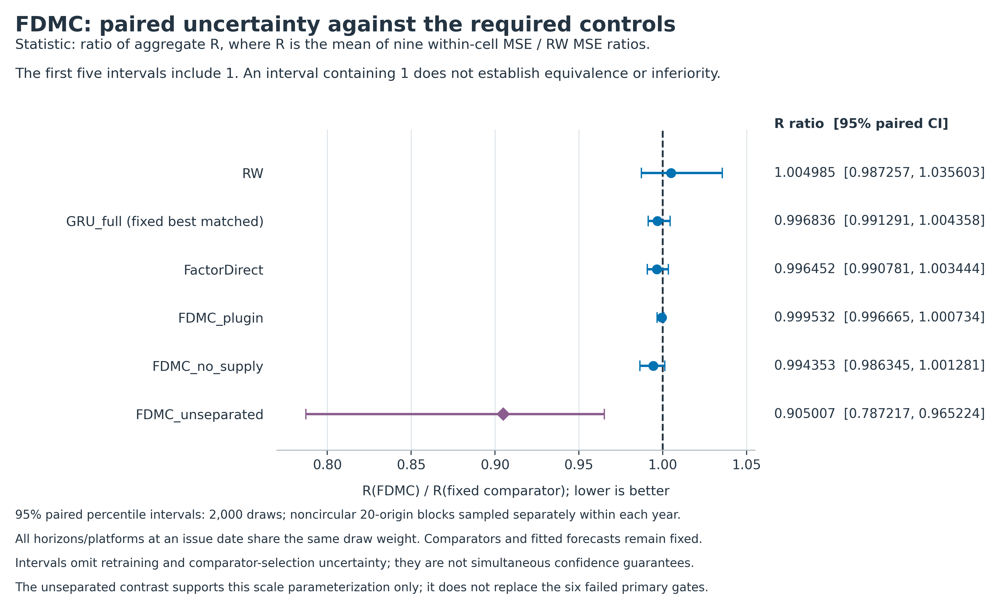

# EEX EUA 拍卖价格：模型创新研究与完整实验

**当前结论：SDMC 和 FDMC 都没有通过预先冻结的开发推进门槛；确认评分保持未开启。**

本目录是一项已完成的模型研究。它包含随机需求清算 SDMC、一次有边界的尺度分离修订 FDMC、同信息与同监督对照、真实运行记录及独立评分。它不是已经取得预测优势的模型发布，也没有用概率评分替换失败的主价格目标。

## 先读什么

- [完整中文研究报告](REPORT_ZH.md)：研究问题、原始论文近邻、公式、全部结果、限制与唯一条件化发表路线。
- [三阶段完整数表](reporting/REPORT_TABLES_ZH.md)：35 个模型行、25 个配对区间及三轮门槛。
- [复现说明](reproduction/REPRODUCE_ZH.md)：私有 prepared 证据校验、指标重算、模型回放和新目录重训。
- [唯一未来研究提案](docs/SINGLE_ROUTE_PROPOSAL_ZH.md)：部分数量约束下的联合拍卖价格预测，尚未取得新增观测、实现或训练。
- [方法与声明审查](docs/PUBLICATION_CLAIM_REQUIREMENTS_ZH.md)：可微清算、随机分布、因子化与单供给重参数化的创新边界。

## 主要结果

主指标 `R` 是 2021/2022/2023 × H=1/5/20 九格 `MSE_model / MSE_RW` 的等权平均。H 指未来计划拍卖事件数；先平均三个 seed 的点预测并混合分布，再评分。`R < 1` 表示优于 RW。

| 有效阶段 | 候选 R | 同信息 GRU R | 候选 / GRU 的 95% 配对区间 | 决定 |
|---|---:|---:|---|---|
| 修正日历后的 SDMC | 1.225753 | 1.005612 | [1.152024, 1.318286] | 停止 |
| FDMC | 1.004985 | 1.008176 | [0.991291, 1.004358] | 停止 |

FDMC 原六项门槛全部未通过，仅附加尺度条件通过。对 unseparated 对照的比值为 0.905007，区间为 [0.787217, 0.965224]；这支持本规格的尺度修改，不能证明随机积分或供给清算结构的额外价值。



## 实际完成的预算

三个阶段依次为原始 SDMC、官方脚注修正后原协议完整重跑、FDMC 修订。累计 **345 次神经拟合 + 81 次经典学习拟合 = 426 次拟合**，保存 **243 个正式预测 NPZ**、**138 个神经验证预测 NPZ**及所有训练状态。固定 RW / LastBidMedian 规则不计为学习拟合。

每模型每阶段有 652 个不同预测日期、1,933 条已发预测记录，其中 1,927 条有成交价。不是 1,933 个独立样本，也不是四个独立市场。两种有效候选均未进入 2024-2025 确认评分；既有有限来源暴露按报告披露。

## 目录与正式指标

| 目录 | 地位 | 正式结果入口 |
|---|---|---|
| 本目录 | 原始完整运行；已知日历脚注解释缺陷保留 | [AGGREGATE](results/independent_metrics/AGGREGATE.csv) / [GATES](results/independent_metrics/GATES.json) |
| `calendar_correction_20261018/rerun/` | 原件支持的输入修正，架构、损失与搜索不变 | [AGGREGATE](calendar_correction_20261018/rerun/results/independent_metrics/AGGREGATE.csv) / [GATES](calendar_correction_20261018/rerun/results/independent_metrics/GATES.json) |
| `scale_separated_revision/` | 看过 v1 失败后预先冻结的一次开发修订 | [AGGREGATE](scale_separated_revision/results/independent_metrics/AGGREGATE.csv) / [GATES](scale_separated_revision/results/independent_metrics/GATES.json) |

图表由 [make_report_figures.py](reporting/make_report_figures.py) 从正式 CSV/JSON 自动生成。PDF 渲染器使用完整报告源和嵌入中文字体，字体单独按官方 Noto Sans SC 来源取得。

## 复现入口

公开仓库包含代码、协议、聚合结果与来源说明。完成指标重算或训练还需要完整实验包中的 `local_only/` prepared 输入、逐起点预测及模型状态；它们不在公开 Git 中。复现包不包含外部论文全文和官方原始工作簿，默认流程从经过哈希验证的 prepared 数据开始。

在完整实验包的研究根目录安装 `reproduction/requirements-pinned.txt` 后，可先只检查证据：

```bash
python reproduction/verify_evidence_bundle.py \
  --study-root . \
  --index reproduction/PRIVATE_EVIDENCE_INDEX.json \
  --report ../carbon_evidence_check_01.json
```

再把正式评分和模型回放写入一个尚不存在的新目录：

```bash
python reproduction/reproduce.py \
  --study-root . --action audit --studies all \
  --output ../carbon_audit_01
```

可选重训使用 `--action train --studies fdmc`；先加 `--plan-only` 查看计划。原始结果不会被覆盖，所有新输出均在副本中。新入口已经在不同绝对目录实际完成 FDMC 的经典与全部 63 个最终神经模型回放；来源验证及原始回放精度通过。未为此增加任何模型拟合。

更多路径、版本、跨硬件差异及从官方原件重建 prepared 输入的限制，见完整复现说明。

## 版本与发表状态

运行前提交依次为：

1. `d3b881c399f5a3a3b227f4092678d7a0e680a696`：原始开发协议。
2. `ef8f7c1b21157895b4bbb99f6a7623c819014845`：日历修正重跑协议。
3. `0d23baf7c0580ecb16bd33071c9693190f3198d3`：FDMC 开发修订协议。

这些固定点是当次运行前的版本记录，不是无既有数据暴露的独立预注册。所有最终交付在其后追加，保留前一研究分支的全部已有文件。

后续主投建议为条件满足后的 **Journal of Forecasting**，优先考虑标准订阅路线。当前实验不支持正面的模型优势投稿。未来路线先取得可核验价格与部分数量观测，再检验信息增益、形式贡献、同信息机制价值和一次确认结果；没有保证录用、分区或“模型一定有效”的声明。

