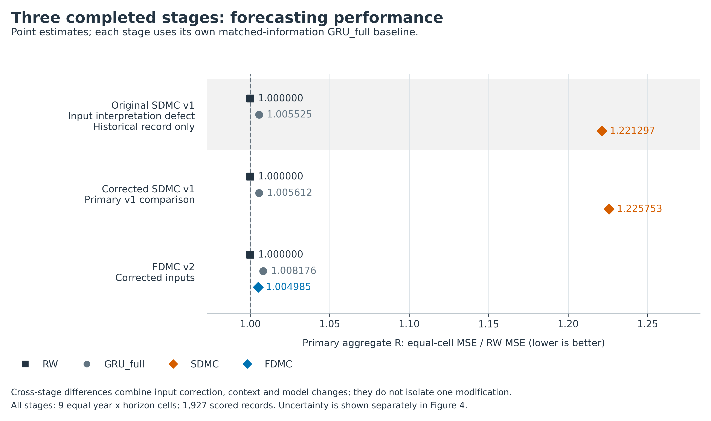
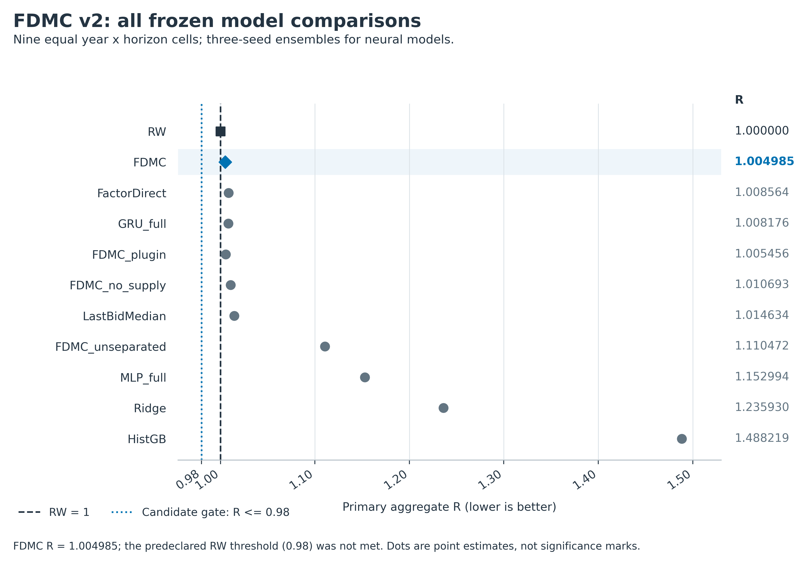
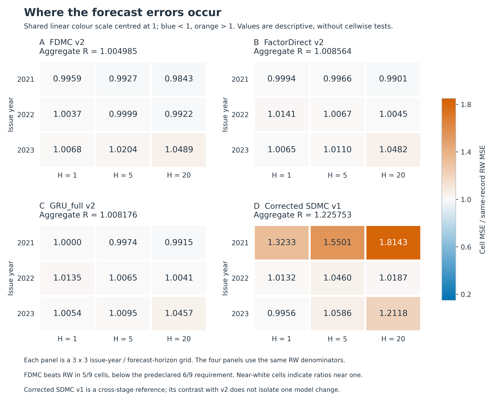

# 碳拍卖价格预测：模型创新研究、完整实验与发表路线

**研究对象：EEX EUA 单场一级拍卖价格。核查与实验日期：2026-10-18。**

本报告对应仓库 `124-creator/carbon-forecast-model-research` 的 `research/auction-clearing-innovation-20261018` 分支。它记录已经完成的实验，同时给出一条有明确推进条件的后续模型研究路线。文中的“开发评价”均指 2021-2023 年按时间顺序构造的历史回测，不能理解为本项目从未接触过的独立确认样本。

## 结论与交付状态

**当前两版模型均未取得足以支持“预测方法优势”的证据，不建议据此直接提交一篇宣称模型优越的论文。** 原模型 SDMC 在修正日历输入后，主指标为 1.225753；一次预先冻结的尺度分离修订 FDMC 将其改善到 1.004985，但随机游走 RW 为 1，越低越好。FDMC 对最强同信息直接对照 GRU 的主指标比值为 0.996836，95% 配对区间为 [0.991291, 1.004358]，尚未证实优势。

这次工作已经完成模型实现、真实训练、原始数据问题修复、全部对照、独立评分、数值与梯度核验及最终模型回放，并没有把一个未运行的方案当作实验结果交付。

| 已完成阶段 | 神经网络拟合 | 经典模型拟合 | 正式预测文件 | 结果地位 |
|---|---:|---:|---:|---|
| 原始 SDMC 与对照 | 120 | 27 | 84 | 保留的完整运行；后发现日历脚注解释缺陷 |
| 修正日历后的原协议重跑 | 120 | 27 | 84 | SDMC 的有效主结果 |
| 尺度分离 FDMC 与匹配对照 | 105 | 27 | 75 | 看过 v1 后的一次明确开发修订 |
| 合计 | **345** | **81** | **243** | **426 次实际模型拟合** |

RW 和 LastBidMedian 是固定预测规则；另外 18 个模型-年份规则实例没有计入“模型拟合”。138 个验证预测文件只用于训练内选择，没有混入正式评价。三个阶段共同经历 34,801 次神经优化器更新；神经拟合计时累计约 494.6 秒，仅指小模型 CPU 拟合，不包括数据取得、文献研究、文件读写和复核耗时。

唯一得到较清楚支持的局部结论是：**在这套参数化和训练协议下，区分跨拍卖价格波动与同场中心价差，优于把两者使用同一尺度。** FDMC 相对专门的 unseparated 对照，主指标改善约 9.50%，配对区间排除 1。但随机积分、供给算子和相同监督下的结构预测，均没有取得预先规定的额外收益。

最终决定是停止当前两版候选的确认推进，保留全部结果，不开启第三次结果驱动的结构或损失搜索。**2024-2025 年确认评分没有运行。** 后续主路线定位为“利用新增可核验观测，学习价格与总需求的联合约束”，以 Journal of Forecasting 为条件满足后的主投目标；这是一条待验证路线，不是已经成功的新模型。

## 1. 把研究问题固定到一个可判断的目标

### 1.1 本轮实际预测什么

预测目标是 EEX T3PA 中 EUA 一级拍卖的清算价，单位为欧元/配额。CAP、DE、PL、NI 是同一底层 EUA 的拍卖平台类别，不能当成四个独立碳市场。每次发出预测时，先根据当时已公布的日历确定第 1、5、20 个未来计划拍卖事件，再匹配后来实际发生的目标；H=20 指事件数，不是 20 个交易日。

EEX 公布的清算方式是将报价从高到低排序、累计竞价数量，累计量首次达到或超过供给时的价格作为统一成交价。这使“已知供给、未知未来需求”成为一个可以具体建模的结构问题。[1]

原始工作表覆盖 2012-2023 年 2,272 场事件：2,269 场完成、3 场取消。14 个双拍卖日解释了事件数与旧日频行数之间的主要差额，不能把差额都解释成取消。可靠日历版本支持 2017-2023 年样本构造，共生成 4,141 条多期限样本。

### 1.2 唯一需要回答的主问题

**在同一组历史拍卖信息、同一个可得时点、相同未来公告供给和训练预算下，随机清算结构能否比直接预测更准确地预测价格？**

这个问题包含三层证据：首先胜过 RW；其次胜过使用全部同信息的普通直接模型；最后胜过同概率分解、同辅助标签和同损失的直接分布对照。如果只胜过一个弱 MLP，或者只改善未来投标量的辅助任务，都不足以支持价格预测方法创新。

本轮没有重新运行旧项目的 BCM、renewal/hurdle、shape、transport 等已关闭主张，也没有把过去的信息审计改称新的预测模型。旧工作只用于防止重复投入；不同旧任务的分数不与这次拍卖事件任务拼成排名。

## 2. 文献前沿与真正的新颖性边界

研究围绕原始论文、作者机构全文和官方数据规则展开；核心方法近邻有全文方法核读，近期扩展工作保留摘要层面的阅读限制。本报告没有穷尽所有等价实现，也没有完整复现这些论文的作者代码。

| 直接近邻 | 已有的方法内容 | 对本项目的约束 |
|---|---|---|
| Tschora 等，DSAA 2023 [2] | 网络预测潜在订单簿，接入可微清算并联合训练；纯 P&O 分支可以没有订单簿监督损失 | “潜在曲线 + 可微清算 + 没有真曲线标签”不能单独称新 |
| Derksen、Kleijn、de Vilder，2020 [3] | 随机订单产生清算价与交易量分布 | “随机需求诱导价格分布”已有直接理论先例 |
| Ziel、Steinert，X-Model，2016 [4] | 预测买卖曲线并由其得到价格 | 改预测对象为曲线不是本项目独创 |
| Steinbakk 等，arXiv:1812.02433 [5] | 将已有点预测的体积误差通过近期可得的真实竞价曲线变换为价格分布 | 中心预测与曲线驱动误差分布的分工已有先例 |
| Sinha、Lucheroni，Applied Energy 2025 [6] | 将体积轴窗口端点与窗口内价格形状分开，使用单调 autoencoder 等预测完整曲线 | 不与本次 M×Q 完全等价，但排除宽泛的“位置/尺度与形状分离首创”主张 |
| Deep Factors，ICML 2019 [7] | 概率预测中全局与局部因子分解 | 单独引入因子化、局部不确定性或混合分布没有足够新意 |
| Chen 等，2026 预印本 [8] | EUA 期货的 Transformer、成熟误差 GRU 修正、历史外生特征及采购评价 | 提醒我们与强价格基准比较；其滚动十二月期货与本次拍卖价格不是同一目标，作者成绩没有在本项目复现 |

Steinbakk 的预印本标识起于 2018 年，但本次下载的 PDF 封面日期为 2021-11-19；报告保留这一区别。Sinha 的作者大学仓储提供正式发表版，已核读方法与讨论部分。新增阅读修正了较早研究笔记中“仅摘要”的状态，不能反过来改写先前实际阅读记录。

### 2.1 单一供给下的表达能力并不构成创新

固定历史 H、供给 S、总形状 A、尺度 θ 与价格网格，且不限制正份额时，单分量 Gamma 清算可通过反解尾部形状，在机械可清算条件下表示任意严格正的离散价格 CDF。因此，“清算层给出了新的单变量价格分布函数类”不能作为主要贡献。这个命题针对理想权重参数化，不意味着实际有限容量、有边界与数值裁剪的神经网络具有完全相同的全局函数类。

其潜在价值只能来自同一需求法则在多个供给下的共享约束、可观测价格与总投标量之间的联合关系，或被公平对照证实的估计效率。若供给可以被网络任意重新编码，跨供给约束会进一步削弱。这个反例使 FactorDirect 这样的同监督自由分布对照成为必要组成，而非可选附加实验。FactorDirect 是当前有限分解规格内的匹配去清算对照，不能被称为任意联合分布模型。

### 2.2 汇总信息不识别完整订单簿

即使均值和中位数都确实按数量计算，min、max、mean、median、总投标量和一个成交价也不唯一确定需求曲线。例如等量报价 (10,12,14,15,16,18,20) 与 (10,11,13,15,17,19,20)，这些汇总和供给 3.5 单位时的清算价相同，供给 1.5 单位时的价格却分别为 18 和 19。

本次公开 bid median/mean 的数量加权口径尚未得到认证。固定 12 个原始事件中，7 个与“同一有效数量池的量加权中位数及标准清算规则”这一联合假设不相容。这个检查排除了一种解释，不能据此确认真实加权口径。模型只能把这些字段当作报告的统计输入与标签，不能称其为真实估值、二级市场价格或已识别需求 CDF 的矩。

## 3. 已实现的第一版：随机需求清算 SDMC

历史信息记作 H，公告供给为 S。网络给出 3 个混合分量，每个分量有 17 个严格递增的价格档。分量内部的需求数量使用同尺度、独立 Gamma 变量：

```math
W_{kj}\sim\mathrm{Gamma}(\alpha_{kj},\theta_k),\qquad B_k=\sum_j W_{kj}\sim\mathrm{Gamma}(A_k,\theta_k)
```

其中 A_k 为各档形状之和，Gamma 采用 shape-scale 定义。未来总投标量 B 只作辅助监督，不在预测时输入未来真实 B。相同尺度意味着分量内部归一化数量份额与总量条件独立，并由同一浓度控制两者的不确定性；3 分量混合可部分放松边际独立性，但不能表达任意订单簿依赖。

令 G 为 Gamma CDF，a(>j) 与 a(≥j) 为严格高于或至少达到该价格档的形状和。对 S>0，约定退化零需求的 CDF 为 G(S;0,θ)=1。机械成功且清算落于该价格档的未归一化概率为：

```math
m_{kj}(S)=G(S;a_{k,>j},\theta_k)-G(S;a_{k,\geq j},\theta_k)
```

最终价格权重必须先对分量混合，再按机械成功总质量归一化：

```math
q_{kj}=\frac{\pi_k m_{kj}}{\sum_{l,i}\pi_l m_{li}}
```

这一步积分了随机总需求、随机档位数量及混合分量。把 E[B] 填进非线性清算器不等于这个期望；先分别条件化后仍沿用原混合权重也会出错。代码用 float64 的 Gamma 生存函数差分降低尾部相消问题，形状梯度采用经独立数值核验的中心差分，不能称为精确符号自动微分。

清算使用严格广义逆：F(p_c-)≤1-S/B<F(p_c)。若三个等量报价为 10、20、30，供给为 1，则成交价是 30；通常使用“≥”的逆 CDF 在边界上会错误返回 20。数值实现和独立数学检查均覆盖这个边界。[1]

价格网格采用以历史价格为参考的正值指数矩中心化，使参考状态下可包含 RW 的均值预测。价格目标为标准化 MSE + 0.2×CRPS，另外加 0.02×总投标量边际 NLL。它是复合目标，**不是价格、数量与取消状态的精确联合似然**。

只有 3 个历史取消事件，不足以识别实际取消规则。模型没有训练取消筛选机制，也没有把机械 B<S 概率当成已校准的实际取消概率。无成交价的记录仍先发预测，但不以零值代替价格计算误差。

## 4. 数据问题与失败诊断如何处理

### 4.1 发现并修复一处可由原件证实的输入解释缺陷

2019-12-12 版 2020 年日历的 `***` 脚注说明，每个标记 CAP 拍卖中 373,000 个 Innovation Fund 配额被延后。数字 Volume 单元格没有自行扣除该数量；旧解析器忽略文字脚注，因而误读已公告供给。修正规则只对指定源文件 SHA、T3PA/CAP 和对应 `***` 标记生效，没有按最终实际量回填日历。

该规则修正 96 个源日历行，最终改变 96 条已有样本的计划供给输入，涉及 44 个目标事件、48 个预测起点。只修改相应两列供给 context 和 base 中的计划 S；历史序列、目标身份、价格真值、价格基准与宏观尺度不变。2021-2023 年直接评价输入没有变化，较早训练与验证中的输入受到影响。

原数据中计划量与最终量不一致的样本从 170 条减为 81 条。剩余差异保留，不能根据事后真实供给“修正”当时不可知的信息。修正后完整重跑原模型、原损失、原搜索、原种子和全部基线，而非只挑候选模型重训。

| SDMC 阶段 | 主指标 R | 相对最强 GRU 的 R 比值 | 主区间 | 结论 |
|---|---:|---:|---|---|
| 原始日历解析 | 1.221297 | 1.214587 | [1.151509, 1.318299] | 有解释缺陷的保留运行 |
| 原件支持的日历修正后 | **1.225753** | **1.218913** | **[1.152024, 1.318286]** | 修正没有恢复预测优势 |



### 4.2 从失败中提出一个可检验的修订

已有开发历史中，报告 median 与同场清算价的绝对价差中位数约 €0.08，而跨拍卖未来价格变化通常更大。原模型让预测期限的市场波动尺度同时放大内部竞价价格网格，因此提出将共同报价位置和同场价差尺度分开。

这最初只是诊断假设。原模型可以通过学习跨度与权重进行部分补偿，不能仅凭尺度关系断言失败因果。随后修订加入专门的 unseparated 对照，保持其他标签、损失和边界不变，才对尺度选择做有针对性的实验。

## 5. 一次冻结后的修订：FDMC

FDMC 用未来官方报告的 bid median 记作 M，清算比率记作 Q=P/M，将价格写为：

```math
P=M Q
```

M 仍是报告字段，不代表认证的二级市场公平价格。未来 M 和 Q 只作标签，价格前向始终使用预测分布，不输入未来真实 median。

历史参考 P0、M0、B0、S0 来自同一已知拍卖。宏观价格尺度 v 由过去 61 个有效价格及已知日历间隔计算。微观尺度 d 是过去 60 个有效历史 |P-M| 的中位数，下界为 max(€0.01, 0.0001×M0)，不乘预测期限平方根。两项新增已知 context，即 log(d/P0) 与 log(M0/P0)，也提供给所有可训练基线。

令 r=v/M0，未来 M 使用条件 Lognormal 分布：

```math
\log M=\log M_0+r a-\frac{1}{2}\sigma^2+\sigma Z,\qquad Z\sim N(0,1)
```

因此 E[M]=M0 exp(r a)。微观 Q 仍由 3×17 Gamma 清算原子产生，改用 d/M0 设置价差尺度，位置与跨度范围在训练前固定。给定历史信息，将共同位置与 Gamma 需求实现条件独立是本次低容量工作假设，未被当作数据事实。

于是 P 是一个有限 Lognormal 混合，其价格均值、CDF、分位数和 CRPS 按完整混合分布计算。三个种子合并后最多 153 个连续混合分量，评分没有用随机抽样均值代替解析预测，也没有将连续分布错误当作有限点质量。

实际损失保留价格 MSE + 0.2×CRPS + 0.02×B-NLL，并加入 0.1×(median MSE + 0.2×median CRPS) 和 0.02×(basis MSE + 0.2×basis CRPS)。basis 使用线性比率 (Q-P0/M0)/(d/M0)，没有采用较早建议稿里的 log Q。该选择在结果产生前固定，所有同分解对照完全一致。

| 关键对照 | 与 FDMC 保持一致 | 改变的内容 |
|---|---|---|
| FactorDirect | 共同位置、尺度、网格边界、参数预算、B/M/Q 标签及损失 | 以自由价格概率和自由参考中心完全替换 Gamma 清算；价格不保留 Gamma 成功权重 |
| FDMC_plugin | 共同位置分布、编码器及训练预算 | 仅内部使用均值需求曲线的平滑清算点，仍积分共同位置 M |
| FDMC_no_supply | 输入与辅助监督、共同位置及 B 预测 | 清算中的未来计划 S 换成历史 S0；其他可得信息仍保留 |
| FDMC_unseparated | 其他模型结构、辅助标签、损失、位置与跨度边界 | 仅将内部 d/M0 换回宏观 v/M0 |
| GRU_full / MLP_full | 全部可得输入、相同时间划分和搜索预算 | 普通直接价格预测，没有分解辅助监督 |

较早 v1 的 DirectMT 仍保留部分 Gamma 参考中心和成功重加权，因而只属于部分结构去除对照。FDMC 的 FactorDirect 修正了这一比较限制；报告没有把两者混为同一种完全自由模型。

## 6. 实验协议与统计口径

### 6.1 可得时点与时间划分

| 项目 | 实际采用的规则 |
|---|---|
| 发出预测的时点 | 最后拍卖日之后的 00:00 UTC；假设历史报告字段届时可得 |
| 计划供给 | Document History 公告日期加一自然日生效；使用当时已知的完整年度版本 |
| 日历缺口 | 2019-06-26 至 07-11、2020-03-18 至 07-01 等不确定区间不以最终版回填 |
| 评价年份 | 2021、2022、2023；所有目标日期早于 2024 |
| 每年初始训练 | 目标已成熟且早于上一年 1 月 1 日 |
| 学习率与 epoch 验证 | 上一年发出的预测，且目标在评价年 1 月 1 日前成熟 |
| 最终重拟合 | 评价年开始前全部成熟标签；该年权重固定，历史输入逐起点因果更新 |
| 数据维度 | 20×39 历史序列；原版 16 个 context，修订版 18 个 |
| 神经预算 | hidden=32；学习率 0.001/0.003；最多 50 epoch；执行至少 8 epoch 后可早停；patience=8；batch=128 |
| 最终种子 | 17、29、43；先合并预测与分布，再评分 |
| 经典模型 | Ridge 5 个 alpha；HistGB 两种叶节点数；仅用训练内验证选择 |

“至少执行 8 epoch 才允许早停”不意味着选中的最佳 checkpoint 必须晚于第 8 个 epoch。执行记录中的较早最佳 epoch 符合协议。

历史结果可得时间是公开档案基础上的披露假设，并不是经过逐条发布时间认证的实时快照。预测目标在查阅未来成交价或取消状态前确定；未成交记录不按未来状态预先剔除。

### 6.2 样本规模不能重复膨胀

正式评价每个模型有 652 个不同预测日期、1,933 条已发多期限记录，其中 1,927 条有成交价。6 条无价记录对应两个取消目标在不同期限上的记录，不是 6 次独立取消。四个平台、多期限和三个随机种子均不能被当成独立市场样本。

主指标先在每个年份×期限单元内计算价格 MSE，再除以同一单元的 RW MSE，最后对九格等权平均：

```math
R_f=\frac{1}{9}\sum_{c=1}^{9}\frac{\mathrm{MSE}_{f,c}}{\mathrm{MSE}_{RW,c}}
```

R<1 表示主指标优于 RW。它不等于所有记录合并后两个 MSE 的比值；本报告涉及百分比改善时均注明比较对象，不能把不同聚合方式互换。

### 6.3 配对区间

使用按年分层、长度 20 个不同预测日期的非循环移动块 bootstrap，共 2,000 次，种子为 20261018。一个起点的所有期限、平台和模型共享抽样重复权重，并在每次抽样重新计算 RW 分母。

主统计量为 R_FDMC/R_固定对照。对照身份在原开发样本中选定后固定，bootstrap 内没有重选最佳模型。区间没有校正开发期模型选择、所有比较的同时覆盖或重新训练的不确定性，因此只能按这个条件范围解释。区间包含 1 不等于“已证明等价”，也不等于“已证明更差”。

## 7. 完整实验结果

### 7.1 FDMC 主结果与全部固定对照

所有行使用相同目标、起点及评分口径。R_CRPS 也是九格相对 RW 的等权比值；80% 覆盖率是对应预测区间的九格平均，接近 80% 只能作为校准诊断。

RW、LastBidMedian、Ridge、HistGB 及 GRU/MLP 点预测基线的概率分布，使用前一年已成熟验证样本的分期限标准化残差经验分位数构成 101 个等权原子，并平移至残差均值为零；神经基线再将三个 seed 的原子分布等权合并。该分布校准不使用评价年结果。

| 模型 | R_MSE | R_CRPS | 80% 区间覆盖率 | 赢 RW 的格数 |
|---|---:|---:|---:|---:|
| RW | 1.000000 | 1.000000 | 80.47% | 基准 |
| **FDMC** | **1.004985** | **1.006202** | **81.54%** | **5/9** |
| FDMC_plugin | 1.005456 | 1.006052 | 81.33% | 5/9 |
| GRU_full | 1.008176 | 1.004023 | 80.62% | 3/9 |
| FactorDirect | 1.008564 | 1.008481 | 81.86% | 3/9 |
| FDMC_no_supply | 1.010693 | 1.009430 | 81.60% | 3/9 |
| LastBidMedian | 1.014634 | 1.005634 | 80.81% | 4/9 |
| FDMC_unseparated | 1.110472 | 1.062754 | 83.26% | 3/9 |
| MLP_full | 1.152994 | 1.063816 | 79.16% | 0/9 |
| Ridge | 1.235930 | 1.078937 | 79.07% | 1/9 |
| HistGB | 1.488219 | 1.190331 | 69.68% | 0/9 |

FDMC 的主指标比 RW 高约 0.50%，CRPS 比值高约 0.62%。其平均 MAE 为 3.698609，RW 为 3.701332，微小的 MAE 改善不能替换已冻结的主 MSE 目标。80% 区间平均宽度分别为 13.275757 与 13.066648 欧元，FDMC 的覆盖率更高同时区间略宽，不能只截取覆盖率宣布概率预测优越。



### 7.2 时间稳定性

| 评价年份 | H=1 | H=5 | H=20 | 年度等权 R |
|---|---:|---:|---:|---:|
| 2021 | 0.995943 | 0.992741 | 0.984286 | 0.990990 |
| 2022 | 1.003699 | 0.999910 | 0.992238 | 0.998616 |
| 2023 | 1.006766 | 1.020374 | 1.048911 | 1.025350 |

FDMC 在 2021 年三个期限均略好于 RW，2023 年三个期限均更差。跨年份主指标不能被“5 格胜出”单独取代，2022 H=5 的 0.999910 也只是极小差异。不同年份同一 EUA 的结果构成时间稳定性证据，不构成多市场外部重复。



### 7.3 创新主张依赖的配对比较

| 固定比较对象 | R_FDMC / R_对照 | 主 95% 区间 | 解释 |
|---|---:|---|---|
| RW | 1.004985 | [0.987257, 1.035603] | 尚未证实优于基本价格基准 |
| GRU_full | 0.996836 | [0.991291, 1.004358] | 约 0.32% 的点估计改善，区间含 1 |
| FactorDirect | 0.996452 | [0.990781, 1.003444] | 约 0.35% 的点估计改善，区间含 1 |
| FDMC_plugin | 0.999532 | [0.996665, 1.000734] | 随机内部清算相对均值近似的额外改善约 0.047% |
| FDMC_no_supply | 0.994353 | [0.986345, 1.001281] | 供给算子额外改善约 0.565%，区间含 1 |
| FDMC_unseparated | **0.905007** | **[0.787217, 0.965224]** | 支持本次尺度参数化修改，但不证明清算机制优势 |


从修正 SDMC 到 FDMC 的总 R 改善约 18.01%，包含位置分解、额外监督、连续外部分布及尺度等共同变化，不能全部归因于尺度分离。专门的 unseparated 对照才对应同一修订框架中的尺度比较。

### 7.4 冻结门槛没有因结果而下调

| 推进条件 | 原定要求 | FDMC 实际结果 | 通过 |
|---|---|---|---|
| 对 RW 的价格价值 | R≤0.98 | 1.004985 | 否 |
| 对最强同信息直接模型 | 比值≤0.98 | 0.996836 | 否 |
| 随机积分价值 | 对 plugin 比值≤0.99 | 0.999532 | 否 |
| 供给算子价值 | 对 no_supply 比值≤0.99 | 0.994353 | 否 |
| 时间稳定性 | 至少 6/9 格胜 RW；每年 R≤1.10 | 5/9；年度最大 1.025350 | 否 |
| 不确定性 | 对固定最强对照的区间上界<1 | 1.004358 | 否 |
| 附加尺度条件 | 对 unseparated 比值<1 | 0.905007 | 是 |

修正 SDMC 也未通过推进条件；六项中只有随机积分相对 plugin 一项通过。两个有效阶段的正式决定均为 `STOP_LEAVE_CONFIRMATION_UNSCORED`。门槛是本研究预先约定的推进规则，不是任何期刊的录用标准。

## 8. 实验可信度与仍然存在的边界

### 8.1 已完成的实质核验

第一组独立数学脚本完成 15 项检查，包含严格逆边界、Gamma 清算概率与 400,000 次模拟、Beta 条件关系积分回边际、成功后混合权重、数量单位不变性、汇总不识别反例及单供给 CDF 重参数化。它不读取市场结果，只验证理论构造。

FDMC 算子另有 12 项训练前检查，覆盖 Lognormal 混合 CRPS、独立积分与 Monte Carlo、梯度、NaN mask、自由直接分支、正价格和 RW 参考状态。真实连续预测中的 12 个实例，含 153 分量 ensemble，解析 CRPS 与独立 CDF 平方积分最大差为 3.55×10^-14。

独立评分读取保存的正式预测与冻结 float64 输入，核对全部目标身份、anchor、scale 和真值，最大对应误差为 0，最大权重和偏差为 4.44×10^-16。三轮经典预测都从保存状态回放通过。FDMC 全部 63 个最终神经 checkpoint 回放了 40,593 条预测记录，比较字段最大差为 0，并核对模型状态哈希、训练标签成熟条件和归一化参数。

40,593 是多模型、多种子、多期限的回放记录数，不能作为市场样本量；63 次回放也没有计入训练次数。

### 8.2 失败与修复记录完整保留

修正 v1 启动时曾因输出父目录不存在而在第一次拟合前退出，随后只创建目录重启。独立 Lognormal 积分核验也曾因分点数超过积分器默认容量而退出；仅增加积分容量，积分公式、容差、指标和门槛不变。早期数值修复、失败收据和对应代码快照保留，不能把“最终通过”写成整个开发过程从未出错。

三个阶段的正式源文件冻结后未改变。v2 是看到 v1 开发失败后的修订，不能标作独立事前注册。冻结清单与 Git 提交可以证明当次运行前的版本固定，但不能把本项目已有开发数据暴露消除。

### 8.3 没有被这些核验解决的问题

公开汇总仍不识别完整需求曲线；Gamma 分量的依赖限制仍然存在；价格与总量的边际损失没有直接识别联合关系；历史报告的真实发布/修订时点没有逐条认证；日历缺口导致样本不能覆盖所有可能预测起点。

本轮没有复现 P&O、X-Model、Sinha 或最新 EUA 期货论文的作者实验，不能宣布优于现有全部方法或达到 SOTA。统计区间未纳入模型选择与训练不确定性。只研究同一 EUA，不外推到中国各试点、全国 CEA、其他制度或不同合约。

2024-2025 年 EEX 年表在旧项目中曾机械解析但没有模型评分；本轮检索又偶然见到两条 2024 年公开价格摘要，已记录。因而准确状态是“确认评分未开启、存在披露的有限历史暴露”，不是“任何人从未看过这些年份”。旧项目上海 2024-2025 年已有评分，不能换个名字充当新确认集。

## 9. 唯一建议继续的模型创新路线

### 9.1 研究问题：从边际拼接转向可检验的联合约束

建议把后续问题限定为：**在拥有可核验的同期价格锚和部分竞价数量约束时，学习价格、报告统计与总投标量的联合预测法则，并通过同一个清算映射将其在不同已公告供给下连接，是否比同信息自由联合预测更有效？**

工作题目可用 *Joint Auction Price Forecasting with Partial Quantity Constraints*。题目描述待解决的问题，不宣称当前 FDMC 已经实现联合似然、识别完整需求或证明预测优势。

创新主张必须落在“部分观测条件下，哪些跨输出、跨供给限制可检验，如何有效学习，以及这些限制何时改善预测”上。加一个二级市场价格、改用 energy score、把 GRU 换成 Transformer，或者把 M×Q 改名，都不足以独立构成该主张。

### 9.2 一个候选模型的明确形式

用小型历史编码器形成低维共同状态 Z 的条件分布，再共同生成未来二级市场参照 A、总投标量 B 和单调量加权相对价格分位曲线 q。这里 A 与主指标 R 使用不同符号；A 不等于现有模型的报告 bid median M。候选表示为低秩联合潜变量加非负增量单调样条，不预定 Gamma 分布或网络规模。

先把预测对象限定为已完成且有成交价的拍卖，E=1 表示该状态；E 不作为未来输入，也不拟合其发生概率。历史信息 H 包含原点可得价格、数量与公告。若最终供给仍可能修订，将 S_* 一并作为联合预测量，成功条件分布的支持限于 B≥S_*：

```math
Z\sim p_\theta(\cdot\mid H,E=1),\qquad (A,B,q,S_*)=T_\theta(H,Z)
```

同一需求实现定义一条静态供给清算曲线，而实际预测积分最终供给的不确定性：

```math
\Pi(s)=A q^+(1-s/B),\quad B\geq s,\qquad P=\Pi(S_*)
```

未来真实 A、B、S_* 和数量字段只作标签。没有修订不确定性时，S_* 退化为当时已知供给；不能回填事后实际供给。共同 Z 允许价格位置、需求总量与局部形状相关，但其相关性是否含有稳定预测信息，必须先验证。

将实际取整区间、经认证的数量分位或深度报告及成交价共同定义为兼容集合 C(O)，候选学习目标是观测集合概率的负对数与价格均值误差：

```math
L=-\log\Pr_\theta\{(A,B,q,S_*)\in C(O)\mid H,E=1\}+\lambda(\mu_P-P)^2/v^2
```

这里 μ_P 是条件预测价格均值，v 只使用历史信息。只有取整精度、报告选择与缺失机制可核验且已纳入模型时，第一项才可称观测似然。否则只能称工作约束目标，不能冒称真实联合似然。必须先用模拟核验集合概率、积分和梯度的可计算性，并说明哪些供给范围确实被数量观测收紧。

这种共同随机实现的路径单调性不自动给出不同成功条件下的均值单调性；跨 S 是同一本需求实现的静态清算场景，不是改变公告供给后竞价行为的因果效应。部分数量约束仍不点识别私人完整订单簿，同一本簿衍生的多个供给场景也不是新增独立样本。

强机制对照须直接对相同可观测 A、B、P 及数量报告建模，允许完整联合依赖，并使用相同观测评分和搜索预算。另做同信息新版 FactorDirect，以及去数量约束、去清算相容性和切断共同状态依赖的对照。旧 FactorDirect 的现有分数不能充当新增信息后的比较成绩。

**这一结构尚未实现、训练或通过新颖性验收。** 当前 SDMC/FDMC 分数不能作为它的实验成绩。可微清算、潜变量、单调样条、联合评分本身都不是独立创新；正式启动前仍须查验部分观测联合清算的直接等价近邻，并给出实质的可反驳共享限制或新的可计算学习结果。

### 9.3 先取得什么新证据

最低要求是取得带时间戳与合约定义的同 EUA 价格参照，核对价格类型、币种、结算时刻及是否在预测时点可得。若使用期货，需要固定合约和换月/期限规则，不能把未知来源的 EU_REPORTED 列当作同一现货价格。本轮没有取得满足这些条件的新价格锚。

本路线还需要属于同一有效投标池、经认证按数量加权的多个分位点、深度区间或完整价格-数量簿。仅核对现有 median/mean 的字段名称不能替代这些约束。目前同资产、有可核验时点的二级价格和上述数量观测两类都尚未落实；在来源、数量语义和可用时点通过之前，不启动新模型训练。数据的实际可获得性、使用及再分发条件应由来源确认。

### 9.4 三道推进关卡与停止条件

| 阶段 | 必须完成的实验或证明 | 继续的条件 | 不满足时 |
|---|---|---|---|
| 信息关卡 | 来源身份与可得时点；简单价格锚/RW/线性 ARX；按成熟时间检查价格-数量残差依赖 | 新观测在预指定历史时间块带来价格 MSE 增益，且联合依赖或数量约束具有可估计信号 | 停止新增网络，先解决数据与目标 |
| 方法关卡 | 固定联合模型；同信息、同数量标签与同观测评分的自由联合分布；去数量约束、去清算相容性、切断共同依赖的对照 | 先给出不同于近邻与单 S 重参数化的形式贡献，再在固定主指标通过幅度与区间门槛 | 不包装为方法创新，不持续扩展结构搜索 |
| 确认关卡 | 在未评分区间冻结一次协议；仅一次正式评分；来源暴露、选择过程、全部失败披露 | 主价格优势、同信息机制优势与时间稳定性同时成立 | 保留否定结果，不回用确认数据改模型 |

新实验应在看结果前确定最低有意义效应；本研究的 2% 主优势、1% 机制消融、6/9 格稳定性和固定对照区间可作为事先讨论的起点，不能因为此次失败而事后降低。若数据身份或联合依赖关卡不通过，没有理由继续增加层数、分量数或辅助损失权重。

## 10. 可发表路线与稿件结构

### 10.1 主投定位

**条件满足后的唯一主投建议是 Journal of Forecasting，走常规预测方法论文路线。** 这是基于问题与期刊范围的判断，不代表编辑部预审或录用概率。它适合围绕一个清楚的预测学习问题、与直接方法的数学边界和可信的时间评价组织稿件。[11]

官方作者指南明确该刊无投稿费，是订阅期刊，可在接受后选择开放获取。若资助要求允许，标准订阅路线无需购买可选 OA APC；2026-10-18 核查时，官方可选 OA 报价为 USD 3,750 / GBP 2,500 / EUR 3,130，未含适用税费。这不等于保证所有附加服务免费，也不构成替作者选择许可或支付费用。[11-12]

此前碳价网络专题的截止日期 2025-05-30 已经过去，不能当作当前开放征稿使用。现阶段不根据未核实的分区、影响因子或接受率选择论文叙事。

若以后方法具有更一般的预测贡献，可再评估 International Journal of Forecasting；若重心是可实现智能系统且有充分创新证据，可考虑 Expert Systems with Applications。它们不是用于规避当前证据缺口的“更容易”通道。ESWA 官方也明确反对仅给已有概念改名。[13-14]

### 10.2 未来投稿稿件应交付什么

| 论文部分 | 必须回答的问题 | 对应材料 |
|---|---|---|
| 引言与近邻 | 在预定同信息评价中，所提约束是否必要，去除后是否损失预测收益 | 精确近邻矩阵；不给组合模块冒领首创 |
| 观测与识别 | 哪些对象可观测，哪些曲线不识别，哪些共享限制可以检验 | 反例、合约与时点定义、数据生成假设 |
| 模型与学习 | 联合清算预测族、可计算目标、成功选择、必要数值近似 | 公式、算法、复杂度、数值与梯度检查 |
| 主要预测结果 | 真实价格是否稳定优于 RW 和同信息强对照 | 主表、年份×期限图、预指定配对区间 |
| 机制结果 | 收益来自新信息、联合依赖、随机积分还是供给结构 | 同标签自由联合对照与专门消融 |
| 确认与复现 | 开发选择是否在新样本成立；他人能否复算 | 一次确认表、代码、冻结记录、可共享数据与获取说明 |

建议论文只保留一个核心学习贡献，把原 SDMC 与当前 FDMC 的失败作为开发历史或补充材料透明交代。不能用已有数学正确性代替新模型准确性，也不能临时添加未做的采购节省、政策因果效应或减排收益来迎合应用期刊。

当前材料适合作为内部研究报告、完整复现材料与否定结果记录。是否单独投稿一篇否定结果论文需要另行选择研究问题；本报告没有把它替换成用户希望的模型创新路线。

## 11. 复现交付与版本说明

研究根目录包含原始阶段，`calendar_correction_20261018/rerun/` 包含纠正后的 SDMC，`scale_separated_revision/` 包含 FDMC。每轮 `results/independent_metrics/AGGREGATE.csv`、`FULL_CELLS.csv`、`PAIRED_CI.csv` 和 `GATES.json` 是正式指标入口，不能用早期临时汇总覆盖它们。

| 交付 | 内容 |
|---|---|
| 中文 PDF 与本 Markdown 报告 | 方法研究、完整结果、失败解释、条件化发表路线、来源与限制 |
| 公开代码包 / Git 分支 | 模型、解析与训练程序、独立评分、冻结协议、聚合结果、科学图和复现说明 |
| 完整实验复现包 | 公开内容及本轮 prepared 输入、逐起点预测、最终权重、运行日志和可核验哈希；供用户复核使用 |
| `reproduction/` | 版本依赖、不会覆盖原证据的重算/重跑入口、输入与模型证据校验器 |
| `docs/` | 分阶段方法审查、数据语义与曝光说明、发表声明要求；较早文件按原有时间状态保留 |

公开仓库默认不上传原始 EEX 工作簿、逐起点价格预测和模型权重。完整复现包提供个人复核所需派生数据与状态；外部论文全文不包含在交付中，文献通过原始链接获取。公开可读不自动等于原数据可任意再分发。[9-10]

三个运行前的 Git 固定点分别为 `d3b881c399f5a3a3b227f4092678d7a0e680a696`、`ef8f7c1b21157895b4bbb99f6a7623c819014845` 和 `0d23baf7c0580ecb16bd33071c9693190f3198d3`。FDMC 协议 SHA256 为 `327c96fb050e60b86cb58dfcf23c47ca971ddfe910201687cf1c54f7f8917a62`。最终交付提交在这些运行前固定点之后追加，不重写历史。

实际模型环境是 Python 3.12.14、PyTorch 2.5.1+cpu、NumPy 2.3.5、pandas 2.2.3、SciPy 1.17.0、scikit-learn 1.8.0。CPU 使用 2 个计算线程及 1 个 interop 线程。相同环境已验证状态回放精确一致；跨硬件、库版本或数学内核重新训练不保证逐位相同，应同时核对容差与最终门槛。

## 12. 最终研究判断

这次实验排除了两个容易误判的解释：原 SDMC 的失败没有被官方日历修复消除；FDMC 接近 RW 的表现也没有证明随机清算带来实质额外预测信息。结果支持一个较窄的尺度参数化改进。边际任务目标和潜在需求不识别是已知模型边界；外部价格锚是否增加信息、共同位置与需求的独立性是否真实失效，尚未完成实测，不能将其写成已经定位的失败原因。

因此下一步的研究投入应由新增可验证信息与联合依赖证据决定。当前代码与实验已经完成；一篇正面的模型创新论文仍缺少新模型形式贡献和通过确认的预测优势。不能把待验证条件写成已经实现的成果，也不能由这两次失败断言所有碳价格预测都不可行。

## 附录：原始 SDMC 与日历修正重跑的完整主表

原始列保留输入解释缺陷，修正列才是 v1 的有效比较。每个阶段均使用自身训练内校准和同一正式评分口径；这里不跨阶段组合预测。

| 模型 | 原始 R_MSE | 修正 R_MSE | 修正 R_CRPS | 修正胜 RW 格数 |
|---|---:|---:|---:|---:|
| RW | 1.000000 | 1.000000 | 1.000000 | 0/9 |
| GRU_full | 1.005525 | 1.005612 | 1.003604 | 3/9 |
| LastBidMedian | 1.014634 | 1.014634 | 1.005634 | 4/9 |
| SDMC_no_supply | 1.041890 | 1.042371 | 1.047870 | 3/9 |
| GRU_price | 1.026147 | 1.086349 | 1.019218 | 3/9 |
| MLP_full | 1.086625 | 1.088135 | 1.036372 | 0/9 |
| DirectMT | 1.109353 | 1.109223 | 1.092816 | 0/9 |
| Ridge | 1.182765 | 1.187052 | 1.057630 | 1/9 |
| SDMC | 1.221297 | 1.225753 | 1.152115 | 1/9 |
| SDMC_single | 1.246967 | 1.262804 | 1.184183 | 3/9 |
| SDMC_plugin | 1.348701 | 1.329866 | 1.253749 | 0/9 |
| HistGB | 1.420423 | 1.394032 | 1.134584 | 0/9 |

RW 的 0/9 代表与自身相等，没有严格胜出；不表示基准在所有格失败。全部三阶段逐格指标、25 个配对区间、逐 seed 结果与门槛另见 `reporting/REPORT_TABLES_ZH.md` 和各阶段正式 CSV/JSON。

## 参考资料与一手来源

以下文献用于界定规则、近邻与发表条件；本报告的实验数值来自随包提供的正式结果文件。论文中的成绩若未复现，不与本次分数直接比较。所有网页核查日期为 2026-10-18。

1. EEX. [Auction Design](https://www.eex.com/en/markets/environmentals/eu-ets1-eu-ets2-auctions/eu-ets1-auctions/auction-design). 用于清算排序与价格规则；现行页面的 lot size 不外推到整个历史样本。

2. Tschora 等. *Electricity Price Forecasting based on Order Books: a differentiable optimization approach*. DSAA 2023. [作者机构全文](https://www.lrde.epita.fr/dload-new/papers/tschora.23.dsaa.pdf); [DOI](https://doi.org/10.1109/DSAA60987.2023.10302542); [作者代码](https://github.com/Leonardbcm/MOB). 已核读方法及无订单簿损失的 P&O 分支；没有复现作者实验。

3. Derksen, Kleijn, de Vilder. *Clearing price distributions in call auctions*. Quantitative Finance, 2020. [作者全文](https://arxiv.org/html/1904.07583v2); [DOI](https://doi.org/10.1080/14697688.2020.1744699).

4. Ziel, Steinert. *Electricity Price Forecasting using Sale and Purchase Curves: The X-Model*. Energy Economics, 2016. [作者预印本](https://arxiv.org/abs/1509.00372); [DOI](https://doi.org/10.1016/j.eneco.2016.08.008). 本次用于曲线预测近邻界定，未复现作者代码。

5. Steinbakk 等. *Using published bid/ask curves to error dress spot electricity price forecasts*. [arXiv 全文](https://arxiv.org/pdf/1812.02433). 20 页；核读第 3-5 节；本次 PDF 封面为 2021-11-19，arXiv 标识起于 2018 年。

6. Sinha, Lucheroni. *Demand and supply curve forecasting using a monotonic autoencoder for short-term day-ahead electricity market bid curves*. Applied Energy 397 (2025), 126262. [作者大学记录](https://pubblicazioni.unicam.it/handle/11581/493064); [正式全文](https://pubblicazioni.unicam.it/retrieve/fe4bb2bd-e383-4428-b503-27332f5319d0/APEN%202025.pdf); [DOI](https://doi.org/10.1016/j.apenergy.2025.126262). 已核读第 4.2-4.13、7-8 节。

7. Wang 等. *Deep Factors for Forecasting*. ICML 2019. [PMLR 官方论文](https://proceedings.mlr.press/v97/wang19k.html). 用于概率因子分解近邻，不将其描述为相同拍卖算子。

8. Chen, Huang, Wang, Xia. *Do Carbon Price Forecasts Improve Compliance Procurement? Evidence from European Union Allowances*. 2026 预印本. [arXiv 官方页面](https://arxiv.org/abs/2607.23426); [全文](https://arxiv.org/pdf/2607.23426). 本次阅读数据与方法；没有复现其预测或采购收益。

9. EEX. [一级拍卖报告官方归档](https://www.eex.com/fileadmin/EEX/Downloads/Markets/Environmentals/EUA_Emission_Spot_Primary_Market_Auction_Report/Archive_Reports/emission-spot-primary-market-auction-report-2012-2025-data.zip). 本轮只取得并使用 2012-2023 年成员；不以归档标题声称已评价 2024-2025 年。

10. EEX. [历史拍卖日历官方归档](https://www.eex.com/fileadmin/EEX/Downloads/Trading/Calendar/Auction_Calendar/20260217_History_EUA_Primary_Auction_Calendar_2011-2025.zip). 模型只使用批准范围内、可核查的历史版本及其脚注；保留缺失与冲突区间。

11. Wiley. [Journal of Forecasting Author Guidelines](https://onlinelibrary.wiley.com/page/journal/1099131x/homepage/forauthors.html). 用于投稿费、订阅/OA 和数据共享要求。

12. Wiley. [Journal of Forecasting Open Access / APC](https://onlinelibrary.wiley.com/page/journal/1099131x/homepage/fundedaccess.html). 金额只代表本次核查时页面；实际接受时应再核实报价与机构协议。

13. Elsevier. [International Journal of Forecasting 官方介绍](https://shop.elsevier.com/journals/international-journal-of-forecasting/0169-2070). 用于范围及预测评价定位，未据第三方数据推算录用概率。

14. Elsevier. [Expert Systems with Applications 官方介绍](https://shop.elsevier.com/journals/expert-systems-with-applications/0957-4174). 用于创新及方法表述要求，不以期刊名称替代贡献判断。
