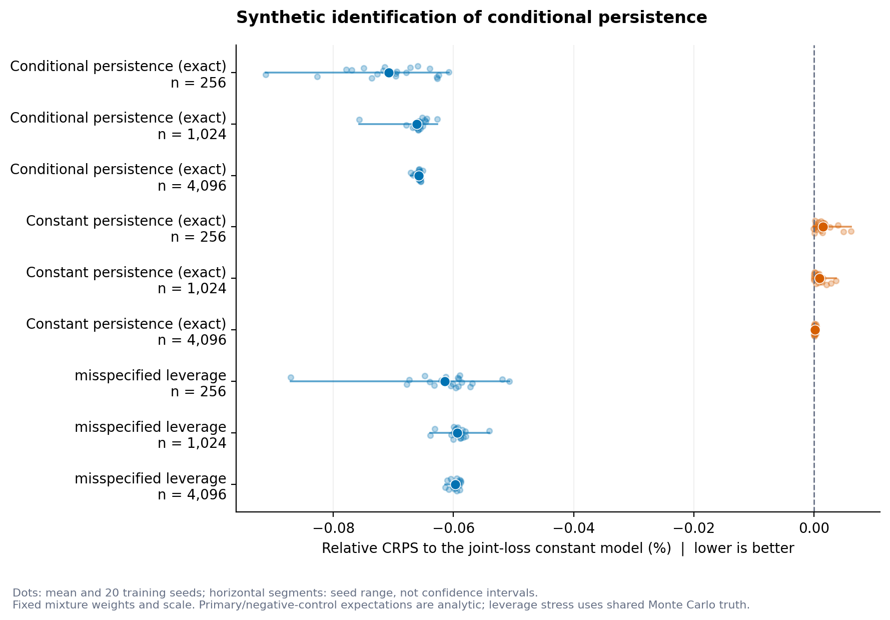
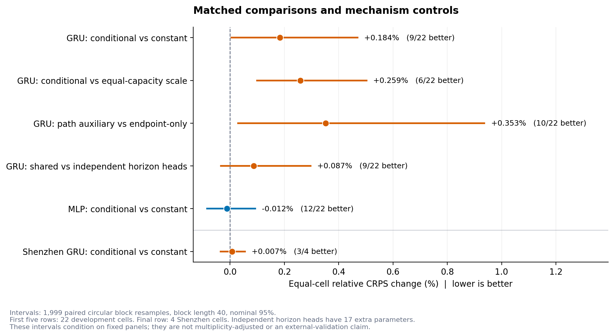
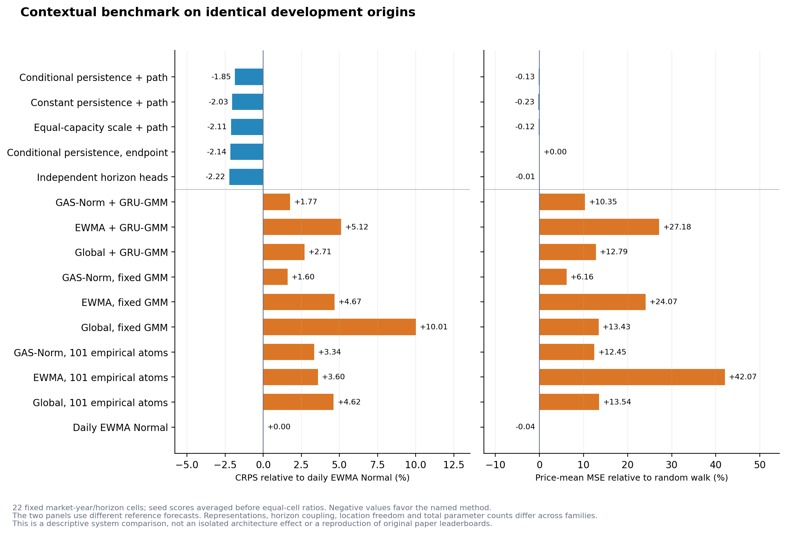

# 碳价多期限分布预测：条件持续性候选的完整实验与近邻论文对照

日期：2026-10-19。研究目标：预测模型及学习机制创新。当前状态：**本轮预定实验完成，固定候选停止，尚未达到正向模型创新论文的证据标准。**

## 1. 结论与实际完成的工作

这次提出并实际检验的候选是：用报价历史学习未来波动状态的持续性，在固定一步分布和累计二阶矩的条件下改变多期限尾形，并用未来路径似然辅助端点 CRPS 学习。数学机制成立，低维合成筛选通过；但是，真实市场中的新机制没有优于关键控制。主 GRU 相对固定持续性对照的平均 CRPS **增加 0.183892%**，相对相同容量的尺度对照增加 **0.258964%**。6 项拟合前指定的继续条件仅通过 1 项，因此正式决定是 `STOP_FIXED_CANDIDATE`。[完整决定与原始精度结果](results/market/persistence/SUMMARY.json)

这是已经完成、可以逐项复核的模型研究迭代。它不能被改写成“新模型有效”或“已达到发表标准”，也不转为政策解释、价格影响因素分析等经济实证论文。数学正确、实施正确、样本外改善和方法新颖性是不同判断。

| 实验范围 | 实际执行 | 说明 |
|---|---:|---|
| 低维合成识别 | 720 次模型拟合；1,080 次标量优化；36,713 次目标计算 | 不是神经网络训练；3 场景 × 3 样本量 × 20 种子 × 4 模型 |
| 条件持续性及消融 | 312 次神经拟合；39 次统计拟合 | 13 个市场年面板；8 个骨干与模型组合；3 种子 |
| GAS-Norm / EWMA / Global | 198 次神经拟合；22 次 GAS 静态拟合；154 份固定预测 | 11 个开发面板 × h5/h20；三个归一化使用相同 GRU-GMM |
| 正式市场神经训练合计 | **510 次拟合、20,400 个完整 epoch、387,360 次参数更新** | 每次完整执行 40 epoch；验证选择包括初始模型 |
| 保存的正式预测文件 | **690 份** | 候选 338；GAS 与固定控制 352；每份包含多个预测起点 |

312 次候选训练中 103 次选择 epoch 0，198 次 GAS 组训练中 35 次选择 epoch 0。这些模型仍然跑完全部 40 轮；初始模型被验证集选中，不能误报为“没训练”，也不能删掉它来改善均值。候选 39 次统计拟合均报告收敛；22 次 GAS 拟合有 3 次达到 4,000 次目标计算预算，保留有限有效解及 `success=False`，没有补算或更换起点。[候选计数](results/market/persistence/MODEL_FIT_ACCOUNTING.json)、[GAS 计数](results/gas_benchmark/EXECUTION_ACCOUNTING.json)

合成实现检查、公式积分、完整流程冒烟训练和独立前向重放分别记账，没有叠加进 510 次正式训练。

## 2. 选题理由与数学边界

上一轮分布更新候选已停止。只读回查发现，训练与验证改善常未延续到后续时间段，且大量模型的验证最优解为初始参照；没有证据支持盲目延长训练。本轮先把机制压缩为一个能与尺度作用分离的自由度：**整体波动幅度相同时，预测“高波动会连续保持多久”，能否帮助累计收益尾形预测？** 同时补上上一轮未完整覆盖的 GAS-Norm 动态位置／尺度过滤基线。[方法全文](methods/METHOD_ZH.md)、[文献及适配依据](literature/CLOSEST_PAPERS_ZH.md)

在起点 o，历史编码器输出尺度修正 f 和持续性 ρ。三态乘子 q=(1/4,1,4)，以训练期固定概率 π 归一化为 v=q/(πq)。未来状态从 π 开始，共享转移核：

$$
P_o=\rho_o I+(1-\rho_o)\mathbf1\pi^\top,
\qquad r_{o+j}=s_o f_o\sqrt{v_{S_j}}\epsilon_j,
\quad \epsilon_j\sim N(0,1).
$$

s 为起点已知历史的 EWMA 日收益尺度。固定 f、π、s 时，一步边际不随 ρ 变化，累计 h 步方差始终为 h s² f²。ρ 改变平方收益依赖及累计超额峰度：

$$
\operatorname{Cov}(r_i^2,r_j^2\mid X_o)
=s_o^4 f_o^4\operatorname{Var}_{\pi}(v)\rho_o^{|i-j|},
$$

$$
\kappa_h(\rho_o)=\frac{3\operatorname{Var}_{\pi}(v)}{h^2}
\left[h+2\sum_{k=1}^{h-1}(h-k)\rho_o^k\right].
$$

利用 q 的格点结构，令 m=n中态+5n高态，h 步累计方差最多保留 5h+1 个格点；h20 至多 101 个含零质量位置的高斯分量，而非枚举全部 3²⁰ 条路径。端点 CRPS 与 HMM 路径似然精确计算，无 Monte Carlo 训练损失近似。联合目标为 h1/h5/h20 平均端点 CRPS 加 0.05 倍每步平均路径负对数似然。

这不是新 HMM、新 proper score 或通用神经状态空间框架。待检验的是受限参数化与路径辅助学习在有限报价历史中的价值。分别训练的模型可以学出不同 f，因此其一步评分不必相同；本轮只保证一个起点内共享未来分布，不声称跨起点重新估计满足 tower property。

## 3. 数据、时间切分与公平比较

开发组为 EUA、广州、湖北、上海 11 个市场年面板，测试年 2021—2023；上海 2021 按原有规则排除。额外组为 PLOS 补充数据中的深圳 2020、2021，单独报告，不混入开发组主统计。h=1、5、20 指未来可用报价步数，不自动等于交易日或日历日。

测试年开始前设训练和 126 个验证起点，所有 h20 标签须在切分边界前成熟；测试起点与最远目标均在测试年。三个期限使用同一起点。输入为过去 20 步的已知报价收益、因果尺度和报价日期间隔，标准化参数只用训练数据估计。测试权重冻结，只更新允许的已观测历史。[数据与来源审查](data_sources)、[时间成熟审计](audits/MARKET_TIME_DATA_AUDIT_ZH.md)

所有候选使用种子 17、41、89，固定 AdamW 学习率 .002、权重衰减 .001、batch 64、40 epoch。GRU 主模型 1,042 个神经参数，固定持续性对照 1,025，同容量尺度对照 1,042；独立期限头 1,059。MLP 只重复条件／常数持续性主比较。模型使用相同成熟路径标签，不给主模型额外未来信息。

深圳在合成门槛通过、市场协议冻结后才用于本轮训练评分。该工作簿在既往工作中被机械读取过，所以称“首次模型使用的额外年份”，不称从未见过的市场。至 2021 年有 1,857 条正价格记录；375 条有日期但无有效价格的行按固定规则排除，不用零或未来插值填补。原论文于 2025 年因早期刊发版本不完整而重发，不能将更正误称为数据错误或撤稿。[原论文](https://journals.plos.org/plosone/article?id=10.1371/journal.pone.0296105)、[更正](https://journals.plos.org/plosone/article?id=10.1371/journal.pone.0329804)

发表前仍需解决数据口径：EUA 连续期货换月未完全核实；湖北 Latest 与收盘价关系未完全核实；广州保留来源周末日期；深圳合约／单位和报价跳变缺少官方逐条核对。这不允许按结果删样本，也意味着本轮不是完整多市场外部验证。**未打开任何保留的 2024+ 价格。**

## 4. 合成识别：可学习，但理想化收益很小

合成实验固定混合权重和尺度，只估计持续性。正向场景令二值条件对应 ρ=.1 或 .9；无条件差异控制为 ρ=.5；另有不属于模型族的杠杆反馈。每场景 20 个种子，样本量 256、1,024、4,096 嵌套。

| 主样本量 1,024：条件联合目标 / 常数联合目标 | 平均相对 CRPS | 改善种子 |
|---|---:|---:|
| 真实条件持续性差异 | **−0.066077%** | 20 / 20 |
| 实际没有条件持续性差异 | **+0.000913%** | 0 / 20 |
| 杠杆反馈错设 | **−0.059331%** | 20 / 20 |

前两行总体期望解析计算；错设行使用固定 200,000 条 Monte Carlo 真值路径及 40 批统计量。正向场景平均估计 ρ 约 .1017、.9027，识别正确；负控制的小幅损失是额外估计代价；杠杆场景未推翻改善，不证明普遍抗错设。[完整汇总及 720 拟合记录](results/synthetic)

预定主场景满足至少 0.02% 平均改善、至少 14/20 种子改善门槛，才进入市场。理想总体改善仅约 .066%；现实还需估计 π、f 和编码器，所以合成通过不能替代市场证据。

## 5. 市场结果：条件持续性与路径辅助均未获支持

统计先在每起点平均三种子**评分**，求每市场年／期限平均，再算候选／对照−1，最后等权平均单元；不是混合三个预测分布。开发组主分析为 22 个 h5/h20 单元，h1 为次要分析。1,999 次长度 40 的配对循环块重抽样在面板内跨方法及期限使用相同索引。名义区间条件于固定年度面板，不代表所有市场总体，消融未校正多重检验。

| 比较 | 平均相对 CRPS | 名义 95% 区间 | 严格胜 / 平 / 负 |
|---|---:|---:|---:|
| GRU 条件 / 固定持续性 | **+0.183892%** | **[+0.004735%, +0.469536%]** | 9 / 5 / 8 |
| GRU 条件持续性 / 同容量尺度 | **+0.258964%** | **[+0.098944%, +0.502603%]** | 6 / 5 / 11 |
| GRU 路径辅助 / 仅端点，均为条件持续性 | **+0.352520%** | **[+0.029586%, +0.936724%]** | 10 / 0 / 12 |
| GRU 共享持续性 / 独立期限头，均仅端点 | +0.087168% | [−0.033965%, +0.296433%] | 9 / 8 / 5 |
| MLP 条件 / 固定持续性 | −0.011817% | [−0.084860%, +0.092557%] | 12 / 5 / 5 |
| 深圳 GRU 条件 / 固定持续性 | +0.006976% | [−0.034884%, +0.055109%] | 3 / 0 / 1 |

第一行检验条件持续性，第二行排除多 17 个参数的容量解释，第三行检验路径辅助，第四行以同端点损失比较期限约束，并承认独立头多 17 个参数。主模型对独立头还同时改变损失，不能把该比较单独归因于共同传播。

主 GRU 对无神经网络的统计联合目标参照也较差，平均 +0.793377%；对统计端点参照 +1.213645%。最大恶化在上海 2022：h5 +1.820417%、h20 +2.611890%；不事后删除该面板。深圳 3/4 单元改善而均值略差，说明胜率与效应大小需要同时报告。个别差异小于 10⁻¹²，公开表描述其数量，但严格胜／平及门槛一直用未四舍五入的值。

主均值、至少 60% 严格改善、区间上界、同容量控制、深圳非恶化五条件未通过；只有 MLP 均值为负通过。正式停止固定候选，不追加权重、状态倍率、种子或年份搜索。[独立重算的 52 组比较与门槛](audits/PERSISTENCE_AGGREGATE_REPLAY.json)

## 6. GAS-Norm 适配与跨模型表现

GAS、EWMA、Global 使用同一历史目标过程、GRU16 和三高斯混合头，各 1,065 个神经参数。GAS Student 只用于历史过滤，最终收益密度是高斯混合，价格变换有有限解析矩。本轮没有把无界 Student 直接当对数收益并错误报告有限价格均值。

适配在拟合前明确：尺度递推系数按作者代码解释为 β尺度；未来状态按论文纯 AR 式推进；删去作者目标中人为重复的最后观测。训练期固定预算估计静态参数，神经阶段冻结。输入是已实现的 h 步历史收益，该过程未来 h 步目标恰为本项目累计收益。这是独立数学实现的任务适配，不能称原论文全部实验复现。[原文](https://arxiv.org/html/2410.03935v1)、[版本和偏离](literature/CLOSEST_PAPERS_ZH.md)

| GAS-GRU-GMM 相对对照 | 平均相对 CRPS | 名义 95% 区间 | 改善单元 |
|---|---:|---:|---:|
| EWMA-GRU-GMM | −1.751022% | [−5.563693%, +3.024108%] | 15 / 22 |
| Global-GRU-GMM | −0.494340% | [−1.930891%, +1.033427%] | 13 / 22 |
| 公共日 EWMA 正态 | +1.768268% | 区间跨零 | 12 / 22 |

部分均值有利，但未建立稳健改进。3 个固定预算未收敛解还限制了解释：结论只适用于明示预算的适配，不能推广为原论文方法无效，也不是完整调参竞赛。[GAS 结果](results/gas_benchmark/SUMMARY.json)

15 模型族在同 22 个开发单元上的描述性比较节选：

| 模型族 | CRPS / 日 EWMA 正态−1 | 价格均值 MSE / 随机游走 | 90% 覆盖率 |
|---|---:|---:|---:|
| 条件持续性 + 路径辅助 | −1.847018% | .998714 | 93.04% |
| 固定持续性 + 路径辅助 | −2.030978% | .997743 | 92.83% |
| 同容量尺度 + 路径辅助 | −2.105035% | .998779 | 93.23% |
| 条件持续性，仅端点 | −2.138483% | 1.000048 | 92.60% |
| 独立期限头，仅端点 | −2.223419% | .999931 | 92.59% |
| GAS-GRU-GMM | +1.768268% | 1.103476 | 87.32% |
| EWMA-GRU-GMM | +5.123140% | 1.271785 | 83.95% |
| Global-GRU-GMM | +2.711791% | 1.127918 | 89.78% |
| 公共日 EWMA 正态 | 0 | .999649 | 91.90% |

候选相对 GAS-GRU-GMM 的配对 CRPS 为 −3.074706%，相对日 EWMA 正态为 −1.847018%。按同年度观测日期并集同步重抽样市场后，区间分别为 [−4.921659%, −0.271660%] 和 [−2.813591%, −1.193943%]。该次要敏感性方案在训练期间、读取候选比较前记录，不伪称拟合前或外部预注册，不改变主门槛。

候选使用三个日频特征、零中心收益和共享期限；GAS 使用一个期限目标过程、每期限独立网络和自由位置 GMM。表示、位置自由度及期限耦合不同，跨模型容量不完全匹配。整体配置优于 GAS 适配，却不如自身简单控制，故不能归因于条件持续性创新。[全部 15 族及 7 组配对比较](results/cross_benchmark)

## 7. 相似论文比较与原创性边界

审查覆盖 14 篇近邻。无全文的论文仅保留可核摘要，不猜训练切分或算法，不将不同数据上的原论文报表误差直接与本轮数值相减。[完整矩阵、阅读深度和原始链接](literature/CLOSEST_PAPERS_ZH.md)

| 近邻 | 已有设计 | 本轮关系与未完成事项 |
|---|---|---|
| CRPS Learning，2023，碳价应用 | 在线学习分位水平相关组合权重 | 此前简化适配不能称五专家、99 分位完整复现 |
| QTCN，2023；QRTransformer-MIDAS，2025 | TCN 分位预测、混频与 Transformer 概率输出 | 摘要级审查，缺完整原数据和实现；未数值复现 |
| Causal neural network，2025；TCN-iTransformer，2026 | 单调分位数／KDE，以及分位预测与 conformal 区间 | 直接碳价近邻；概率或区间输出本身不足以创新 |
| GAS-Norm，CIKM 2024 | score 归一化、未来统计量预测、反变换 | 已完成明示偏离的适配；不是原论文全部 Monash／LSTM 复现 |
| DS³M，2026，预印本 2021 | 神经切换状态空间与未来概率路径 | 已核正文、Apache-2.0 作者代码；未训练原模型 |
| D2D，2026 预印本 | 递归分布映射、多期限联合损失 | 受限状态和精确 CRPS 是较窄差别，未证明原创性 |
| Proper-Score Observation-Driven Filters，2026 预印本 | CRPS、MMD 等驱动状态更新 | 简单把 GAS 的 log-score 换 CRPS 已不足作为新方向 |
| RC-Mamba，2026-09 | HMM 后验进入 Mamba 参数、Student 输出及 CRPS 微调 | 已核全文，未数值复现；原文也区分系统排名和匹配状态机制效应 |

RC-Mamba 报告匹配 no-regime 骨干在五折总体结果中没有分离，后验熵尺度模块未获得相对全局尺度的支持。其完整系统排名不能简写为“加 HMM 有效”。这也说明本轮必须以新模块自己的控制来判断创新。[原文 §4.7、§5](https://www.frontiersin.org/journals/artificial-intelligence/articles/10.3389/frai.2026.1903497/full)

## 8. 内部独立审计及数值限制

分工交叉复核属于内部独立计算检查，不是外部研究团队复现或同行评审。

| 检查层 | 覆盖与结果 |
|---|---|
| 受限模型数学 | 状态枚举、累计方差／峰度、平方收益协方差、CRPS 积分、路径似然及梯度 |
| 全部合成结果 | 独立生成函数／FFT 重算 720 模型、2,160 期限评分；最大单期限差 1.95×10⁻¹⁴ |
| 数据与成熟规则 | 共起点、真实 20 步窗口、训练标准化、GAS 目标映射 |
| 510 检查点 | 独立重建 GRU／MLP、输出变换及状态传播；312 候选、198 GAS 全通过 |
| 候选统计 | 52 组比较、507 单元比较、390 行指标、胜负及门槛一致；区间端点最大差 8.55×10⁻¹⁶ |
| GAS 统计 | 352 文件、12 比较和 1,999 次重抽样重算；区间端点最大差 2.53×10⁻¹⁶ |
| 逐点分布评分 | 690 文件、421,600 个起点／期限分布、4,187,068 个指标值；除价格 CRPS 的明确数值资格限制外，全部通过原阈值 |

候选训练 f/ρ 与存档最大差 4.44×10⁻¹⁶，测试参数／分布最大差 1.89×10⁻¹⁵；GAS 最大差 1.33×10⁻¹⁵。这是计算一致性，不说明泛化有效；起点与任务组合数量也不是独立统计样本数。[检查点审计](audits/INDEPENDENT_CHECKPOINT_REPLAY_ZH.md)

逐点核验发现一个必须公开的数值问题：对较分散的对数正态混合，价格 CRPS 的两个原始期望项都很大，直接相减会损失精度。**原保存值和原独立重放都可能因相同抵消而出错，二者相近不等于接近真值。** 因此没有放宽 rtol=2×10⁻¹⁰、atol=2×10⁻⁹ 来宣称通过。[完整评分资格回执](audits/MARKET_SCORE_REPLAY_QUALIFIED.json)

另一计算者先符号消去公共价格均值项，以稳定截断矩扫描全部 624 份连续分布文件（407,134 个价格评分；另 66 份原子控制不使用此公式），并对原始失败点和最大偏差点作 80/120 位高精度与定义 CDF 积分校验。原价格 CRPS 超阈值共 **331 点**，全部为深圳 h20：验证 215 点、测试 116 点，涉及 32 份预测文件的 53 个角色／期限分布。最大相对误差约 **1.2463×10⁻⁵，即 0.0012463%**；最大绝对误差约 276.374，对应极大的尾部价格评分，不能只用绝对量判断影响。[数值调查与高精度证据](audits/LOGNORMAL_CRPS_CANCELLATION_AUDIT.json)

开发组及所有 GAS 连续分布没有该超阈值问题；归一化 CRPS、NLL、价格均值／MSE、覆盖及宽度均通过原检查。主指标 CRPS 最大绝对重放误差为 2.44×10⁻¹⁵，停止决定不受价格副指标抵消影响。稳定表达式重算的价格向量和聚合表单独交付，明确标为拟合后的数值修正伴随产物，不覆盖原预测、冻结评分源码或原表。数学上价格矩有限仍可能非常大；这也限制了对深圳极端尾部价格误差的实践解释。

修正伴随产物已完成 624 份连续分布向量和 934 行聚合表。超过原阈值的聚合行仅有深圳 h20 测试 9 行、验证 11 行；开发组及 GAS 聚合均值的最大相对改变仅 2.83×10⁻¹³。八个困难点的稳定式最大相对误差约 6.23×10⁻¹⁵；全量使用经过这些校验的稳定 binary64，并未声称所有点都重算了 120 位精度。[稳定价格 CRPS 伴随表](audits/STABLE_PRICE_CRPS_CELLS.csv)、[修正回执及输入不变校验](audits/STABLE_PRICE_CRPS_RECOMPUTATION.json)

## 9. 论文标准与方向决策

本轮已完成明确数学假说、近期近邻定位、同容量及损失控制、多期限、多种子、多年度和额外来源、完整预算、成熟约束、检查点及逐层复核。这些使结果可信，但不会让未通过机制控制的模型自动成为可发表创新。

关键缺口仍是：新机制相对强且匹配的控制有稳定收益；与最近方法的区别足够实质；相同目标下至少完成一个更直接的原模型复现；数据定义及独立验证达到可审查标准。描述性排名不能替代这些证据。

停止当前三态持续性网格，不打开 2024+ 来挽救。下一次立项应先解释为何总体可识别的路径信息，在有限样本端点学习中反而受损，并检验在没有可用条件信号时能恢复强简单参照的学习规则。任何隐式更新、收缩或梯度控制都需与现有方法直接比较，先完成新的低维可证伪实验，不能把通用正则化换名当贡献。[尚未验证的方向假说及否决条件](literature/CLOSEST_PAPERS_ZH.md)

本轮模型、种子、损失和评价网格到此关闭。所有不利结果和数值资格说明保留，不转为经济实证论文，也不宣称正向模型论文已完成。

## 10. 复现与交付

[REPRODUCE_ZH.md](REPRODUCE_ZH.md) 给出固定输入、实际三分片训练及独立审计命令。公开 Git 保留协议、代码、全部拟合回执、聚合结果及 PNG／SVG 图。原始工作簿、准备数组、权重、逐起点预测和日志另存私有运行档案。

协议和源码按阶段在本地冻结，实验结束后再上传 GitHub。它提供内容及执行记录，**不是外部时间戳预注册**。交付清单核对之前研究的全部文件身份、新文件及私有档案哈希。
