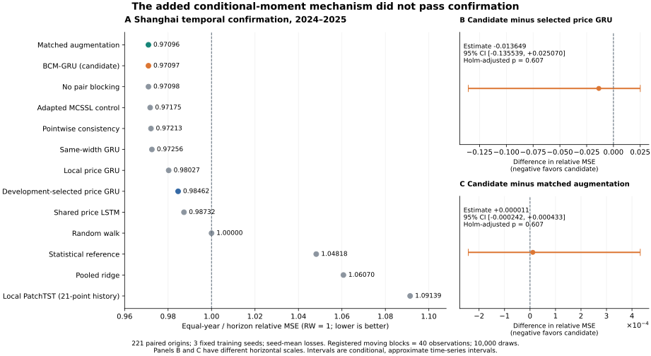
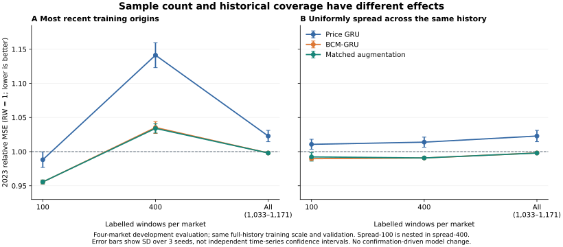

# 扩展数据下的碳价预测模型创新研究：BCM-GRU 实验与发表判断

研究日期：2026-10-17。基础仓库版本：`1c67e562e721dd82fff4e4143b97a798a1cf44fa`。

## 1. 研究结论

本轮已经完成数据扩充、候选模型设计与实现、直接近邻文献核查、机制消融、学习曲线、冻结后的确认实验及独立数值复核。**提出并实际训练了分块条件矩 GRU（Blocked Conditional-Moment GRU，BCM-GRU；代码族名 `kcm`），但实验尚未支持其新增机制具有可发表的经验贡献。**

这不是对研究目标的更换：目标仍然是有实证支持的预测模型或学习算法创新，而不是把现有结果改写成一篇“负结果论文”。现在能交付的是完整、可复核的研究包，不能诚实地宣称已经得到达到发表条件的新模型。

四条主序列的完整来源库存由此前的单一小样本限制扩展至 **6,303 条报价记录**；本轮实际使用 **6,125 条**，其中 **5,864 条开发记录、261 条上海确认记录**。另有 178 条既有作者 CSV 的 2024 年后段未进入本轮训练或确认。新取得的全国对数价格 760 条和七试点成交均价 4,196 条独立存档，不混充相同定义的收盘价样本。

实际完成 **385 次正式预测器拟合、15 次历史补全器拟合（合计 7,500 个优化步骤）**，以及单列的 3 次真实市场计时拟合。所有正式拟合完成，无失败重试。训练次数不等于独立实验样本数，滑动窗口也不等于独立市场观察。

冻结后的上海 2024—2025 确认评分如下，越低越好，随机游走为 1：

| 比较项 | 评分 | 对主模型的含义 |
|---|---:|---|
| BCM-GRU | 0.970974738 | 相对随机游走降低约 2.90% |
| 开发期选出的普通共享 price-GRU | 0.984623878 | 主模型评分低约 1.39%，尚无显著性支持 |
| 匹配的历史粗化训练增强，去掉条件矩机制 | **0.970963789** | 与主模型几乎相同，并略优 |

两项预设主要比较的 Holm 校正单侧 $p$ 值均为 **0.6065**，均未通过。本轮最关键的结论是：**完整方法相对普通 GRU 的改善，不能归因于新提出的条件矩部分。匹配增强在本次主要指标上数值近似相同且点估计略优；未观察到新增条件矩机制的净增益。** 同时，支持排除的消融几乎不改变结果，不能声称分块处理已被实验确认为必要。

主要结果见 [CONFIRMATION_SUMMARY.json](CONFIRMATION_SUMMARY.json)、[CONFIRMATION_INFERENCE.json](CONFIRMATION_INFERENCE.json) 和 [逐点确认预测](results/CONFIRMATION_FORECASTS_H1_H5_H20.csv)。

## 2. 对“数据量太少”的分析与处理

### 2.1 增加的是哪些真实数据

| 主序列 | 完整来源记录数 | 原始覆盖日期 | 本轮开发记录 | 本轮确认记录 |
|---|---:|---|---:|---:|
| 广州作者报价 | 1,492 | 2018-01-03—2024-03-29 | 1,434 | 0 |
| 湖北作者报价 | 1,466 | 2018-01-02—2024-03-29 | 1,408 | 0 |
| EU_REPORTED 作者报价 | 1,577 | 2018-01-02—2024-03-27 | 1,515 | 0 |
| 上海作者 reported close | 1,768 | 2013-12-19—2025-09-25 | 1,507 | 261 |
| **合计** | **6,303** | | **5,864** | **261** |

既有三序列来自仓库固定版本中的 Figshare 28682348 作者数据。新上海数据来自 Mendeley Data 的 [10.17632/d4bv52fgmd.1](https://doi.org/10.17632/d4bv52fgmd.1)。主 CSV 的来源、处理与授权署名见 [DATA_ATTRIBUTION.md](DATA_ATTRIBUTION.md)；数据目录包含本轮实际使用的五个 CSV，便于脱离临时运行路径复现。

新上海源工作簿只有作者定义的 `收盘价`、日期与城市等字段。本轮仅选择字段、规范日期、按日期排序、按预定边界拆分，没有填充、平滑或按成绩剔除异常值。作者上游是否清洗、缺日报价如何形成、价格单位及每行的交易所原始出处没有全部认证。因此表述为“作者整理的上海 reported close”，不包装成已认证的交易所完整原始日线。

广州已有逐行历史核对证据；湖北字段不能自动认定为官方收盘价；EU_REPORTED 的合约、场所、币种和换月规则未充分认证。跨市场训练仅使用各市场训练前缀计算的尺度进行归一化，不能由此消除来源身份问题，也不把不同单位的原始 MSE 直接相加。

### 2.2 取得但没有混入主实验的数据

| 来源 | 记录数 | 保留字段 | 本轮处理决定 |
|---|---:|---|---|
| 全国市场，Mendeley [10.17632/5skvz8sgrz.1](https://doi.org/10.17632/5skvz8sgrz.1) | 760 | `LNCEA` | 保留对数价格，不凭指数变换假装恢复未舍入原价；本轮未拟合 |
| 七试点，ScienceDB [10.11922/sciencedb.819](https://doi.org/10.11922/sciencedb.819) | 4,196 | 配额日成交均价 | 与收盘价分开；作者清洗可能含月内后验信息，本轮未拟合 |

三个新来源共取得 6,724 条记录，25 个导出 CSV 已逐条对照原工作簿。ScienceDB 两个版本的日期和均价相同，只计一份。来源库存合计 11,259 条不表示 11,259 个同质、独立、未经处理的收盘价样本。

官方 GDEA、HBEA、CEA 正常入口本轮分别返回 HTTP 418、503、420，未取得报价正文。过去报告记载的官方历史快照规模没有计为本轮下载成果。完整证据见 [数据扩展说明](data_provenance/DATA_EXPANSION_ZH.md) 与其来源清单。该目录保留数据子任务当时的封存状态文字；本主报告描述后续已经完成的确认开启和实验，不倒改历史记录。

### 2.3 为什么扩大行数仍不能自动解决问题

本轮取消了旧训练协议中只取最近有限窗口的限制。2023 年训练切点下，四市场共使用 **4,373 个监督训练起点**：广州 1,052、湖北 1,033、EU_REPORTED 1,117、上海 1,171。2024 年确认训练切点对应 5,304 个起点。每个起点读取 21 个历史价格节点，并预测后续 20 个观测步；相邻起点的历史和目标大量重叠，不能把它们作为相互独立的复制。

上海年份覆盖不均，2021 年仅 47 条观察记录，严格要求所有 20 步目标在当年成熟后，只剩 27 个评价起点。`h=20` 表示后续第 20 条被观察到的报价，不等于 20 个自然日，也没有完整交易日日历认证。在开发期，部分 20 步跨度很长。因此扩充数据同时增加了来源、时间跨度、市场状态和报价频率的异质性。

为直接回答数量问题，本轮增加了控制时间覆盖范围的学习诊断，详见第 6 节。观察结果不支持“窗口越多，预测必然越好”，也不能推导成“旧数据普遍有害”。

## 3. 创新假设与实际模型

### 3.1 要解决的具体问题

短价格序列中，模型可能过度依赖细粒度路径的偶然变化。普通逐点一致性约束会要求完整历史和删减历史产生相同预测，这又可能抹掉有用的细节信息。本轮研究的问题是：**能否约束“删去细节后的系统性预测偏差”，同时允许完整历史保留真正有用的额外信息？**

令完整历史为 $X$，只保留部分价格节点后的粗历史为 $C=T(X)$。若两个预测分别对应相应信息集下的条件均值，则条件期望的塔式性质给出：

$$
\mathbb{E}\left[f(X)-f(C)\mid C\right]=0.
$$

这里要求的是给定粗信息后的平均差异为零，不是每一个样本上两个预测都相同。例如 $Y=A+B$、粗信息只有 $A$，且 $\mathbb E[B\mid A]=0$，完整预测可以利用 $B$；逐点一致性会惩罚这项有用信息，条件矩约束在理想总体下不会。

这条恒等式和核条件矩理论已有文献基础，不是本轮原创定理。最近的直接近邻还包括 2026 年预印本 [Martingale-Consistent Self-Supervised Learning](https://arxiv.org/abs/2605.11846)。本轮把可辨识的候选贡献限定为：**无需条件历史补全器的分块核条件矩正则化，在跨市场、多期限价格预测中的具体学习算法与有效性。** 文献对应关系和反例见 [RELATED_WORK_ZH.md](methods/RELATED_WORK_ZH.md)。

### 3.2 输入、预测目标与网络

完整输入使用 $p_{t-20},\ldots,p_t$ 共 21 个价格节点。粗历史有两种：最后 11 个节点，或在 21 个节点中保留编号 0、2、…、20。每一种视图先选价格节点，再重新计算相邻差分，避免删掉的价格通过旧差分泄漏回来。全部视图保留当前价格，预测相同的未来目标。

模型每个有效 token 使用三个数值通道：训练尺度归一化后的价格差、原始观测序号间隔的 `log1p`、自然日间隔的 `log1p`；附加四维已知市场身份。短序列右侧填充并显式传入 mask，不把填充值作为实际历史。

目标为：

$$
y_{t,h}=\frac{p_{t+h}-p_t}{s_m\sqrt h},\quad h=1,\ldots,20,
$$

其中 $s_m$ 仅由该市场当前训练前缀的一步差分计算。完整网络为共享 GRU、32 维隐藏状态、20 维读出，共 **4,596 个可训练参数**。市场 ID 使模型知道市场身份；这一设置并不构成完全未见市场上的零样本迁移。

### 3.3 条件矩正则项

记 $d_{i,h}=f_h(X_i)-f_h(C_i)$。在同市场内取样本对，并排除历史与目标支持相互重叠的起点，即要求 $|t_i-t_j|>40$，其中 $t_i$ 是该市场原始观测序号，不是抽样后重新编号的行号。采用固定的三个高斯核宽度 $0.5,1,2$ 的平均核，作用在填充后的粗历史原始三通道上，不对市场 ID 再计算距离。

$$
U_{m,h}=\frac{\sum_{(i,j)\in\mathcal A_m}k(C_i,C_j)d_{i,h}d_{j,h}}
{|\mathcal A_m|},\qquad
R=\frac{1}{MH}\sum_{m,h}\max(0,U_{m,h}).
$$

训练损失为完整与粗视图监督 MSE 各半，加公共输出收缩、读出层 L2 与 $\lambda R$。每个 epoch 交替使用短视图和稀疏视图，固定最终 $\lambda=1$。完整公式、初始化、市场权重、优化步骤和所有控制组见 [METHODS_ZH.md](methods/METHODS_ZH.md)。

支持排除可以去掉直接共享原始记录的样本对，但不能使非平稳市场变成独立同分布过程；有限样本正部截断也会引入偏差。本轮没有证明该估计量在任意非平稳市场上无偏，没有宣称塔式性质保证跨状态泛化。若精细伪信号在每个粗状态下均值为零，条件矩也可能检测不到其跨期失效；这类反例已写入方法讨论。

## 4. 按可审阅研究要求执行的实验

### 4.1 开发与确认分工

开发期使用四市场截至 2023 年的资料，以 2021、2022、2023 三个年份评价并选择候选及基线。每次训练只使用当时可用前缀；最后 80 个成熟起点用于验证，训练与验证标签之间做 20 步清除。训练上限 60 epoch，耐心值 12，epoch 0 初始化也可以被验证选中。神经模型使用确定性 CPU、float64、单数学线程。

确认来源与 2024—2025 边界在新价格文件下载前已经记录；最终选择规则在 D2 完成前固定。最终运行计划于 2026-10-17 07:44:10 UTC 启动记录后才进入 root 的首次确认价格数值读取。确认执行过程中没有用评分修改配置。内部文件哈希和运行日志可以复核这一会话内顺序，但不冒称已在外部注册平台预注册，也不声称公开数据此前从未被任何人看过。

确认按预定年度更新：2024 使用此前成熟标签训练；2025 允许使用已经成熟的上海 2024 标签。其余三市场仍停在 2023 年底，2024 评分不触发任何配置修改。这是固定规则的顺序预测，不是 2024、2025 两组完全独立的训练实验，也不是完全未见上海历史的市场外测试。

### 4.2 对照与机制消融

| 组别 | 所回答的问题 |
|---|---|
| 随机游走、原统计参考、Ridge | 是否超过合理的低复杂度预测 |
| 共享和本地 price-GRU、LSTM | 收益是否只是共享训练或基础序列模型本身 |
| 与主模型同宽、同三类数值特征及四维市场身份的 GRU | 收益是否只是额外特征、宽度或公共训练设置 |
| 匹配的完整/粗历史监督增强 | 条件矩机制是否比普通训练增强多做了有效工作 |
| 逐点一致性 | 条件平均约束是否优于直接拉近两个预测 |
| 不排除重叠支持的核矩 | 分块支持排除是否有可测的作用 |
| MCSSL 补全器控制 | 与最接近的条件补全思路比较 |
| PatchTST | 在相同短历史信息范围内检查现代 Transformer 基线 |

PatchTST 使用作者仓库固定提交 `204c21efe0b39603ad6e2ca640ef5896646ab1a9` 的核心文件，保留 Apache-2.0 授权与来源。它在本研究中采用 21 节点短历史、本地单市场训练、宽度 16/32、固定小规模开发选择；不能把这个适配结果写成对作者原 benchmark 的复现或对所有长上下文 Transformer 的普遍结论。[作者方法](https://arxiv.org/abs/2211.14730) 与适配细节见 `methods/patchtst/`。

MCSSL 为依据论文思想构造的控制实现：历史缺失价格节点由仅在训练历史上拟合的补全器处理，两个独立噪声生成两份补全历史；它不是作者原代码 benchmark 的认证复现。补全器的 MSE 训练不保证学得真实条件分布，本方使用的正部稳定化也明确登记。

### 4.3 实际运行量

| 阶段 | 正式预测器拟合 | 补全器拟合 | 内容 |
|---|---:|---:|---|
| D1 | 141 | 0 | 有限配置筛选、基础模型与首轮机制检查 |
| D2 | 158 | 9 | 三个固定种子、机制消融、PatchTST、数据量诊断 |
| 时间覆盖受控的学习诊断 | 24 | 0 | 100/400 起点、时间均匀嵌套抽样及配对基线 |
| 冻结后的确认 | 62 | 6 | 上海 2024/2025，三种子，全部预定模型 |
| **正式合计** | **385** | **15** | 补全器每次 500 步，共 7,500 步 |

另有 3 次真实市场计时拟合，单列在 `TIMING_RESULTS.json`。合成实现检查和独立前向复算不增加市场训练次数。所有任务和失败状态都保留，未只公布胜出配置。

## 5. 完整确认结果与统计解释

主要分数 $S$ 先在每个年份、每个预测期限内计算 MSE/RW-MSE，再对年份和期限等权平均；神经模型先平均固定种子的**损失**。没有把三个种子的预测平均后作为另一个集成模型计分。2024 年有 143 个、2025 年有 78 个同年成熟 H20 起点，共 **221 个**；所有模型使用相同起点。

| 模型 | 2024 | 2025 | 两年等权总分 |
|---|---:|---:|---:|
| 匹配的历史粗化增强 | 0.996722 | 0.945206 | **0.970964** |
| BCM-GRU | 0.997044 | 0.944906 | **0.970975** |
| 核矩但不排除重叠支持 | 0.997045 | 0.944912 | 0.970978 |
| MCSSL 补全器控制 | 0.997056 | 0.946451 | 0.971754 |
| 逐点一致性 | 0.997308 | 0.946949 | 0.972129 |
| 同宽、同三类数值特征及四维市场身份 GRU | 0.996041 | 0.949089 | 0.972565 |
| 本地 price-GRU | 1.009494 | 0.951054 | 0.980274 |
| 开发选出的共享 price-GRU | 1.021153 | 0.948095 | 0.984624 |
| LSTM | 1.004089 | 0.970551 | 0.987320 |
| 随机游走 | 1.000000 | 1.000000 | 1.000000 |
| 原统计参考 | 1.123673 | 0.972693 | 1.048183 |
| Ridge | 1.088139 | 1.033257 | 1.060698 |
| PatchTST，当前短历史适配 | 1.115448 | 1.067334 | 1.091391 |

图中误差线对应已冻结的主要比较；两个效应图使用不同横轴范围，不能凭条形视觉长度比较绝对尺度。

### 5.1 新机制没有超过匹配增强

定义 $\Delta=S_{\mathrm{BCM}}-S_{\text{比较模型}}$，负数有利于 BCM。预设主检验按年份分层，使用成对循环移动块 bootstrap，块长 40、10,000 次重采样、固定随机种子 20261019。同一重采样索引应用于所有模型、期限和种子，并在每次抽样中重新计算 RW 分母；两项主比较作 Holm 校正。

| 主比较 | 观测 $\Delta$ | 95% basic 区间 | Holm 校正单侧 $p$ | 预设条件 |
|---|---:|---|---:|---|
| BCM − 开发选出的普通 GRU | −0.013649141 | [−0.135538525, 0.025069550] | 0.606539 | 未通过 |
| BCM − 匹配增强 | +0.000010948 | [−0.000242137, 0.000432564] | 0.606539 | 未通过 |

两项比较都没有支持优越性；第二项的观测方向也并未有利于主模型。BCM 相对匹配增强的评分变化仅约 **+0.00113%**，不能借四舍五入把并列写成优势，也不能把整体相对普通 GRU 的 1.39% 改善称为新机制贡献。

开发期结果已经有同样迹象：三种子候选分数 0.987512777、匹配增强 0.987885254、无支持排除核矩 0.987506315。主模型对匹配增强只有很小的开发均值改善，而且无支持排除对照略好。开发选型没有用确认结果，但这些开发成绩也不能作为额外独立检验。

### 5.2 推断的实际边界

40 步块长下，2024 和 2025 分别只有约 **3.575 和 1.95 个等效块长**的序列长度。区间和 $p$ 值是弱依赖、局部平稳等条件下的近似，不能声称具有任意状态切换下的精确覆盖。推断条件于本次已选配置、固定种子与已生成预测，不重新训练，因而不传播训练估计误差及年度更新造成的全部依赖。

块长 20 和 60 的结果按预定敏感性项目完整公开，没有挑选显著的块长替代主检验。95% 边际区间和 97.5% Bonferroni 区间都保留。项目要求两项主要效果方向有利、Holm 校正 $p<0.05$，只是本项目用于判断正面证据的必要条件，不是期刊通用的接收门槛，更不是证明新颖性的充分条件。

另一个权重不同的次要统计量——未做 RW 归一化的原始 MSE 差——对匹配增强为 −0.008022747，95% 区间 [−0.012595019, −0.003309437]。它更重视高波动年份和长预测期限，因此可以与等权相对分数产生不同排序。本报告公开这项结果，但没有在见到结果后更换主要指标来挽救假设；原价格单位未全部认证，也不把这里的数值标成“元²”。

这些失败结果说明当前数据与固定训练程序**没有建立新增机制有效的证据**，不证明所有条件矩模型在所有数据上必然无效。

## 6. 学习曲线：数量与历史状态要分开

第一组诊断取最近 100、最近 400 和全部成熟训练起点。最近样本同时改变数据数量与历史覆盖范围，因此又执行第二组诊断：在相同完整历史跨度上均匀选取 400 个起点，再从中取嵌套的 100 个；全部配置共享同一训练前缀尺度。三种子、2023 年、四市场与三个期限等权评价，未使用确认成绩调整方法。

| 取样方式 | 模型 | 100 起点/市场 | 400 起点/市场 | 全部起点/市场 |
|---|---|---:|---:|---:|
| 最近历史 | price-GRU | 0.988187 | 1.141376 | 1.022884 |
| 最近历史 | BCM-GRU | 0.955495 | 1.035374 | 0.998075 |
| 最近历史 | 匹配增强 | 0.955621 | 1.034069 | 0.997985 |
| 同一时间跨度，嵌套均匀选取 | price-GRU | 1.010730 | 1.013914 | 1.022884 |
| 同一时间跨度，嵌套均匀选取 | BCM-GRU | 0.989736 | 0.990753 | 0.998075 |
| 同一时间跨度，嵌套均匀选取 | 匹配增强 | 0.992293 | 0.990786 | 0.997985 |

这里“全部”是 2023 年切点下每市场 1,033—1,171 个监督起点，共 4,373 个；100/400 并不是独立价格行数。两组的“全部”重复使用同一已完成拟合，不重复计数。均匀嵌套组减少了历史覆盖不同造成的混淆，但仍有滑动窗口依赖、共同历史尺度、有限三个种子和仅一个评价年份等限制。

误差线为三个训练种子之间的标准差，不是时间序列总体误差的置信区间。完整数值见 [LEARNING_CURVES.csv](results/LEARNING_CURVES.csv)。

这组实验说明，在当前价格信息、模型和训练规则下，增加窗口没有呈现单调收益。最近 400 起点的普通 GRU 甚至明显差于最近 100；在相同时间跨度下，扩大标签起点数也没有产生稳定改善。因而“再堆更多同类重叠窗口”不能被视为足够的创新路径。需要进一步识别的是可预测信息、状态变化与跨市场可迁移条件，而不能仅靠样本行数或参数量来推断可发表性。

## 7. 独立验证与可复核性

独立审核器没有再次调用训练模型的前向函数来复写同一答案，而是以 NumPy/math 从保存权重重建 GRU、LSTM、Ridge 和 PatchTST 的预测计算。PatchTST 核对包括 RevIN、patch、注意力、GELU、BatchNorm 保存状态、读出及逆尺度。确认阶段全部可用视图、20 个期限、输入标签支持、市场映射、年度前缀和最终聚合均复算。

| 验证阶段 | 核对范围 | 数值比较次数 | 最大绝对差 |
|---|---|---:|---:|
| D1 | 141 个预测器 | 8,913,309 | 2.84e−14 |
| D2 | 158 个预测器，含 48 个 PatchTST | 8,347,504 | 1.42e−13 |
| 开发选型与学习诊断 | 49 个聚合组、24 个额外诊断拟合等 | 934,196 | 7.11e−15 |
| 确认 | 62 个预测器、全聚合与主统计输出 | 1,362,196 | 5.86e−14 |

补全器核查覆盖 15 次训练的历史支持、500 步记录、状态哈希与冻结使用；独立审核没有重演随机补全器的全部训练轨迹。数值复核证明保存状态与报告计算一致，不认证上游未知清洗，不验证所有研究假设，也不替代另一团队重新训练。

训练与独立审核环境为 Python 3.12.14、NumPy 2.5.4、PyTorch 2.3.1+cpu；原始最终统计后处理和绘图使用基础环境 NumPy 2.3.5。审核在 2.5.4 下复算统计与 Holm 结果一致。环境差异分别登记，没有误称全流程同一依赖版本。

确认结束后，首个聚合调用把全部 13 模型字典传给只接受三个主要模型的统计 API，在重采样前被拒绝。修复只将传参限制为已冻结的三个名称，未改统计代码、主要比较、模型配置、预测或重新拟合，见 [POSTPROCESSING_CORRECTION.json](POSTPROCESSING_CORRECTION.json)。

公开包保留冻结源码、全部任务/指标/训练收据、逐点确认预测、主要统计输入与确认模型保存状态；较大的原始记录和数组使用有逐文件校验清单的压缩归档。附可移植的复现入口，重新运行会写入新目录，不能把对已公开确认数据的复现重新称作一次盲确认。文件布局与发布范围见 [README_ZH.md](README_ZH.md)。

## 8. 现在能否按模型创新论文投稿

**当前不建议作为已经验证的新模型正面论文投稿。**

理由不是“分数必须提高某个固定百分比”，也不是“必须达到某个统一样本数”。最直接的问题是贡献归因：删除新机制后的匹配增强在本次主要指标上数值近似相同且点估计略优；这里未做正式等效或非劣检验。支持排除也没有稳定可测的增益。与此同时，唯一新确认来源是上海一个作者数据集，报价身份和日历还有未认证部分，221 个相关起点不足以建立广泛跨市场结论。

本轮已把几项常见的审稿问题具体化：扩大了真实来源与历史范围；避免随机时间切分；使用未来标签清除；公开多种子和所有配置；纳入近邻方法及匹配消融；保留固定主检验和不成功结果。这些工作提高了研究可信度，但不自动产生学术贡献。

未来仍以预测模型或学习算法创新为目标，值得推进的条件是：

1. **先取得更可靠的外部验证资料。** 明确合约或配额定义、单位、是否实际成交、历史修订/清洗与可用日期，增加一个以上尚未用于方法选择的市场或新时间段。全国 LNCEA、ScienceDB 均价不能直接充当已认证同类收盘价扩容。
2. **机制必须针对可验证的失败原因。** 当前条件均值约束不识别均值为零的精细伪信号。新方案需要说明新增信息或结构怎样识别跨状态可靠信号，以及在何种条件下比现有方法多解决一个问题；只再加门控、注意力或更换网络名称不足以回答这一点。
3. **重新冻结一种真正不同的假设，并保留最强必要对照。** 匹配增强应继续作为主要对照；新外部数据在新方案确定后才用于确认。不能继续拿本轮上海 2024—2025 当成未见数据反复调参。
4. **达到可重复的贡献证据后再定稿和选刊。** 需要主机制相对近邻和匹配消融的可重复增益、适用条件与失败边界，而不是只挑最优种子或一个预测期限。期刊分区、订阅/OA 政策属于另一个应在投稿时核实的问题，本轮不以列期刊名称替代结果成立。

已额外检查的两条理论备选——受保护读出更新和随机业务时钟——也没有冒充新主模型：前者涉及已有投影/鲁棒优化结构，并有退化条件；后者在简单 OU 与独立指数时钟下，用于平方损失点预测的多步条件均值退化为事件步 AR(1) 形式，更一般的联合时间与数值建模已有文献。说明收入 `methods/`，没有为了获得正面成绩追加没有新假设的模型网格。

## 9. 阅读与复现入口

- [研究包总览](README_ZH.md)：文件布局、公开归档、运行入口和限制。
- [方法完整定义](methods/METHODS_ZH.md)、[相关工作与理论边界](methods/RELATED_WORK_ZH.md)。
- [数据署名和变换](DATA_ATTRIBUTION.md)、[数据扩展来源](data_provenance/DATA_EXPANSION_ZH.md)。
- [全部配置开发汇总](results/ALL_CONFIGS.csv)、[全部正式拟合索引](results/ALL_FITS.csv)、[全部单元指标](results/ALL_METRICS.csv)。
- [确认逐点预测](results/CONFIRMATION_FORECASTS_H1_H5_H20.csv)、[学习曲线](results/LEARNING_CURVES.csv)。
- [确认统计](CONFIRMATION_INFERENCE.json)、`audits/` 中的独立核验与 `records/` 中的原始运行记录。

所有结论以保存的实际输出为依据；本报告没有把尚未验证的候选贡献写成已完成的可发表创新。
