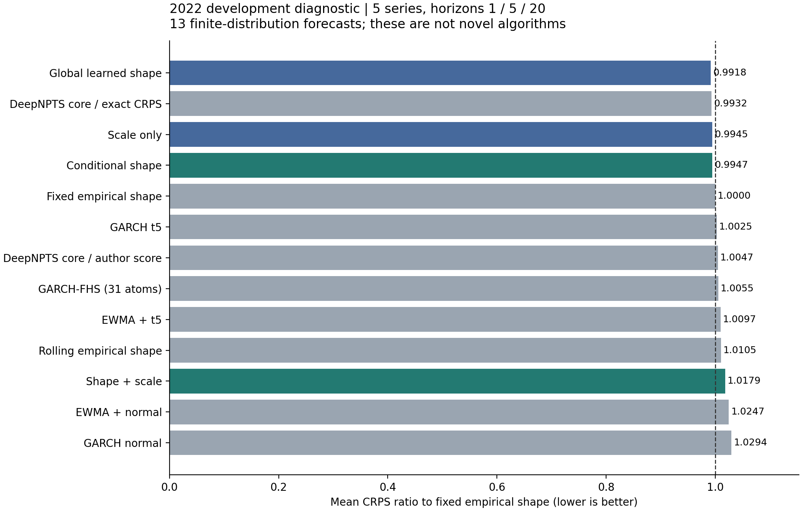
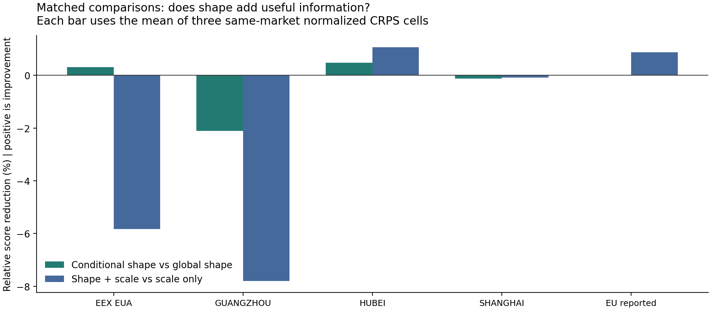

# 碳价条件分布形状研究：真实实验、数据扩展与停止判断

研究日期：2026-10-17。研究目录：`distribution_shape_diagnostic_20261017c`。父提交：`e2d99b8a5c26c4d7b363ec728eadab6d3fbabbcd`。本轮只新增研究文件，保留此前 SMP、RRC 及其他固定候选的完整结果。

## 1. 目前的结论

**真实实验和独立数值复核均已完成，但本轮没有得到可以主张为论文贡献的新模型。** 本轮先检验“控制条件均值与波动尺度之后，动态学习分布形状是否还有足够收益”这一必要性问题。采用的 GRU、经验分布、矩归一、GARCH 和作者概率网络均是已有方法或其明确披露的任务适配，不预先包装成原创算法。

正式完成 **30 次神经网络拟合、10 次统计模型拟合、65 条预测流**，无失败、无重试。共同开发评价中，条件形状模型的主 CRPS 比值为 **0.994666769**，全局静态学习形状为 **0.991848009**；条件形状相对后者误差高 **0.2842%**。联合学习形状和尺度为 **1.017943136**，仅尺度为 **0.994536684**，前者相对误差高 **2.3535%**。五项冻结门槛只通过一项，按原规则结束该固定实验。[E1–E4]

数据检索取得了可核验的深圳作者附件：**1,893 条有效日期与数值收盘价，2013-08-05—2022-03-11**。这扩大了可供后续研究选择的来源覆盖，但本轮只检查附件结构、日期和行数，没有将该新序列用于训练。当前实际实验仍使用原有五个开发文件的 **8,119 条记录**。深圳附件与旧来源的年份覆盖部分重叠，不能将它的全部行数计作全新独立样本。[D1–D3]

本轮达成的是可检查的研究判断、可重放的实验和新的数据来源交付。**尚未达成用户要求的可发表模型创新；不将这个停止结果改成阴性结果论文，也不将简单排名冠军视为部署或发表认证。**

## 2. 为什么选择这个问题

此前条件均值候选的失败不说明概率预测必然成功，也不证明均值永远不可预测。本轮只把共同均值固定为当前价格，隔离一个更小的研究问题：市场过去状态中，是否有超出波动尺度的、可学习的偏斜或尾部形状信息？若动态形状不能稳定超过同一尺度下的静态形状对照，就没有充分依据继续为这个固定需求增加复杂机制。

本轮围绕三个直接近邻做有界比较，保留阅读和执行层级。[L1–L3；完整表见 methods/METHOD_SCREEN_ZH.md]

| 方案或学习机制 | 已取得证据 | 本轮采用与判断 |
|---|---|---|
| DeepNPTS | 完整方法与实验文本；固定 GluonTS 数学核心、许可和实际执行 | 作为主要的作者核心概率对照，直接多期限任务适配；不是原论文基准的完整复现 |
| Entropy pooling | 原作者有限场景约束、相对熵目标和对偶推导；未取得并运行 MATLAB 实现 | 排除将“神经先验加 KL 概率约束”直接当作新算法；没有对该方案做市场拟合 |
| HNN | 最终发表正文方法；作者仓库树、README、MIT 许可；没有执行 TensorFlow 实现 | 作为均值/方差识别的近邻与备选方向；本轮尺度 GRU 不是 HNN 复现，未另行启动完整 HNN 实验 |

主要执行方向是有限分布的条件形状诊断，作者核心配对臂帮助区分训练评分实现的影响。备选方向是较完整的均值/方差学习方案；它仍属已有方法，当前没有发现足够具体、通过近邻比较的原创改动，因此没有在形状失败后自动追加另一轮拟合。更多摘要或局部查重不计作完整方案复核。

这项设计的实质用途是防止把波动拟合的收益误归给分布形状，也防止把修正现有评分函数称为结构创新。它不是对“碳价动态形状永远不可预测”的普遍检验。

## 3. 数据量、支持和暴露状态

五个文件只接受冻结 SHA256 身份和 `date < 2024-01-01` 的开发范围。本轮模型按序列分别拟合，**没有把五个序列拼成一个有 8,119 个独立训练样本的共享网络**。真正用于每个网络的训练起点只有 756—1,647 个，仍是数据受限问题。[E1、E2]

| 序列 | 开发文件记录 | 训练起点 | 验证起点 | 2022 评价起点 | 评价起点日期 |
|---|---:|---:|---:|---:|---|
| EEX EUA T3PA | 2,255 | 1,647 | 80 | 193 | 2022-01-10—2022-11-17 |
| 广州 | 1,434 | 770 | 80 | 222 | 2022-01-04—2022-12-02 |
| 湖北 | 1,408 | 756 | 80 | 217 | 2022-01-04—2022-12-02 |
| 上海 | 1,507 | 916 | 80 | 195 | 2022-01-04—2022-12-01 |
| EU 作者报告序列 | 1,515 | 819 | 80 | 238 | 2022-01-03—2022-12-01 |
| 合计 | **8,119** | **4,908** | **400** | **1,065** | 按完整 H20 成熟支持评价 |

训练和验证来自 2022 之前；评价要求每个起点的完整 20 步标签在该年内成熟。验证使用年度切点前最后 80 个完整成熟起点。训练最后一个 H20 标签必须严格早于首个验证起点，因此不会让同一未来标签跨入训练和验证。`h=1,5,20` 表示原始观测步，未补齐交易日历或日历日价格。[E1；source/data.py]

所有输入只使用预测时点已经观测到的增量、过去日期间隔和因果尺度。保留原价、原日期和数值零，不根据连续同价判断是否无成交，不将缺量设为零，不使用 Excel 行号和来源字段作为市场特征。主任务不使用外生协变量。

2022 和 2023 已在历史开发中暴露，本轮 2022 成绩是开发诊断，不能称为全新确认测试。EEX 和 EU 序列同属相关 ETS 风险，且 EU 作者文件的具体交易场所、工具和 vintage 尚未完全识别；五个序列不等于五次独立复制。多期限起点互相重叠，1,065 个评价起点也不是 IID 样本。过去 EEX 准备器机械解析过档案内容与本轮没有将 C 交给模型是两个不同事实；上海旧确认部分已经暴露。本轮没有读取旧 C 文件用于拟合或确认预测。[E1；audits/RESEARCH_BOUNDARY_ZH.md]

## 4. 模型、控制与评分定义

### 4.1 预测分布和输入

目标为累计价差 \(Y_{t,h}=P_{t+h}-P_t\)。每个期限发布 31 个原子的有限分布：

\[
F_{t,h}=\sum_{k=1}^{31} w_{t,h,k}\,\delta_{a_{t,h,k}},
\qquad w_k>0,\quad\sum_k w_k=1,\quad\sum_k w_k a_k=0.
\]

因此预测价格均值始终是 \(P_t\)，均值 MSE 与随机游走相同至舍入误差。这是为了隔离分布形状而施加的模型限制，不是实际概率分布必须满足的无套利或风险中性定理。

输入为过去 20 个观测步的三个通道：原价增量除以当前因果 EWMA 标准差；过去日期间隔的 `log1p(gap)/log(8)`；当前尺度与训练前缀增量 RMS 比值的对数。各通道裁剪至 ±10。EWMA 系数固定为 0.94，用最早 60 个增量初始化并固定方差下界，发行尺度为 \(\sigma_{t,h}=\sigma_t\sqrt h\)。每条历史目标以它自身发行时点的尺度标准化，而非用后来评价时点的尺度倒算。[E1；source/data.py]

固定经验形状对每个期限取训练标准化目标的 31 个中点分位数，先拒绝退化方差，再令相邻间隔不小于 \(10^{-4}\)，重新归一到均值零、方差一。这里的 `fhs_fixed` 是正则化经验边际近似，不等于完整的递归 GARCH-FHS。严格正间隔也会消除经验分布的精确零质量；它没有改变原始报价，但限制了预测分布表达能力。

### 4.2 四个主要配对诊断臂

形状网络对基础原子间隔 \(g_k>0\) 输出 \(d_k\)：

\[
g'_k=g_k\exp\{2\tanh(d_k)\},\qquad
\widetilde a_k=\frac{b_k-\sum_jw_j b_j}
{\sqrt{\sum_jw_j(b_j-\sum_lw_l b_l)^2}},
\]

其中 \(b_k\) 由正间隔累加得到。尺度头给出 \(c=\exp\{\tanh(s)\}\)，最终原子为 \(\sigma_{t,h}c\widetilde a_k\)。四个主臂均使用均匀概率；所有矩运算保留梯度。[E1；MODELS_AND_AUTHOR_ZH.md]

| 诊断臂 | 可以变化的部分 | 可训练参数 |
|---|---|---:|
| `global_shape` | 与当前状态无关的全局形状 | 600 |
| `conditional_shape` | GRU32 条件形状，保持共同尺度 | 23,352 |
| `scale_only` | GRU32 尺度，保持固定经验形状 | 4,212 |
| `shape_scale` | GRU32 同时改变形状和尺度 | 24,012 |

三个 GRU 采用相同的编码器结构，分别构造时初始权重相同，各臂独立训练；形状和尺度头均零初始化，使四臂从同一固定经验分布开始。专用 `torch.Generator(seed=17)` 产生小批次顺序，与不同参数量所消耗的模型初始化随机数隔离。它保证共同训练轮次内配对实验的采样可比性，但不是容量完全一致的比较。

### 4.3 统计控制和作者核心

另外执行固定/滚动经验形状、EWMA 正态/t5、GARCH 正态/t5 和 GARCH-FHS。滚动经验池只取最后 120 条已完成 H20 的历史路径；其起点 \(s\) 必须满足 \(s+20\le t\)。两种 GARCH 似然分别在训练前缀以一个固定初值拟合，最多 500 个 L-BFGS-B 迭代，无重启。GARCH-FHS 复用高斯拟合，按每起点固定种子递归模拟 2,048 条残差重采样路径，再压缩成 31 个矩归一原子，故不增加参数拟合数。[E1；methods/GARCH_REFERENCE_ZH.md]

正态和 t5 也统一为 31 个归一化原子。多步保持正态或 t5 形状是明确近似，不是 t-GARCH 累计增量的解析完整分布；最终评分针对实际发出的有限分布，不使用连续分布的 CRPS 公式。GARCH-FHS 的 2,048 路径仅用于估计原子，不是新增市场观测，也不是作为最终预测测度的 IID 样本。

DeepNPTS 两臂执行固定作者 MLP32/32 数学核心，来源提交 `d60556ca71167a3ec1ea807b491dd982d1de2112`，保留原文件、Apache-2.0 许可和 NOTICE。将相同过去输入映射到 31 个经验支撑槽位，采用直接 20 期限输出、期限静态特征、共享概率下界 `0.03/31+0.97*p_author` 和加权矩归一。两臂模型结构、初态及共同训练轮次内的小批次顺序相同，实际早停轮数可以不同；配对设置只改变训练评分：作者原始 `rps` 与精确有限分布 CRPS。每臂可训练参数 6,143；另有一个已注册但冻结的虚拟类别嵌入参数。[L1；MODELS_AND_AUTHOR_ZH.md；vendor/deep_npts/TASK_ADAPTER_NOTICE_ZH.md]

这不是原作者递归 estimator、原论文数据集或完整训练协议的复现。各期限只发布边际分布，没有声称 31 原子构成一致的联合 20 期路径。

### 4.4 主评分、训练与停止规则

有限分布的评分采用精确概率加权 CRPS：

\[
\mathrm{CRPS}(F,y)=\sum_iw_i|a_i-y|
-\frac12\sum_i\sum_jw_iw_j|a_i-a_j|.
\]

此处包括全部原子有序对的 V 形式是所发布有限测度的精确分数；去掉对角项并更换分母会改变被评价的分布目标。

主分数先在每一“序列 × 期限”格内除以同格固定经验形状的 CRPS，再等权平均五个序列及期限 1、5、20：

\[
S_m=\frac1{15}\sum_{s=1}^5\sum_{h\in\{1,5,20\}}
\frac{\overline{\mathrm{CRPS}}_{m,s,h}}
{\overline{\mathrm{CRPS}}_{\mathrm{fixed},s,h}}.
\]

越低越好，固定经验形状为 1。这不是 MSE/RW 指标，不与旧 SMP 或 RRC 的不同任务分数连成进步曲线。

神经训练使用全部 20 个期限的原价格单位评分，各期限除以固定训练参考分母；验证用同一验证支持上的精确 CRPS 比值选择 checkpoint，包括第零轮。作者原评分臂仅训练目标使用原函数，最终比较与验证选择仍使用统一精确 CRPS。固定 AdamW 学习率 0.003、权重衰减 0.001、batch 128、最多 60 轮、耐心 12 轮、`min_delta=1e-6`、梯度裁剪 1。年度内参数不更新，预测输入和因果滤波随已观测数据更新。[E1]

## 5. 实际执行账本

协议于 **15:44:49.917186 UTC** 冻结，早于第一笔正式市场拟合。冻结包含五个数据摘要和 13 个运行时文件摘要。协议 SHA256 为 `f8759e570226bf9454858da348bcba53f3b714bbf47eeaf8458f36c608a85273`。正式完成时间为 **15:47:53.625815 UTC**，墙钟时间 **183.3468 秒**，CPU 两进程、每进程一个数学线程、float64；未使用 GPU。[E1、E2]

| 项目 | 实际值 |
|---|---:|
| 神经拟合 | 6 臂 × 5 序列 = 30 |
| 统计参数拟合 | 2 个 GARCH 似然 × 5 序列 = 10 |
| 预测流 | 13 臂 × 5 序列 = 65 |
| 神经网络实际训练轮次 / 优化步 | 688 / 5,761 |
| 失败 / 重试 | 0 / 0 |
| 去重后的评价起点 | 1,065 |
| 跨模型评价预测行 | 13,845 |
| 全部 20 期评价边际分布 | 276,900 |
| 新深圳数据用于模型的次数 | 0 |
| D2 / bootstrap / C | 均为 0 |

湖北、EU 的 `scale_only` 选择第零轮。广州、EEX、EU 的 `global_shape` 到达 60 轮上限，所选轮次分别为 58、59、54。因此只能说所有预定任务完成，不能说所有模型已经充分收敛或搜索过最优参数。没有为此延长训练。预定 2,400 秒上限与无重试策略保留。[E2、E4]

正式运行前完成了人工分布、梯度、成熟标签、因果输入、GARCH 递推和完整流程检查。计时阶段与合成试跑有自己的优化步骤，不混入 40 次市场拟合。部分合成回执对应冻结前的历史代码阶段；最终 sampler 改动有单独的同源检查。没有将旧回执重写为一次对最终代码的完整重新运行。[audits/PREFLIGHT_REVIEW_ZH.md；provenance/ 中对应回执]

## 6. 全部主结果与配对结果

以下保留全部 13 臂的成绩。表内排名是这一有限开发实验的描述，不是用评价集选出的可部署策略。[E2、E3]

| 排名 | 模型/诊断臂 | 主 CRPS 比值 |
|---:|---|---:|
| 1 | 全局学习形状 `global_shape` | 0.991848009 |
| 2 | 作者核心、精确 CRPS `deepnpts_crps` | 0.993165695 |
| 3 | 仅尺度 `scale_only` | 0.994536684 |
| 4 | 条件形状 `conditional_shape` | 0.994666769 |
| 5 | 固定经验形状 `fhs_fixed` | 1.000000000 |
| 6 | GARCH t5 | 1.002488724 |
| 7 | 作者核心、原评分 `deepnpts_rps` | 1.004651946 |
| 8 | GARCH-FHS | 1.005485868 |
| 9 | EWMA t5 | 1.009690044 |
| 10 | 滚动经验形状 | 1.010456876 |
| 11 | 形状加尺度 `shape_scale` | 1.017943136 |
| 12 | EWMA 正态 | 1.024652291 |
| 13 | GARCH 正态 | 1.029440292 |

条件形状比固定经验分布改善约 0.5333%，但没有超过更强的全局形状。若只保留较弱参考，会夸大动态机制的证据。相同尺度控制下的配对收益定义为 `100×(1−候选分数/对照分数)`，正数为改善。[E4]

| 序列 | 条件形状相对全局形状 | 形状加尺度相对仅尺度 |
|---|---:|---:|
| EEX EUA T3PA | +0.3122% | −5.8358% |
| 广州 | −2.1035% | −7.7942% |
| 湖北 | +0.4808% | +1.0712% |
| 上海 | −0.1218% | −0.0832% |
| EU 作者报告序列 | +0.0058% | +0.8686% |
| 对整体主分数计算的相对变化 | **−0.2842%** | **−2.3535%** |

整体相对变化是整体主分数的比，不是上面五个百分数的算术平均。EU 的条件形状优势只有约 0.0058%；“3/5 序列获胜”不能替代收益幅度与总体控制。

### 区间与校准的描述性检查

所有臂原本就保存了全部 20 期限的覆盖率、宽度、中位数 MAE 和均值 MSE。下表只是从这些已评分聚合中整理 h1/5/20 的等权描述，不增加新的选择标准或事后晋级门槛。宽度先除以同序列同期限固定经验区间宽度，避免直接跨不同价格单位相加。[E3、E4]

| 臂 | 50% 区间覆盖 | 80% 区间覆盖 | 90% 区间覆盖 | 90% 宽度/固定经验宽度 |
|---|---:|---:|---:|---:|
| 固定经验形状 | 56.33% | 79.66% | 89.28% | 1.0000 |
| 全局形状 | 52.79% | 77.71% | 88.61% | 0.9749 |
| 条件形状 | 53.55% | 76.50% | 88.01% | 0.9543 |
| 仅尺度 | 55.79% | 79.27% | 89.39% | 0.9784 |
| 形状加尺度 | 48.29% | 74.71% | 87.98% | 1.0312 |
| 作者核心、原评分 | 56.76% | 81.90% | 85.50% | 0.8634 |
| 作者核心、精确 CRPS | 48.26% | 78.88% | 89.54% | 1.1034 |

条件形状的平均区间变窄同时伴随较低覆盖，不能把变窄单独写成更好不确定性估计。精确 CRPS 作者臂的 90% 覆盖更接近名义值，但平均归一宽度更大。以上平均也可能掩盖具体序列差异；没有做校准显著性检验，没有声称名义覆盖得到统计保证。

## 7. 冻结门槛和解释限度

| 推进条件（全部须满足） | 实际 | 结果 |
|---|---|---|
| 条件形状比固定经验、滚动经验、全局形状的最强者改善至少 1% | 0.994666769 高于最强 0.991848009 | 不通过 |
| 形状加尺度比仅尺度改善至少 1% | 1.017943136 高于 0.994536684 | 不通过 |
| 形状加尺度优于最强统计参考 | 1.017943136 高于 1.000000000 | 不通过 |
| 条件形状在至少 3/5 序列优于全局形状 | 3/5 | 通过 |
| 形状加尺度在至少 3/5 序列优于仅尺度 | 2/5 | 不通过 |

1% 是本轮预先定义的资源推进阈值，不是期刊统一发表门槛。`advance=false` 是数据和冻结规则的实际输出；没有调低阈值，没有在成绩之后移除广州/EEX，也没有为“救分”再加种子、期限或形状参数化。[E1、E2]

失败的外推范围有限：只涉及这组输入、31 原子、固定零均值、EWMA/GRU 结构、一个种子和既定训练预算。它不否定所有条件形状方法、外生数据、联合路径模型或更大数据上的可能性，也不能仅凭参数多和成绩下降就证明过拟合是唯一原因。正间隔与矩约束、按序列独立拟合、有限样本和已暴露开发期都是具体限制。

## 8. 固定作者评分函数的实现发现

直接执行上述固定提交的 `DiscreteDistribution.rps`，并用第二份独立人工反例核验。真实分布在 \(-1,+1\) 各有一半概率，预测概率为 \((p,1-p)\) 时：

\[
\mathbb E[\mathrm{rps}_{\mathrm{fixed\ source}}]=p/2,
\qquad
\mathbb E[\mathrm{CRPS}]=p^2+(1-p)^2.
\]

原函数的期望在真实概率 0.5 处导数为 0.5；精确 CRPS 在该处导数为零。这证明**该固定函数在一般有限分布族上不是 proper score**。实际 37 项独立检查、7 个概率设置与解析结果一致，最大误差约 `2.22e-16`。证据只针对这个版本和函数，不概括为论文所有公式、所有版本或作者整个系统的结论。[MODELS_AND_AUTHOR_ZH.md；audits/AUTHOR_SCORE_INDEPENDENT_AUDIT.json]

本轮适配任务中，改用精确 CRPS 的作者臂相对原评分臂改善约 **1.1433%**，但仍没有超过全局形状对照。固定支撑二点反例与本任务矩归一后的受限 31 原子族不同，不能用前者直接预言后者的市场排名；配对结果来自真实运行。采用已知正确 CRPS 是实现修正，不是新评分规则或原创预测模型。[E2、E4；L1]

## 9. 独立复算验证了什么

独立程序在第一次读取正式成绩之前冻结，时间为 **15:47:41.197496 UTC**。当时训练已经开始；因此不宣称审核器在训练开始前冻结。它于 **15:49:26.554222—15:49:32.231768 UTC** 读取 65 份本轮保存预测，重新计算全部评价和验证期限的分数、矩、覆盖和选模规则。[E5]

| 项目 | 核验结果 |
|---|---:|
| 检查数 | 21,061 |
| 数值比较数 | 1,432,423 |
| 精确比较数 | 747,433 |
| 最大绝对数值差 | 8.526512829121202 × 10⁻¹⁴ |
| 主分数、五项门槛、拟合计数、选中轮次 | 全部一致 |

审核器只依赖 NumPy 和标准库，没有导入生产评分、模型、数据或统计实现。使用显式双重求和复算 CRPS，按下逆 CDF 计算闭区间，先形成自己的聚合和停止判断，再比较主运行结果。它不读取价格 CSV、权重或旧确认文件，不做新拟合。

因此此次独立复核证明保存预测与公布指标一致；它的标签重叠恒等式不是从原始 CSV 重新核定全部源价格的证据。数据因果性另由人工未来污染与成熟规则检查支撑。工程实现通过、研究假设通过、可发表原创贡献成立，是不同结论。[INDEPENDENT_AUDIT_ZH.md；audits/PREFLIGHT_REVIEW_ZH.md]

## 10. 新数据取得了什么，尚缺什么

固定附件来自 Wei、Ouyang 的 PLOS One 论文 *Carbon price prediction based on a scaled PCA approach*，DOI `10.1371/journal.pone.0296105`，S1 DOI `10.1371/journal.pone.0296105.s001`。完整下载 **13,625,856 字节**，SHA256 `90c49501afa9beb7370c4409084a28729daa4904a7e7e5de310d0f6bd7a3ba10`。[D1、D2]

深圳工作表有 1,893 条有效价格记录，另有 398 行有日期但无有限数值价格。旧 ScienceDB 深圳来源覆盖 2014—2017 年；新表中 911 条在这些年份内，**982 条在这些年份外（2013 年 89 条、2018—2022 年 893 条）**。这仅是年份覆盖核对，未逐日比较旧价格或完成同口径去重。旧来源为日成交均价，新表字段是 `close price`，不能直接拼接。[D2、D3]

文件的日期唯一递增，但没有原始成交量列，尚未核实 SZA 配额年份和跨年份工具衔接口径。不能将空值、连续同价或无日期记录解释为无成交。正文去除零成交量的明确说明对应湖北主实验，不用于推断深圳每个空价格行的原因。本轮不使用附件的 71 列技术指标，也没有使用未公开的 Wind 外生输入。[D1–D3]

该论文及公开发表材料有 CC BY 4.0 来源和署名说明。出版社因误发早期不完整稿件，于 2025-06-05 重新发布，2025-08-05 刊出更正；这是版本更正，不是撤稿。公开交付保留稳定来源、许可范围、文件身份、检查和显式导出脚本；不附第三方全文、工作簿或临时重定向凭据。[D1、D4；data_sources/plos_shenzhen/DATA_DISCOVERY_ZH.md]

其他线索中，已读到 Wiley 作者正文与附件列表所报告的北京 1,250 条、深圳 1,921 条；执行器正常获取正文入口返回 403，检索工具的附件点击报错且未成功解析最终文件 URL，因此没有取得可机械验证文件。本轮没有取得全新、超过 1,000 条且口径明确的全国 CEA 原始价格文件。失败入口、已见来源、首个本地截断下载及随后同链接完整读取都保留实际记录，没有通过改变入口绕过拒绝。[D3]

用户提出的样本量问题仍然成立：增加来源数量不等于增加单个模型的独立训练信息。深圳长历史可以成为下一轮候选来源，但在研究设计前需要明确将它作为作者报告的收盘价序列，并为真正的新机制设置单独冻结的验证方案；不能把机械核验称为完成了新增数据上的实验。

## 11. 距离论文实验标准的实际差距

| 需要成立的部分 | 本轮状态 |
|---|---|
| 可追踪来源、代码、固定协议、真实运行与全部失败记录 | 已完成本轮范围 |
| 同支持强对照、尺度/形状配对消融、作者核心明确接入 | 已完成当前有限实验 |
| 提出与直接近邻有实质差异的模型或学习规则 | **尚未取得** |
| 预定机制在开发诊断中超过必要控制 | **未通过** |
| 多种子和独立时间/市场复核支持稳定优势 | **未执行；本轮失败后不扩大** |
| 处理时间相关、相关市场及多重尝试的不确定性证据 | **尚缺**；没有伪造置信区间或 p 值 |
| 新数据上的真实模型验证 | **尚未执行** |
| 可据此提交的创新模型论文 | **当前不成立** |

未来若有真正不同、可检验的新机制，论文应围绕该机制的动机、与近邻的数学差别、信息与训练路径、时间划分、强对照与消融、多种子及时间外评价、不确定性和计算成本来组织。当前材料只能支持其中的数据、实现和研究判断部分，不能先写一个“新模型显著有效”的摘要再寻找结果。此处给出的是未完成的证据结构，不是一篇阴性结果论文的替代提纲。

## 12. 交付和复现入口

- [复现说明](REPRODUCE_ZH.md)：依赖、精确开发数据身份、路径映射、新输出目录和实际重训命令。
- [冻结协议](provenance/PROTOCOL.json)：数据/源摘要、40 次拟合与 65 流预算、训练与停止规则。
- [全部正式结果](results/D1/RESULTS.json)：所有模型、序列、20 期限指标和训练轨迹；另存每序列 JSON。
- [主分数表](results/tables/models.csv)、[序列表](results/tables/markets.csv)、[完整期限表](results/tables/horizons.csv)、[执行表](results/tables/execution.csv)。
- [描述性摘要](results/REPORT_SUMMARY.json)：本文配对百分数和区间汇总的明确算式；只读聚合结果，无新拟合。
- [独立审计说明](INDEPENDENT_AUDIT_ZH.md)及[机器回执](results/INDEPENDENT_D1_AUDIT.json)。
- [新数据来源包](data_sources/plos_shenzhen/DATA_DISCOVERY_ZH.md)：固定 SHA 下载、检查、显式日期/价格导出入口；本轮未执行提取后训练。

公开交付包含源码、许可、聚合指标、训练轨迹、图表和出处。逐起点预测/目标/尺度、模型权重和 EEX 原始报价留在本地运行目录，不混入 GitHub。外部复现者可依说明重新取得合法来源并生成自己的预测，随后运行独立审核器；没有这些数组时只能检查公开聚合和代码，不能把读取本次 PASS 收据称为重新验分。

### 证据索引

- **E1**：[PROTOCOL.json](provenance/PROTOCOL.json)；[PRE_RUN.json](results/D1/PRE_RUN.json)。
- **E2**：[RESULTS.json](results/D1/RESULTS.json)。
- **E3**：[聚合表格](results/tables/horizons.csv)；[图表导出回执](provenance/TABLE_FIGURE_EXPORT.json)。
- **E4**：[REPORT_SUMMARY.json](results/REPORT_SUMMARY.json)；[其生成器](source/summarize_report.py)。
- **E5**：[INDEPENDENT_RESULTS_FREEZE.json](provenance/INDEPENDENT_RESULTS_FREEZE.json)；[独立正式回执](results/INDEPENDENT_D1_AUDIT.json)。
- **L1**：Deep Non-Parametric Time Series Forecaster，[arXiv:2312.14657v1](https://arxiv.org/html/2312.14657v1)；[固定作者来源及 SHA](vendor/deep_npts/SOURCE_MANIFEST.json)。
- **L2**：Meucci，Entropy pooling，[作者原文](https://arxiv.org/pdf/1012.2848)；有限约束等价性为本轮根据原文作出的推论。
- **L3**：HNN 最终论文，[DOI 10.1002/jae.70042](https://onlinelibrary.wiley.com/doi/10.1002/jae.70042)；本轮阅读/执行层级见 [SOURCE_TABLE.json](methods/SOURCE_TABLE.json)。
- **D1**：Wei X, Ouyang H (2024)，[论文与数据可用性](https://journals.plos.org/plosone/article?id=10.1371/journal.pone.0296105)。
- **D2**：[附件机械检查](data_sources/plos_shenzhen/REPRODUCIBLE_MECHANICAL_CHECK.json)。
- **D3**：[来源记录](data_sources/plos_shenzhen/DATA_DISCOVERY_ZH.md)及[访问日志](data_sources/plos_shenzhen/SOURCE_ACCESS_LOG.json)。
- **D4**：[PLOS 版本更正](https://journals.plos.org/plosone/article?id=10.1371/journal.pone.0329804)。
