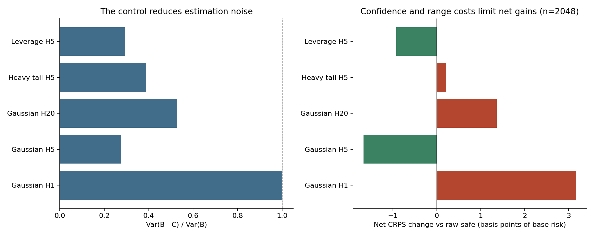
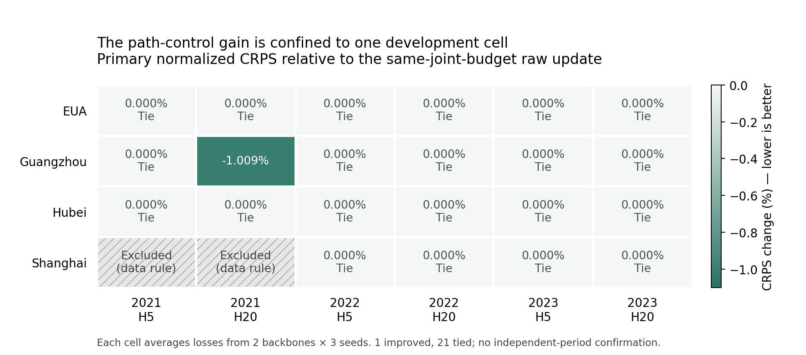

# 碳价格模型学习方法：可预测路径控制与偏差预算分布更新

日期：2026-10-19。状态：**本轮预先规定的开发实验已完成，固定候选未达到进入独立确认的条件。**

## 1. 本轮结论与论文定位

本轮围绕一个明确的模型学习问题开展研究：给定已有预测分布和一个新模型的提议，怎样在样本有限时更准确地学习“哪些历史状态下应更新、更新多少”？研究主体是学习算子、正确性条件、估计效率及其消融，碳价格用于真实任务验证。没有建立政策冲击、宏观变量影响或市场因果关系的实证论题。

完成了数学推导、原始文献排查、独立合成、通用随机过程实验、4 个市场的 22 个组合、两种网络与三个种子，以及全部预定对照。主方法相对同等联合置信预算的无路径更新，平均 normalized CRPS 改善 **0.045856%**；但收益全部来自**广州 2021 年 H20**，其余 **21/22** 个组合持平。这个事实不支持目前版本具有可推广的模型创新收益。

最终机器判定为 `STOP_FIXED_CANDIDATE_NO_CONFIRMATION_OPENED`。没有把零偏差预算、单一市场、其他评分或较好消融改为主结果，也没有为本候选打开新时期的保留价格。这份成果可作为完整的方法开发记录和后续论文的可复用实验基础，**不能直接包装成一个已证实普遍优越的新模型论文**。

## 2. 为什么扩大到学习规则

上一轮 OHLC 路径辅助学习的价格 MSE/RW 为 1.020229，未通过推进条件；更早的动态分布形状、状态过滤和迁移研究也未提供稳定的机制增益。既有报告见 [上一轮完整报告](../ohlc_path_learning_20261019/REPORT_ZH.md) 与 [分布形状诊断](../distribution_shape_diagnostic_20261017c/REPORT_ZH.md)。这些失败只约束相应实现、目标与数据，不证明所有碳价预测都不可学习。

本次在新拟合之前，把主任务明确改为多步对数价格增量的概率预测，采用原点已知 EWMA 尺度归一化后的 CRPS。价格 CRPS、价格均值 MSE、90% 区间覆盖继续完整报告。原目标没有被事后改名为成功：新任务检验的是条件分布更新的学习效率。

普通网络结构不足以构成主贡献。两种提议网络分别是 MLP32–16 和 GRU16，输出一个限制在 [0.5,1.5] 的尺度因子；它们只是验证学习规则对不同骨干是否一致有效。真正待检验的是路径控制、偏差预算、联合统计界和连续分布更新的结合。

## 3. 近几年文献带来的具体约束

本轮区分“已读原始全文/作者代码”和“只能确认出版页摘要”。完整来源及阅读位置见 [文献筛选](methods/LITERATURE_SCREEN_ZH.md)。摘要级条目没有被用来证明某个算法无泄漏或达到某种精度。

| 工作 | 已核实的相关机制 | 对方向选择的影响 |
|---|---|---|
| Berrisch 与 Ziel，CRPS Learning，2021 年预印本、2023 年期刊卷期 | EUA 概率预测，逐分位 Bernstein 在线聚合、时间变化权重与复杂度控制；已读方法和作者代码 | 在线分布聚合已有直接碳价先例，必须纳入相同专家的强对照。[原文](https://arxiv.org/abs/2102.00968) |
| Applied Energy 2025，QRTransformer–MIDAS，DOI 10.1016/j.apenergy.2025.125951 | 官方摘要为混频与分位 Transformer 的碳价预测 | 不能把“Transformer 加分位数”当作新方向。[出版页](https://www.sciencedirect.com/science/article/pii/S0306261925006816) |
| Applied Energy 2025，Causal neural network for carbon prices probabilistic forecasting，DOI 10.1016/j.apenergy.2025.126343 | 摘要描述 EPPT、单调复合分位数与 causal TCN | 分解加概率网络已有近邻；未取得正文，未采信具体提升或因果识别。[出版页](https://www.sciencedirect.com/science/article/pii/S0306261925010736) |
| TCN–iTransformer EUA 区间预测，2025-09 首次在线、2026 年卷期，DOI 10.1002/for.70024 | 摘要含分位回归、区间与 conformal | 概率输出加区间校准也不是空白。[官方页](https://onlinelibrary.wiley.com/doi/10.1002/for.70024) |
| GAS-Norm，CIKM 2024，以及 2026 年 score-driven 方法 | 已有状态位置/尺度过滤、神经归一化和 proper-score 驱动更新 | 普通神经波动或换 CRPS 不能独立支撑新意。[GAS-Norm](https://arxiv.org/abs/2410.03935) |
| Pic 等 2025、CLOVER 2024、CCRPS | 固定聚合后评分、联合概率头与条件/投影 CRPS 已有直接构造 | 全区间 CRPS 候选被排除，未为其启动市场训练。[Pic 原文](https://ascmo.copernicus.org/articles/11/23/2025/index.html) |
| Almeida 等 2025，High Probability Risk Control Under Covariate Shift | 附录 D 已把控制变量用于风险校准，并指出分样和范围成本可能抵消降方差 | 本轮不能主张首次控制变量风险校准；贡献只能落在具体路径条件和更新机制。[作者全文](https://research.feedzai.com/oshuzuxa/2025/10/high_probability_risk_control_under_covariate_shift.pdf) |

其他被排除的候选包括：把累计平方直接换成路径平方和并声称普遍降方差；固定完整未来幅度后任意翻符号；把普通旋转 Rao–Blackwell 包装为新评分。前者存在有界鞅反例，后两者分别有杠杆依赖反例或直接原始文献先例。对应审查与反例完整保留在 [前序候选数学筛选](methods/PRIOR_CANDIDATE_SCREEN_ZH.md) 中。

## 4. 实际实现的算子

先在严格更早的数据上拟合、验证并冻结两个合法 CDF：基准 F0 和提议 F1。取三个非负、和为 1 的历史波动状态软基函数 v(X)，学习 0≤w≤1，并输出

`F_w = F0 + (wᵀv(X)) (F1 − F0)`。

令逐样本 `a=∫(F1−F0)²`、`b=∫(1{Y≤z}−F0)(F1−F0)`。期望 CRPS 差具有**精确二次形式** `wᵀA w − 2Bᵀw`，不是局部 Taylor 近似。Gaussian mixture 下 a、b 和 CRPS 都用解析绝对距离公式计算。

在成熟的未来路径上，使用冻结的 Gaussian 参考剩余噪声计算 b 的 continuation。每步将当前增量正负反射后的 continuation 差取一半，得到相对于真实已实现过去的奇函数。参考分布可以错设；它决定控制效率，奇函数的零/小均值性质依赖另一个明确条件。

主版本把整条路径可消耗的绝对控制幅度限制在 `K(X)=W1(F0,F1)/4`。每步只根据此前已消耗的幅度做对称 clip，因此保留当前增量奇性，且总绝对幅度不超过 K。这个 quarter-W1 设计来自对称分布下 `osc(b)≤W1/2` 的数学范围改进，在通用合成和市场拟合前以 [1.1 补充](provenance/DESIGN_ADDENDUM_PRE_RUN.json) 固定；原 1.0 协议原样保留。它不是假装从未发生过设计修订的外部预注册。

若每一步满足

`|E[sign(r_j) | |r_j|, 真实过去]| ≤ δ`，

则控制偏差不超过 `δ E K`。无条件对称、均值为零或条件鞅差均不能推出这个逐步、给定幅度的条件。δ=0 对应条件符号平衡；δ>0 则允许有限的条件符号偏差，也允许非零漂移，不能笼统说它蕴含零均值。普通反射总变差条件也不能直接替代它。市场主预算预定为 δ=0.05，0、0.025、0.10 只作敏感性实验；没有从碳价检验“不拒绝对称”就宣称预算已被认证。

对有限 λ={0,0.5,1} 同时估计 B 的下界，并扣除控制偏差。A 使用矩阵上界，最后解三变量 box 凸二次规划。零向量始终可行。独立有界校准条件下，这给出相应总体 CRPS 不增的条件保证；真实市场采用固定的 moving-block bootstrap 近似版本，**没有任意非平稳未来风险保证**。详细定理、量纲和范围边界见 [方法说明](methods/METHOD_ZH.md)。

## 5. 数据、时间边界与实验矩阵

| 市场 | 本轮开发价格记录 | 日期范围 | 纳入评价组合 |
|---|---:|---|---:|
| EUA_LONG | 2,839 | 2013-01-02—2023-12-29 | 6 |
| 广州/广东作者报价 | 1,434 | 2018-01-03—2023-12-29 | 6 |
| 湖北 | 1,408 | 2018-01-02—2023-12-29 | 6 |
| 上海 | 1,507 | 2013-12-19—2023-12-29 | 4 |

合计 7,188 条原始作者报价，不是 7,188 个独立训练样本。EUA_LONG 与 EU_REPORTED 在 2018–2022 年全部 1,257 个共同日期精确同价，因此后者没有作为额外市场。上海 2021 年仅 47 条报价，最大相邻间隔 248 天；该年两个期限在拟合前排除，未删除源记录。来源的连续合约换月规则及部分价格口径仍未完全认证。[数据审计](data_sources/DATA_AUDIT_ZH.md)

每个评价年为 2021、2022 或 2023，期限为 5/20 个作者报价观测步。每格取严格更早的 252 个校准起点和 126 个验证起点，其前为扩展训练段。各角色的最后标签在下一角色首起点之前成熟。网络输入是 20×3 历史特征；最早起点为索引 39，用于 EWMA 暖机和历史可用性，不是 40 步网络输入。尺度、特征矩、状态基函数均在相应训练前缀确定。没有随机打乱时间切分或未来日历填充。

22 个组合全部达到至少 128 个训练起点的要求；最少为湖北 2021 H20 的 217 个。上海某些 252 起点校准段仍横跨 700–875 个日历日，统一观测数没有消除分布变化。评价端要求原点和终点都处于所列年份，共 4,987 个组合内评价起点；跨期限存在重叠，不能将其算为独立证据。

两种神经提议均从 F0 起步，每个模型实际执行 60 个 epoch，再按验证 CRPS（包括 epoch 0）选择最终状态。合计 132 次梯度拟合、116,640 次优化步；46 次最终选择 epoch 0，但并非没有执行训练。另有 22 次全局混合和 22 次 Gaussian GARCH 数值优化，44 次均报告正常终止。

21 类最终预测规则包括：F0/F1/等权、经验标量和三维 gate、两个无路径统计对照、四个偏差预算、标量/全额幅度/不截断/无前缀消融、冻结与在线 BOA-CDF、19 原子分位 BOAG、FHS、EWMA Normal 和 GARCH Normal。它们共享相同基础模型，2,772 个评分流不等于 2,772 次独立模型训练。

## 6. 合成实验：机制成立的地方与失效的地方

### 6.1 可精确枚举的两步例子

独立审计固定四种符号偏差、四个样本量，每格 1,000 个独立校准重复，共 16,000 份校准样本。真总体风险由四路径原子分布精确计算，全部方法共享同一校准重复。正确预算并没有被假定为从真实碳价可知。

| 条件对称情形 | raw-safe 真 CRPS 变化 | CV，合法 generic 范围 | CV，先验恒等式证明的精确范围 |
|---|---:|---:|---:|
| n=64 | 0 | 0 | −0.010000 |
| n=256 | −0.000878 | −0.003648 | −0.010000 |
| n=1024 | −0.007132 | −0.009602 | −0.010000 |
| n=4096 | −0.009421 | −0.009975 | −0.010000 |

精确范围为零由全支持代数恒等式证明，未使用样本最小最大值。generic 版本仍支付范围成本，小样本确实可能完全不更新。ε=−0.15、n=4096 时，正确预算返回基准；忽略预算的精确范围控制在 1,000 次重复中 **100% 违规**，真 CRPS 平均恶化 +0.02。[独立合成结果](audits/INDEPENDENT_EXACT_SYNTHETIC_ZH.md)

### 6.2 通用算子

八种预定过程覆盖 H1 负控制、H5/H20 高斯、厚尾、杠杆依赖、符号偏差、劣质提议和部署分布突变。每种使用 300 个独立重复，在同一重复中嵌套取 n=128/512/2048；每场景另用 100,000 条独立测试路径。高斯场景总体风险另有解析计算；其他场景显式报告 Monte Carlo 标准误，没有把有限模拟当精确真值。

在 H5 高斯、H20 高斯、厚尾 H5、杠杆 H5 中，控制后 B 估计方差/原方差分别约 **0.274、0.528、0.388、0.294**。H1 同中心尺度负控制的控制量在浮点容差内为零，方差比为 1。

但方差改善不等于净风险改善。n=2048 时，正确预算路径规则相对 raw-safe 在高斯 H5 仅改善约 **1.66 个基点的基准 CRPS**，杠杆 H5 改善约 0.92 个基点；高斯 H20 和厚尾 H5 则略差。符号偏差场景真实上界为 0.30，误设为 0.05 时，95% 重复出现超过 Monte Carlo 判别余量的风险恶化。部署从尺度 1 突变至 0.45 时，两类校准规则都可 100% 违规，符合“保证不覆盖任意分布变化”的理论边界。[完整机器结果](results/synthetic/GENERAL_SYNTHETIC.json)

## 7. 真实市场结果

下表先在每个组合内平均两个骨干、三个种子的损失，再对 22 个组合等权平均比值。它是学习算法的平均表现，**不是把六个预测 CDF 混合后再评分**。价格 CRPS 与 MSE 用组合内同单位分母转成比值，没有直接混合人民币与欧元误差。

| 方法 | 主 CRPS / F0 | 价格 CRPS / F0 | 价格均值 MSE / RW |
|---|---:|---:|---:|
| F0 冻结基准 | 1.000000 | 1.000000 | 1.000379 |
| F1 神经提议 | 1.004392 | 1.005371 | 0.999727 |
| 经验三维 gate | 1.001122 | 1.000969 | 1.000494 |
| 同联合预算无路径更新 | 1.000020 | 1.000023 | 1.000345 |
| **主方法 δ=0.05** | **0.999561** | **0.999577** | **1.000316** |
| 主方法零偏差敏感性 | 0.998857 | 0.998934 | 1.000370 |
| 主方法标量 gate | 0.999482 | 0.999559 | 1.000317 |
| 全额幅度预算 | 1.000018 | 1.000021 | 1.000345 |
| 无前缀消融 | 1.000022 | 1.000027 | 1.000344 |
| BOA-CDF 冻结 | 1.000439 | 1.000654 | 1.000198 |
| BOA-CDF 在线 | 0.998956 | 0.999092 | 1.000546 |
| 19 原子分位 BOAG 在线 | 1.004186 | 1.004981 | 0.999435 |
| FHS | 1.005310 | 1.003001 | 1.003901 |
| EWMA Normal | 1.036524 | 1.042259 | 0.999996 |
| GARCH Normal 方差匹配近似 | 1.207734 | 1.190828 | 1.007043 |

所有未在简表展示的预算和消融仍完整存在于 [21 方法汇总](results/market/SUMMARY.json) 与 [逐组合表](results/market/CELL_METRICS.csv)，没有剔除负结果。

主方法相对同预算 raw 的平均相对差为 −0.00045856048；固定组合内配对块 bootstrap 95% 区间为 [−0.00058994511, −0.00034981767]。这个区间是对既定组合内起点重采样的开发诊断，未建模全部跨市场联动，**不能解释为在独立市场中普遍有效的置信保证**。

更关键的机制结果是：仅广州 2021 H20 改善，其余 21 个组合全为相同预测。132 次学习中只有 14 次主 gate 非零；虽然 63 次某个状态选择了非零控制系数，最终仅 6 次预测相对匹配 raw 发生变化，而且恰好是上述同一组合的六个骨干/种子实现。不能把这六次当作六个独立市场成功。

MLP 与 GRU 的全组合平均相对改进分别约 0.0323% 和 0.0594%，仍都仅来自这一组合。三维 gate 未优于预定标量消融，主方法也未优于持续接收成熟反馈的 BOA-CDF。零偏差预算得分较好，但其条件未在市场被认证，不能事后把 δ=0 改成主模型。

## 8. 独立验证与计算审计

已完成外部 CDF 数值积分、原子双重距离公式、Gaussian continuation 积分、54 个凸 QP 与 SciPy 优化对照、Gershgorin 误差盒全 64 顶点检查。GMM CRPS 最大误差 6.66e−16，lognormal CRPS 外部积分误差 1.56e−13，QP 目标相对误差 2.57e−16。首次把理论零控制要求为浮点精确零的审计断言被定位并改为明确的 1e−14 容差，源算法未改，失败和修正均保留。

时间审计独立核对实际 22 个 prepared 面板、66 个角色成熟边界和 132 个截断历史检查；每个在线基线的 4,712 次反馈均已成熟。检查点审计全量重放 132 个最终模型，63,186 个校准/测试因子逐值完全一致，并独立重建 628,362 条方法评分。主 CRPS 最大差 4.44e−15，价格 CRPS 最大差 4.53e−14，全部 462 个组合×方法聚合及主比较区间一致。完整误差、计数和哈希见 [时间审计](audits/INDEPENDENT_TIME_DATA_AUDIT_ZH.md) 与 [检查点评分审计](audits/INDEPENDENT_MARKET_REPLAY_ZH.md)。

运行开始后有一项输入防护修复：先只读日期列并拒绝 2024+ 文件，再转换价格列。实际四个输入的哈希早已独立核验且均止于 2023，因此本修复没有改变数组、拟合或评分，没有重新训练。[修复记录](provenance/POST_START_AUDIT_FIXES.json)

审计另记录了一个未使用入口的维护问题：`fit_garch` 返回的 `next_variance[0]` 未恢复实际方差单位。本轮最早使用索引为 39，内部递推及全部实际使用的条件方差均复核一致，因此不影响结果。冻结源码原样保留；若后续把此函数用于索引 0，应先修正该入口。

## 9. 距离可写模型创新论文还有什么

| 要求 | 当前状态 |
|---|---|
| 明确可执行的学习算子 | 已实现；有标量和三维条件 gate |
| 正确性、假设与反例 | 已推导、数值独立核验，包含预算失配与漂移反例 |
| 直接近邻与公平对照 | 已核方法来源，执行匹配专家、无控制、消融及 BOA；尚未确证原创性 |
| 跨骨干、多种子、跨期与跨市场 | 固定 22 组合、132 拟合已完成，未挑选有利切分 |
| 新模块的广泛增量 | 未通过：1/22 个组合改善；条件 gate 无额外优势 |
| 对强在线方法的稳定优势 | 未建立；主方法点估计不如在线 BOA-CDF |
| 未触碰新时期的独立确认 | 仍保留；本候选未获推进，不为其消耗确认数据 |
| 可投稿的核心正向贡献 | **尚未达到**，不得把实验数量、推导正确或单一组合改善替代此要求 |

60% 组合改善是本轮内部推进规则，不是某本期刊的统一标准。它被采用是为了阻止单一时期的局部成功支撑宽泛方法结论。即使不使用这一阈值，当前收益集中、三维 gate 消融和在线对照结果也不足以支持成熟的通用方法贡献。

后续方法研究应首先解决两个已具体暴露的瓶颈：如何在可检验条件下获得低偏差且低成本的路径控制，以及怎样使提议分布本身具有跨期稳定的可学习增量。这些需要新的方法设计与独立预先规定的实验，不能靠重命名本轮最好的预算或再加网络模块完成。本轮保留全部代码、定理边界与负结果供后续使用。

## 10. 可复现与公开交付

[README](README.md) 给出环境、数据获取、运行和审计命令。原始数据及逐起点目标/预测、网络检查点没有新加入公开目录；来源链接、固定哈希、聚合验证轨迹、全部结果和审计均可公开复查。EUA 作者页面的 CC BY 声明不自动消除底层第三方数据的再分发限制。以前的实验路径原样保留。

这是完成后上传的研究记录；本地拟合前协议与 1.1 设计补充不等同于第三方预注册。没有声称已完成保留期确认、证明市场条件符号界，或获得 SOTA / 期刊录用资格。
