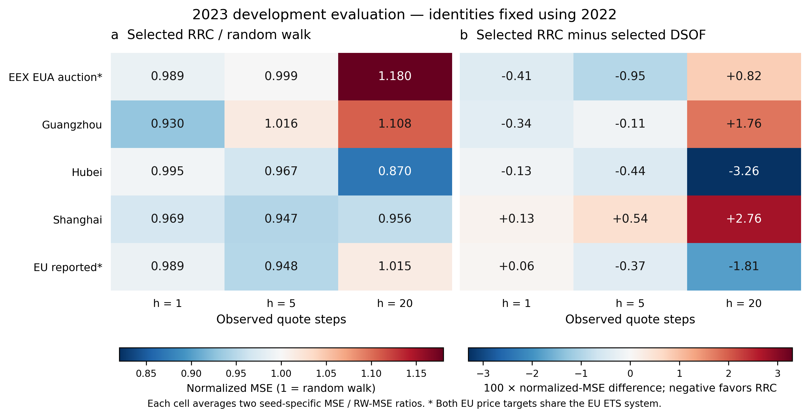
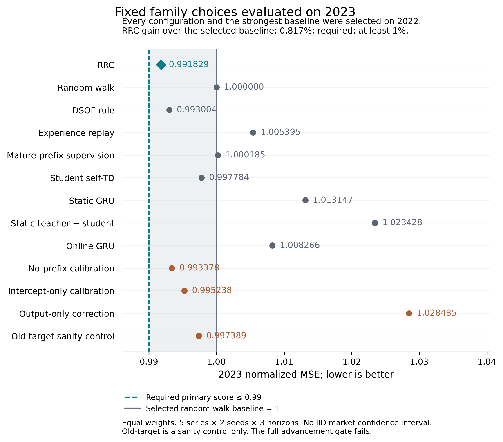

# RRC 冻结阶段结果：未通过晋级，保留新确认区

**本轮固定候选停止。** 按 2022 年选择配置、在 2023 年评价的预定程序，RRC 的总体相对 MSE 为 **0.9918290154**，随机游走为 1，改善 **0.817098%**，未达到至少 1% 的门槛。EEX 子序列相对 MSE 为 **1.0559489721**，仍高于随机游走。两个独立选择实现的所有选择与 gate 一致，逐预测指标核验通过。EEX 2024、2025 年没有用于模型选择、机制成绩检查或确认评分。[独立选择结果](results/D1/independent_selection/INDEPENDENT_SELECTION.json) · [失败决策证据](results/D1/report_artifacts/RRC_STOP_DECISION.json)

## 1. 本轮评价对象与冻结边界

本轮评价的是同骨干在线教师／学生系统中的 RRC 修订残差校准候选。RRC 主族固定为 full/linear 两种校准形式、两种正则参数、两种学生学习率，共 8 个设置；整体含 38 个配置，覆盖随机游走、静态/在线 GRU、ER、成熟部分监督、DSOF 学习路径、自身 TD，以及无前缀、截距、仅输出修正和错误旧目标等对照。表中的 DSOF 是 D1 共同骨干中的学习路径适配对照，不能直接解释为完整原作者方案的跨数据集性能结论。[D1 协议](provenance/D1_PROTOCOL.json) · [冻结实现](source/rrc_core.py)

2021 年用于在线学习预热。各模型族用 **2022 年**的等权分数选配置；指定基线族也先各自在 2022 年选，再仅用 2022 年选出总体最强基线。将所有选定身份原样用于 **2023 年**，禁止再按 2023 年挑选学习率、校准形式或基线族。2023 年承担本轮机制开发和晋级筛选，因此已经是开发证据，不能在后续论文中重新标为从未用于开发的最终独立测试集。[完整配置表](results/D1/ALL_CONFIGS.csv)

每个系列、年份、期限、种子先计算：

$$r_{m,y,h,s} = \frac{\operatorname{MSE}_{m,y,h,s}}{\operatorname{MSE}^{RW}_{m,y,h,s}}.$$

再对 5 条价格序列、2 个种子、h=1/5/20 三个期限等权平均，每个配置每年 30 格。先对每个种子评分，再平均分数；不先平均预测。所有期限使用共同的、完整 H20 且目标仍在同一年内的起点。h 表示未来观察到的报价记录步数，不是固定自然日。跨货币/市场的原价 MSE 不直接混合。[独立指标程序](source/independent_metric_audit.py)

## 2. 新增 EEX 数据及仍封存的确认区

本轮新增来源为 [EEX 官方 2012–2025 拍卖报表归档](https://www.eex.com/en/market-data/market-data-hub/environmentals/eex-eua-primary-auction-spot-download)。主序列只保留 T3PA EUA 成功拍卖结果，价格为同日按拍卖量加权的一级拍卖清算价；它不是二级市场连续收盘价，也不是期货结算价。旧无 Status 报表按追加冻结的正值、收入恒等式和无取消文字规则标为推断完成，而不伪造原表明确状态。[数据方法与许可](data_reproduction/EEX_DATA_METHODS_ZH.md)

| 分区 | 实际日期 | 日价格记录 | 原拍卖场次 | 本轮用途 |
|---|---|---:|---:|---|
| EEX 开发 | 2012-10-26—2023-12-18 | 2,255 | 2,269 | D1 开发与评分 |
| EEX 2024 | 2024-01-15—2024-12-16 | 213 | 213 | 仍封存，未用于模型评价 |
| EEX 2025 | 2025-01-07—2025-12-15 | 213 | 213 | 仍封存，未用于模型评价 |
| 新增合计 | — | **2,681** | **2,695** | 开发 2,255 日＋确认 426 日 |

D1 的 EEX 输入除历史归一化价格增量、已发生的日期间隔外，还使用过去已经公布的拍卖量、覆盖倍数、投标人数。未来实现的拍卖结果与未来实际间隔未作为已知输入。源文件保存了更完整字段，但保存字段不等于所有字段进入模型。[冻结特征实现](source/rrc_core.py)

数据准备者曾为按预先固定边界拆分、核验来源而机械解析 2024/2025 单元格；这些价格未向根研究者展示，也未用于模型评分。这里的“仍封存”指保持研究使用隔离，并非声称数据从未被计算机下载或解析。EEX 原始与派生报价均留在本地，公开包只含代码、元数据和聚合研究结果；不把其他来源的 CC BY 许可套到 EEX。[来源审计](data_reproduction/provenance/EEX_PREPARATION_AUDIT.json)

## 3. 五条价格序列 × 三个期限的 2023 年结果

以下所有 RRC 数值均来自同一个由 2022 年选出的 `full_a0p01_lr0p0003`。DSOF 同样固定为 2022 年选出的 `dsof_lr0p0003`。每个 h 格是两个种子的相对 MSE 平均；RW 每格等于 1。数值越低越好，N 是每个种子的完整 H20 起点数。[可复算表](results/D1/report_artifacts/selected_2023_series_horizon.csv)

| 价格序列 | N/种子 | RRC h1 | RRC h5 | RRC h20 | RRC 三期限平均 | 选定 DSOF 三期限平均 |
|---|---:|---:|---:|---:|---:|---:|
| EEX EUA 拍卖 | 195 | 0.988720 | 0.999169 | 1.179959 | 1.055949 | 1.057750 |
| 广州 | 222 | 0.930070 | 1.016006 | 1.107848 | 1.017975 | 1.013596 |
| 湖北 | 215 | 0.995302 | 0.966643 | 0.870294 | 0.944079 | 0.956846 |
| 上海 | 176 | 0.969381 | 0.946630 | 0.955804 | 0.957272 | 0.945876 |
| EU_REPORTED | 238 | 0.988866 | 0.948240 | 1.014504 | 0.983870 | 0.990954 |



**图 1.** 左：选定 RRC 的相对 MSE，1 为随机游走。右：选定 RRC 减选定 DSOF 的相对 MSE 差乘以 100，负值有利于 RRC。每格先按种子计算比率，再平均；未将种子当作独立市场构造误差条。EEX 与 EU_REPORTED 均连接同一 EU ETS 体系。矢量版：[SVG](results/D1/report_artifacts/figure_1_rrc_series_horizons.svg)、[PDF](results/D1/report_artifacts/figure_1_rrc_series_horizons.pdf)。

湖北、上海、EU_REPORTED 的系列平均优于随机游走，EEX 与广州没有。不能把“3/5 胜出”解释成五个独立市场中的显著多数；EEX 和 EU_REPORTED 的依赖关系必须保留。

## 4. 强对照与各族固定选择

各行配置均由 2022 年独立选择。总体基线也由 2022 年决定，为随机游走；不会因看见 2023 年其他配置更低而替换它。`old_target` 仅是错误目标的合理性检查，不计为创新证据。

| 模型族 | 2022 年选定配置 | 2022 选择分数 | 原配置 2023 分数 |
|---|---|---:|---:|
| RRC | `full_a0p01_lr0p0003` | 1.08836503 | 0.99182902 |
| 随机游走 | `rw` | 1.00000000 | 1.00000000 |
| DSOF 同骨干对照 | `dsof_lr0p0003` | 1.07730928 | 0.99300433 |
| 经验回放 ER | `er_lr0p0003` | 1.06441968 | 1.00539511 |
| 成熟部分监督 | `masked_lr0p0003` | 1.07534975 | 1.00018520 |
| 学生自身 TD | `self_td_lr0p0003` | 1.08311596 | 0.99778350 |
| 静态 GRU | `static_gru` | 1.00190833 | 1.01314678 |
| 静态教师＋学生 | `static_teacher_student` | 1.00876850 | 1.02342808 |
| 在线 GRU | `online_gru` | 1.03057535 | 1.00826634 |
| 无前缀校准 | `no_prefix_a0p1_lr0p0003` | 1.08906035 | 0.99337766 |
| 仅截距校准 | `intercept_a0p1_lr0p0003` | 1.09078150 | 0.99523789 |
| 仅输出修正 | `output_intercept_a0p1` | 1.22137212 | 1.02848507 |
| 错误旧目标诊断 | `old_target_a0p1_lr0p0003` | 1.09294688 | 0.99738947 |



**图 2.** 2022 年固定的各族配置在 2023 年的总体分数。实线为选定 RW 基线 1；虚线为本轮至少改善 1% 对应的 0.99。RRC 位于 0.99 与 1 之间，虽略低于 RW，仍未达到原定主条件。图中没有显著性误差条；该门槛是事前研究推进规则。矢量版：[SVG](results/D1/report_artifacts/figure_2_rrc_frozen_family_comparison.svg)、[PDF](results/D1/report_artifacts/figure_2_rrc_frozen_family_comparison.pdf)。

## 5. 匹配消融揭示的机制限制

晋级协议中的机制比较使用各消融族在 2022 年独立选出的配置。按这个规定，RRC 比选定无前缀和选定仅输出修正分别低 0.0015486445、0.0366560497，均超过 0.0001；这一项通过。

但是，**同 α、同学生学习率的无前缀版本和线性版本在 2023 年略优于选中的 full RRC**。因此，不能把前述通过扩大成前缀信息或交互项已得到稳健消融支持。以下固定匹配比较完整保留，正分差表示对照更差、RRC 更好，负分差表示对照更好。[完整匹配表](results/D1/independent_selection/MATCHED_ABLATIONS.csv)

| 与选中 RRC 的比较 | 对照配置 | 对照 2023 分数 | 对照 − RRC |
|---|---|---:|---:|
| 同模式、同 α 的仅输出修正 | `output_full_a0p01` | 1.09741966 | +0.10559064 |
| 同学生学习率的 DSOF | `dsof_lr0p0003` | 0.99300433 | +0.00117531 |
| 同 α、同学习率的线性校准 | `linear_a0p01_lr0p0003` | 0.99167988 | -0.00014914 |
| 同 α、同学习率的无前缀校准 | `no_prefix_a0p01_lr0p0003` | 0.99162719 | -0.00020183 |
| 同 α、同学习率的仅截距 | `intercept_a0p01_lr0p0003` | 0.99551640 | +0.00368739 |
| 错误旧目标诊断（α 不匹配） | `old_target_a0p1_lr0p0003` | 0.99738947 | +0.00556046 |

选中 RRC 的分数为 0.9918290154。严格匹配无前缀的优势约 0.000202、严格匹配线性的优势约 0.000149，幅度很小，也不是独立确认的效果。错误旧目标只有一个 α=0.1，与选中 RRC 的 α=0.01 不匹配；它的结果仅保留为诊断。未围绕这些已观察差异追加超参数或重新训练。

## 6. 晋级失败决定与两套独立实现核对

| 原定条件 | 结果 | 判定 |
|---|---|---|
| 相对 2022 年选定总体基线改善至少 1%，且分数 < 1 | 改善 0.817098%，低于 1% | 失败 |
| 至少 3/5 条价格序列优于该基线 | 湖北、上海、EU_REPORTED，共 3 条 | 通过 |
| 比 2022 年分别选定的无前缀、仅输出修正均好至少 0.0001 | 两个分差均满足 | 通过 |
| EEX 分数 < 1 且低于选定 DSOF | 1.0559489721，仍 > 1；虽略低于 DSOF | 失败 |
| 固定网格完整，所有结果有限 | 38 配置、2,280 格，无失败任务 | 通过 |

总体为 **停止该固定候选，不打开 EEX 确认区**。不把 1% 改成 0.8%，不删除 EEX 条件，不按 2023 年回选更有利的参数，也不把机制子条件通过改写为总体通过。[决策证据](results/D1/report_artifacts/RRC_STOP_DECISION.json)

根研究者与独立审核者分别实现选择规则，独立版本在读取任何 D1 数值、根选择源码或根选择输出前冻结。执行后逐项比较：73 项选择/gate/结构相等；489 项数值比较通过，最大绝对差 4.44e-16，仅为算术尾差。全部 13 个族内选择、总体基线、所有 gate、38 个配置的两年及各系列分数一致。[交叉核对回执](results/D1/report_artifacts/SELECTOR_AGREEMENT.json)

另一个不导入训练器或 PyTorch 的实现，从批准开发 CSV 和全部 380 份预测 NPZ 复算 2,280 个格，对局部/总体表及每个配置分数完成 32,300 次比较，全部通过。这个审核确认分数计算与预测文件一致，不增加关于创新或可发表性的统计保证。[逐预测审核](results/D1/INDEPENDENT_METRIC_AUDIT.json)

## 7. 实际执行数量与报告边界

| 执行类别 | D1 实际数量 |
|---|---:|
| 系列×种子任务 | 10 |
| 联合教师/学生离线拟合（两种 shrink） | 20 |
| 选定教师在线流 | 10 |
| 学生在线流 | 260 |
| 岭校准在线流 | 90 |
| 保存的配置预测系列 | 380 |
| 年份×期限×种子的指标格 | 2280 |
| 失败任务 | 0 |
| EEX 确认拟合 | 0 |

380 是 38 配置×10 任务的预测系列数，不能写成 380 次完整独立训练；多个配置共享教师路径和选定初始状态。计时运行与原作者实现锚定运行在主协议中另列，不混入 D1 计数。[完成回执](results/D1/COMPLETE.json)

本报告只交付冻结 RRC 阶段的结果。2023 年已经用于机制开发筛选，两个种子、三个期限和重叠标签不是独立重复市场；EEX/EU 相依，未采用 iid 跨市场置信区间或宣称显著性。现有结果没有证明达到发表标准，也没有把任何备用方案说成已经完成了实验。

## 8. 图表和报告复现

`source/make_rrc_results.py` 只读取 D1 公开聚合表、选择结果、完成回执和协议；不打开原始价格、逐点预测、源 ZIP 或确认文件。图 1、图 2 提供 SVG、300 dpi PNG 和嵌入字体 PDF；图中只含聚合误差。运行时记录版本与全部输入哈希，输出必须为新路径：

```bash
python3 -B source/make_rrc_results.py --study-root . --output results/D1/new_report_artifacts --report RESULTS_RRC_REPRODUCED_ZH.md
```

本次绘图环境为 Python 3.12.14、matplotlib 3.10.8、NumPy 2.3.5、Pillow 12.3.0；这是聚合绘图环境，模型训练的依赖版本仍以 D1 运行记录为准。没有为绘图重新安装或更改训练环境。[制图回执](results/D1/report_artifacts/FIGURES_RECEIPT.json)
