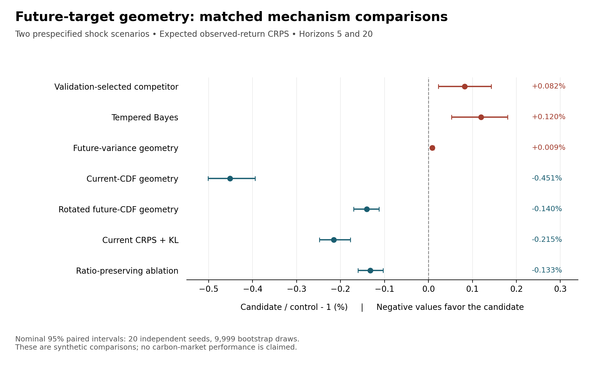
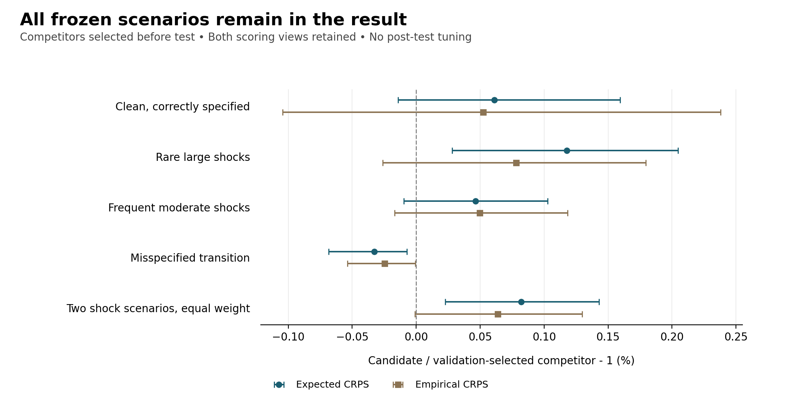

# 未来预测 CDF 几何过滤：恢复执行、完整实验与停止裁决

日期：2026-10-19。研究编号：forecast_geometry_filter_20261019c。状态：**正式合成实验及独立复算完成；STOP_FIXED_GEOMETRY_CANDIDATE；不进入市场阶段。**

## 1. 已完成什么，结论是什么

本轮接续此前因 CRPS+KL 对照的数值停滞而中断的合成资格实验。已恢复原上下文，保留失败现场，只修复一个线搜索的浮点算术问题，保持原模型、科学协议、种子、参数网格、切分、门槛和求解预算，完成正式实验、全测试轨迹独立核验、全验证前缀重放及文献近邻审查。

候选 future_cdf 在两个预列正场景中，相对验证集事先选定的最优对照，主指标为 **+0.082077%**，20 个独立种子配对 bootstrap 的名义 95% 区间为 **[+0.022619%, +0.142870%]**。这里使用“候选 CRPS / 对照 CRPS − 1”，所以正数表示候选更差。经验 CRPS 为 **+0.063945%**，区间 **[−0.000983%, +0.129653%]**；该区间跨零，不能称为经验分数显著更差。

原七项门槛通过四项、失败三项，裁决为停止当前固定候选。还有一项必须公开的协议局限：结果后独立计算发现，在本次固定历史与同一信息集下，即使知道真实生成分布，oracle 相对所选对照也最多改善 **0.559361%**，达不到原定 1% 总 CRPS 改善门槛。因此，未过 1% 本身不足以证明方法无价值。停止决定另有依据：候选主分数实际更差，区间在零上方，而且没有胜过未来方差几何和温度化 Bayes。

本轮完成的是一个具体方法假设的诚实检验与归档。**尚未得到达到投稿要求的碳价预测创新模型，也没有把这个失败包装成已完成的成功方法。** 这次不启动新市场拟合，不查看 2024+ 保留确认结果，不以事后改网格、删对照或换主指标继续挽救本候选。

依据：[正式汇总](results/synthetic/SUMMARY.json)、[逐场景逐种子结果](results/synthetic/SELECTED_RESULTS.csv)、[全部配对比较](results/synthetic/PAIRED_COMPARISONS.csv)、[独立结果解释](audits/INDEPENDENT_RESULT_INTERPRETATION_ZH.md)。

## 2. 恢复的是哪条工作线

此前工作目标是碳价预测中的模型或学习方法创新，需要真实执行、公平比较、文献查重和可复现交付。当前候选属于分布过滤方法的合成机制资格检验。此前已结束的 OHLC、分布更新和条件持续性候选保留原结果，不在本轮重算或改写。

本地前序快照 90b9fd6f2c7cfa72bf68049f58d585df997d48b9 的 Git tree，与已交付的 [Draft PR #23](https://github.com/124-creator/carbon-forecast-model-research/pull/23) 远端提交 434c8e6430e57c0d55272dedfad32fbacf7180e1 的 tree 完全一致。本研究在该前序上追加独立目录。历史协议冻结、失败归档和修复后冻结均保留；远端上传是事后交付，不声称构成外部事前注册。

| 阶段 | 本地冻结或证据 |
|---|---|
| 初次科学协议冻结 | aa93b2bf81b2f49fc87050674b4753aaf1b4dd87 |
| 原失败现场独立归档 | 6d47f1c104e94b1b7f910249a3b8c2c31c1f055d |
| 审查后修复冻结，早于恢复正式运行 | 51ce5582c3b747f4829432c1fbb8f5e114969318 |
| 实际正式运行记录 | results/synthetic/START.json 与 COMPLETE.json |
| 原冻结与修复冻结 | provenance/ORIGINAL_SOURCE_FREEZE.json 与 SOURCE_FREEZE.json |

这些是历史本地提交号；通过 GitHub API 重建交付时，提交的父对象和上传时间不同，远端提交号会不同。对应文件树可逐字节核验，不能把远端上传时间改写为先前冻结时间。

依据：[恢复记录](provenance/RECOVERY_CONTEXT_ZH.json)、[失败收据](attempts/01_kl_dual_stagnation/FAILURE_RECEIPT.json)、[正式开始记录](results/synthetic/START.json)。

## 3. 候选方法的精确定义

### 3.1 目标与状态

生成过程是已知的四状态 HMM，由慢、快两个二状态因子组成。名义慢持续性为 0.97，快持续性为 0.1，平稳状态概率均为 1/4，四个零均值观测分布的方差是 0.16、0.64、0.64、2.56。模型参数不从这批数据中训练。

在时刻 t，先按名义转移矩阵传播得到先验 \(p_t=q_{t-1}P\)，看到当前观测 \(y_t\) 后更新权重 \(q_t\)。未来目标是

\[
Y_{t,h}=\frac{1}{\sqrt h}\sum_{j=1}^{h}y_{t+j},
\qquad h\in\{1,5,20\}.
\]

每一步未来观测之前先转移状态；目标严格从 t+1 开始。候选和可部署对照使用相同的名义未来分布。真实 oracle 则使用实际场景生成规律，包括未来冲击，是条件分数下界诊断，不能当作可部署模型。

### 3.2 当前 CRPS 损失与未来分布度量

当 \(\eta>0\)，候选解下面的单纯形约束凸问题：

\[
q_t=\underset{q\in\Delta_4}{\arg\min}
\left\{
\operatorname{CRPS}\!\left(\sum_i q_i E_i,y_t\right)
+\frac{1}{\eta}\left[
(q-p_t)^\top\widetilde G_H(q-p_t)
+0.01\sum_i\frac{(q_i-p_{t,i})^2}{p_{t,i}}
\right]\right\}.
\]

当 \(\eta=0\) 时严格设 \(q_t=p_t\)。\(E_i\) 是当前观测的固定状态分布，\(\widetilde G_H\) 来自 h=5、20 两个未来累计预测 CDF 的等权平方距离。矩阵先使用状态 CDF 对比进行中心化，再按
\(\operatorname{tr}[(\operatorname{diag}\pi-\pi\pi^\top)G_H]\)
归一化；在单纯形切空间上有

\[
(q-p)^\top G_H(q-p)
=\frac12\sum_{h\in\{5,20\}}\int
\left[F_{h,q}(z)-F_{h,p}(z)\right]^2 dz.
\]

这一步只指定如何限制权重改变：当前损失衡量已见观测，未来度量衡量该更新会怎样改变指定期限的预测边际。它不是对尚未观察到的未来标签进行训练。固定模型和期限下，未来 Gram 固定；先验相关的 χ² 项随过滤递归变化。多期限边际分数之和也不等于完整路径联合分布的严格评分。

这里的当前混合 CRPS 是权重的二次函数，χ² 项在内部先验下提供正曲率，因此更新可用有限活动面枚举的严格凸 QP 求解。唯一解和活动集求解是数值资格，不能作为新优化理论。两个当前观测分布相同的状态仍可能因未来作用不同而改变赔率；候选权重不能解释成真实潜在状态的精确后验。

依据：[完整数学推导](methods/GEOMETRY_DERIVATION_ZH.md)及[归一化方差文字勘误](methods/FROZEN_TEXT_ERRATA_ZH.md)、[生产核心](source/geometry_filter.py)、[冻结协议](provenance/SYNTHETIC_PROTOCOL.json)。

## 4. 冻结实验如何防止事后选择

### 4.1 场景、信息与切分

| 场景 | 实际规律相对名义模型的变化 | 原定角色 |
|---|---|---|
| clean_correct | 无冲击，转移正确 | 正确设定、oracle 一致性与无免费午餐对照 |
| rare_large_shocks | 每期 5% 概率加独立正态冲击，标准差 4 | 预列正场景 |
| frequent_moderate_shocks | 每期 10% 概率加独立正态冲击，标准差 2 | 预列正场景 |
| wrong_transition_geometry | 真实慢持续性 0.6，名义仍为 0.97；无冲击 | 转移几何错设诊断 |

种子固定为 1000–1019。四个场景共用相应随机数以支持配对；因此有 80 条场景—种子序列，但只有 **20 个独立随机种子**。每条序列生成 1,703 个观测。

用零基索引表示：前 128 个位置为 burn-in；验证预测原点为 128–639，共 512 个，最远标签到 659。第一次测试预测在观察 659 后发出，测试标签从 660 开始；测试原点为 659–1682，共 1,024 个，最远标签到 1702。选择只使用验证段 h=1、5、20 的经验 CRPS 均值。验证用过的最后观测可进入首次测试的历史信息，未来测试标签没有进入选择。

主测试指标是已知实际生成过程条件下 h=5、20 的 expected CRPS 均值；它对未来随机性作解析积分，减少 realized score 的额外噪声。这里仍有不同历史之间的模拟不确定性。经验 CRPS 作为另一个预定检查保留，不能与主指标混称。

### 4.2 同预算机制对照

| 家族 | 要隔离的解释 | 冻结参数 |
|---|---|---|
| future_cdf | 完整未来 CDF 几何候选 | η 网格 |
| current_cdf | 当前分布几何是否已经足够 | η 网格 |
| future_variance | 未来二阶矩方向是否已经足够 | η 网格 |
| probability_euclidean | 概率空间一般二次惩罚 | η 网格 |
| rotated_future_cdf | 预列同谱旋转后几何方向 | η 网格 |
| chi_square_only | 先验加权 χ² 正则本身 | η 网格 |
| crps_kl | 对完整混合分布评分，加 KL 近端项 | η 网格 |
| tempered_bayes | 简单似然温度带来的稳健化 | β 网格 |
| contaminated_bayes | 显式污染观测似然 | ε 网格 |
| future_cdf_ratio_preserving | 保留当前观测等价状态的先验赔率 | η 网格 |

η = [0, 0.001, 0.01, 0.1, 1, 10, 100]；β = [0, 0.1, 0.3, 0.6, 1, 1.5, 2]；ε = [0, 0.005, 0.01, 0.025, 0.05, 0.1, 0.2]。每个家族均为七个值。另有不调参的 nominal_bayes、fixed_prior 和 true_oracle。

“验证集预选对照”是在八个合格控制家族中按验证分数选优，排除候选和赔率保持消融。它不是用测试分数事后选择最强对照。污染 Bayes 的加性冲击方差固定为 16，因此在中等冲击场景中存在规模错设；候选和所有非 oracle 方法又共享名义未来密度。这是本次对照的适用范围，不能宣称已经击败所有正确指定的污染过滤器。

统计汇总先在同一个 seed 内等权平均两个正场景的分数比，再在 20 个 seed 上求平均；并按固定 seed 20261019 重采样 9,999 次得到百分位区间。重叠预测期限、同序列原点以及共享种子的场景均不另算独立样本。其他机制比较的区间是名义诊断区间，没有做跨全部比较的家族错误率校正。

依据：[正式 runner](source/run_synthetic.py)、[全部验证配置](results/synthetic/TRIAL_VALIDATION.csv)、[选择与标签隔离复查](audits/RECOVERY_PIPELINE_AUDIT_ZH.md)。

## 5. 实际执行量与完整结果

### 5.1 实际执行量

| 项目 | 正式运行数量 |
|---|---:|
| 独立随机种子 | 20 |
| 场景—种子序列 | 80 |
| 模拟观测 | 136,240 |
| 验证过滤配置 | 5,600 |
| 验证递归分析更新 | 3,690,400 |
| 选中家族的测试流 | 800 |
| 加 nominal、fixed prior、oracle 后的结果记录 | 1,040 |
| 含 nominal Bayes 的测试递归分析更新 | 901,120 |
| 正式单纯形 QP 求解行 | 2,725,216 |
| 正式正步长 CRPS+KL 求解行 | 386,976 |
| 新增神经网络拟合 | **0** |
| 新增观测或转移参数拟合 | **0** |

正式运行耗时 87.523 秒，为本次固定机器上的观测值，不是跨平台速度基准。修复资格检查和后续重放是重复核验，不计为更多模型训练、新实验种子或独立确认样本。过滤在线更新有真实执行，但不能把配置数写成“训练了 5,600 个深度模型”。

依据：[SUMMARY.json](results/synthetic/SUMMARY.json)、[COMPLETE.json](results/synthetic/COMPLETE.json)、[完整执行日志](results/synthetic/EXECUTION.log)。

### 5.2 两个正场景的主比较

下表单位均为百分比，负数对候选有利。区间在 20 个独立种子上配对；胜出单元数按两个场景 × 20 个种子列示，仅作描述。

| 对照 | 候选相对 expected CRPS | 名义 95% 区间 | 候选胜出 / 40 |
|---|---:|---:|---:|
| 验证集预选对照 | **+0.082077%** | **[+0.022619%, +0.142870%]** | 13 |
| 当前 CDF 几何 | −0.451459% | [−0.501380%, −0.393969%] | 39 |
| 未来方差几何 | **+0.008911%** | [+0.005957%, +0.012459%] | 1 |
| 概率欧氏几何 | −0.184912% | [−0.230833%, −0.145953%] | 38 |
| 同谱旋转未来几何 | −0.139992% | [−0.170440%, −0.112641%] | 39 |
| 仅 χ² 项 | −0.112780% | [−0.150797%, −0.077361%] | 36 |
| 原生完整混合 CRPS+KL | −0.215250% | [−0.247784%, −0.177478%] | 38 |
| 温度化 Bayes | **+0.119871%** | [+0.052528%, +0.179852%] | 9 |
| 污染 Bayes | −0.136469% | [−0.212241%, −0.076963%] | 35 |
| 赔率保持消融 | −0.132574% | [−0.160322%, −0.103320%] | 36 |
| 名义 Bayes | −0.049512% | [−0.080009%, −0.019079%] | 33 |
| 固定先验 | −0.835035% | [−0.949573%, −0.714665%] | 39 |
| 真实 oracle | +0.645622% | [+0.619394%, +0.673750%] | 0 |

局部证据确实存在：未来方向优于当前 CDF、同谱旋转和赔率保持限制。但完整 CDF 对未来方差控制的差异是反方向；40 个单元中有 39 个未来方差更好。这个差异数值很小，仍足以表明本轮没有给出完整 CDF 超出预列二阶矩方向的额外价值证据。温度化 Bayes 和预选对照也更好，故不能只展示有利基线。

### 5.3 各场景相对验证预选对照

| 范围 | Expected CRPS 相对值 | 名义 95% 区间 |
|---|---:|---:|
| 干净正确设定 | +0.061004% | [−0.014003%, +0.159462%] |
| 稀有大冲击 | +0.117787% | [+0.028268%, +0.204783%] |
| 频繁中等冲击 | +0.046367% | [−0.009657%, +0.102671%] |
| 转移几何错设 | −0.032867% | [−0.068367%, −0.007385%] |
| 两个预列正场景等权 | +0.082077% | [+0.022619%, +0.142870%] |

转移错设场景出现小幅有利结果，但它是一个固定诊断，不能替代预列正场景的主比较。正场景经验 CRPS 的均值为 +0.063945%，区间跨零；这只支持“没有通过预定均值改善检查”，不支持经验层面显著劣于对照的说法。

依据：[全部 130 个比较](results/synthetic/PAIRED_COMPARISONS.csv)、[图表生成代码](source/make_figures.py)。

## 6. 原门槛、可改善空间与最终裁决

### 6.1 按原协议逐项裁决

| 原检查 | 实际值 | 结果 |
|---|---|---|
| 正场景相对预选对照 expected CRPS 改善至少 1% | +0.082077%，要求 ≤ −1% | 失败 |
| 主比较名义 95% 区间上端小于 0 | +0.142870% | 失败 |
| 两个正场景分别胜过 current_cdf | −0.485072%、−0.417846% | 通过 |
| 正场景胜过预列旋转度量 | −0.139992% | 通过 |
| 正场景经验 CRPS 均值改善 | +0.063945% | 失败 |
| 干净场景非劣界为 0.5% | +0.061004% | 通过 |
| 数值与因果资格 | 正式检查及后续独立复算通过 | 通过 |

所有检查均为必要条件；没有改变比较式或重新选择成功阈值。原始 SUMMARY 保持原样，其中数值门明确写有“最终独立重放仍另需完成”的执行时说明；后续审计文件和 FINAL_EXECUTION_AUDIT 记录其现已完成，不回写历史收据。

### 6.2 原 1% 总 CRPS 门槛存在可达性缺陷

结果解释复核新增一个**结果后的解析诊断**，没有新模拟、调参或选模型：

\[
r_{\mathrm{oracle},s}
=\frac{\operatorname{ECRPS}_{\mathrm{true\ conditional},s}}
{\operatorname{ECRPS}_{\mathrm{validation\ selected},s}}-1.
\]

这里 ECRPS 表示条件 expected CRPS，s 表示场景—种子单元；不是 realized CRPS 的样本下界。逐种子计算再按原相同方式汇总，得到：

| 范围 | oracle 相对验证预选对照 |
|---|---:|
| 稀有大冲击 | −0.773022% |
| 频繁中等冲击 | −0.345701% |
| 两个正场景等权 | **−0.559361%** |

真实条件分布在给定观测历史下最小化 expected CRPS。所以上述值说明：在本次这些实际历史、同一信息集、同一平均比率和所选对照下，可改善空间最多约 0.559361%，连 oracle 也不能达到 1%。这不是关于所有可能样本、其他模型信息集或真实市场的普遍上限。

原方案把不可约的未来随机性计入总 CRPS，却在冻结前没有检查该尺度上资源门槛的可达性。因此不能把单独未过 1% 写成模型无价值或不可能发表的证明。发现之后仍保留原门槛与 STOP，以免利用测试结果改成功标准；后续新研究应在独立设计阶段先检查 oracle 可改善空间，再冻结新协议。

**停止当前候选仍有不依赖该门槛的实证依据。** 候选实际 expected CRPS 相对预选对照更差，名义区间整个在零上方，且完整未来 CDF 没有胜过未来方差和温度化 Bayes。经验分数也未达到预定均值改善条件。这些结果未因门槛缺陷而消失。

依据：[独立解释复核](audits/INDEPENDENT_RESULT_INTERPRETATION_ZH.md)、[可改善空间明细](results/ORACLE_HEADROOM_POSTHOC.json)、[最终机器可读裁决](results/FINAL_DECISION.json)。

## 7. 数值失败怎样修复，是否放宽了要求

原失败发生在干净场景的验证前缀，尚未完成任何场景的选择和测试评分。原 CRPS+KL 对偶 Newton 例程在梯度约 1.4754×10⁻¹² 时停滞，略高于原要求 10⁻¹²。

诊断表明，接近最优点时真实目标下降量很小，两个绝对对偶目标值相减发生浮点抵消。在该失败输入上，80 位精度算得完整 Newton 步的目标变化约 −1.2932×10⁻²⁴；binary64 却得到约 +2.0781×10⁻¹⁵，超过旧实现约 1.7764×10⁻¹⁵ 的允许量。该步本可把梯度降到约 7.36×10⁻¹⁸。

修复仅在 update_crps_kl 内，将线搜索验收从“两个舍入后绝对目标值之差”改为对偶梯度残差平方
\(M=\|g\|^2/2\)
的 Armijo 检查。Newton 方程仍为 \(Hd=-g\)，因此沿该方向 \(M'=-\|g\|^2\)；H 正定时该残差准则的驻点与原梯度为零等价。原 CRPS+KL 目标、梯度、Hessian、Newton 方向、10⁻¹² 容差、100 次 Newton 上限、50 次回溯上限和零步长行为全部保留。

修复后的原始 140 行输入全部通过；其中 120 行正步长用独立 80 位精度的原始 primal log-odds 方程验证，最大权重差约 4.6242×10⁻¹³。正式运行的 386,976 行正步长 KL 全部收敛，最多 8 次 Newton；QP 没有负坐标裁剪修复或优化结果再归一化。名义 Markov 传播中已有的质量舍入归一化另行计数，最大质量误差约 1.78×10⁻¹⁵，不能误写成所有环节绝无浮点归一化。

原 source、原协议、原日志和失败收据在 attempts/01_kl_dual_stagnation/ 完整保留。修复资格阶段又执行了 5,600 条不评分的验证过滤流，目的仅为排除其他数值中断；它们不是另一次性能实验。

依据：[修复报告](audits/SOLVER_REPAIR_REPORT_ZH.md)、[源码差异](audits/solver_repair_source.diff)、[高精度与全前缀诊断](audits/SOLVER_REPAIR_DIAGNOSTIC.json)。

## 8. 独立审查覆盖了什么，还有什么边界

### 8.1 恢复运行前

原 core 审查和 runner 审查在修复后的源代码上重新执行，并写到单独的恢复收据，保留原收据字节。恢复管线审查核查转移先后、标签边界、网格、公平预算、oracle、几何归一化、原始目标及冻结哈希。修复后的 19 个关键文件在正式恢复前再次冻结。

### 8.2 全测试轨迹重算

独立脚本 independent_trace_replay.py 在正式恢复评分前已写入 SOURCE_FREEZE。它不导入生产核心或 runner，而用矩阵多项式的 Fourier 反演重建未来奖励分布，使用 erf 形式的绝对正态矩和直接未来标签切片复算分数，独立重建 oracle，并核查原始约束目标的 KKT 条件。

实际比对 6,389,760 个分数值，包括普通预测与 oracle 的 expected / empirical CRPS；这不是独立样本数。共核查 901,120 行测试递归更新，其中正步长 QP KKT 510,976 行、KL KKT 70,656 行。QP 最大原始 KKT 残差约 6.26×10⁻¹³，KL 约 3.73×10⁻¹³；所有独立分数的最大差不超过 1.78×10⁻¹⁴。全部 1,040 行汇总、130 个比较、20-seed 配对统计、固定 bootstrap 与门槛一致。

Fourier 重建有不超过约 5.02×10⁻¹⁶ 的负系数舍入量，脚本显式记录并仅在该独立分布重建中置零。它不修改生产权重或原结果，不能把该处理隐去。

### 8.3 全验证前缀重放

另一个审查脚本重建全部 5,600 配置、3,690,400 次验证前缀更新，检查 52,800 个生成观测、16,800 个原算式验证分数、800 个家族选择、80 个综合对照选择及首次测试先验。原算式的分数和选择逐位一致；另用 Fourier / erf 路径验证全部 16,800 个分数，最大差约 1.11×10⁻¹⁵。

该审查复用生产更新和传播以核验确定性递归；原始目标的数学正确性另由 core 与测试 KKT 审查承担。该脚本在正式运行期间开始设计、在打开具体结果文件之前封存，但封存前审查者已获知总体 STOP。因此它不冒充事前冻结或完全盲审，固定核验准则没有按分数调整。

解释复核则直接从 CSV 再算全部 130 个均值、种子相对值与 bootstrap，两端差均为零。参与解释复核的审查者此前也参与了求解器修复，明确披露这一角色交叉。上述“独立”指实现路径和复算职责的独立，不等于外部机构认证。

依据：[恢复管线](audits/RECOVERY_PIPELINE_AUDIT.json)、[测试独立重算](audits/INDEPENDENT_TRACE_REPLAY.json)、[验证前缀重放](audits/INDEPENDENT_PREFIX_REPLAY_ZH.md)、[解释复核](audits/INDEPENDENT_RESULT_INTERPRETATION_ZH.md)。

## 9. 与直接文献近邻相比，还能主张什么

近邻补查核实原列八篇文献并扩展至十五项原始来源，区分正式出版、早期已接受版本、预印本与投稿状态，同时注明本次只读摘要或实际审阅方法段的边界。没有用不同论文的数据集成绩做横向数值排名。

**CRPS 诱导几何已有明确公式。** NGBoost 的 ICML 2020 官方论文 §3.2、Equation (11) 给出
\(I_C(\theta)=2\int\nabla_\theta F_\theta(z)\nabla_\theta F_\theta(z)^\top dz\)。
在固定混合族的权重切空间，代入未来 CDF 就得到本轮未来 Gram 的两倍。因此 Gram、CRPS 拉回度量和自然梯度方向不是本轮新理论。NGBoost 的实际 boosting 算法与这里的递归 QP 仍不同，不能由度量一致推出完整算法等价。[NGBoost 原文](https://proceedings.mlr.press/v119/duan20a/duan20a.pdf)

**可预测矩阵与隐式 proper-score 更新已有框架。** Proper-score observation-driven filters、PRADA 与 ISD 都限制了“新过滤原理”的主张。本轮内部解可精确写成可预测矩阵乘当前 CRPS 梯度；但边界活动约束由当前观测决定，因此不能把全部边界轨迹直接等同于无约束更新，更不能自动继承局部稳定、收缩或渐近定理。[Proper-score filters v3](https://arxiv.org/html/2608.02828v3)

**CDF 稳健过滤和先混合再评分也已有专门研究。** Robust CDF-Filtering 使用当前残差 CDF 更新位置参数；Predictively Oriented Posteriors 在模型平均后的预测分布上施加 proper score 并加 KL 约束，已区分“分量分数平均”和“混合分布分数”。因此原生完整混合 CRPS+KL 是必要基线，这种目标区别不能包装成本项目发现。[Robust CDF-Filtering](https://onlinelibrary.wiley.com/doi/10.1111/jtsa.70026)、[PrO v3](https://arxiv.org/html/2510.01915v3)

可保留的方法问题很具体：**当前观测损失与未来预测目标使用不同几何，是否带来超过简单稳健化和低阶未来特征的增量。** 本次没有找到逐项相同的完整算法，但这不证明无人做过，也不等于创新已获认证。成熟框架中的方法设计仍可能有论文价值，前提是非冗余设计和匹配证据成立；本轮完整未来 CDF 没有胜过未来方差及温度化 Bayes，尚不支持据此组织成功方法论文。

依据：[补充文献审查及十五项来源](literature/RECOVERY_LITERATURE_AUDIT_ZH.md)。检索截止 2026-10-19，本轮没有穷尽全部文献。

## 10. 交付、复现和接续边界

本目录包含协议、数学推导、生产代码、失败现场、修复差异、每个验证配置、逐种子结果、图表代码、独立审计代码与收据。四个完整 NPZ 轨迹只含本轮生成的合成数据和预测，另放入纯合成复现包；其 SHA-256 和字节数已在 COMPLETE.json 中冻结。GitHub 代码与汇总结果足以重新生成全部轨迹，压缩包便于直接重算保存的原轨迹。

运行版本为 Python 3.12.14、NumPy 2.3.5、SciPy 1.17.0；高精度诊断使用 mpmath 1.3.0，作图使用 Matplotlib 3.10.8。正式运行限制 OMP、OpenBLAS、MKL 线程为 1。不同硬件和数学库可能有浮点差异，原轨迹可按 SHA 核验，独立重算按审计文件明示的数值阈值核验。首次失败、修复资格、正式性能实验和重复审查在目录与计数上分别记录。

按 [复现说明](REPRODUCE_ZH.md) 在新输出目录执行，避免覆盖历史收据。后续接续直接读取 [上下文接续记录](HANDOFF_CONTINUATION_ZH.md) 和本报告，无须重新猜测中断点。

项目的最终研究目标仍是有实证支持的碳价预测方法创新；本轮没有达到这一终点。当前冻结候选已结束，后续工作若另行开展，应先修正新协议的可改善空间设计，再提出具有不同机制且可辨识的新假设。既有主门槛、失败记录和保留确认集状态不得随之回写。

此前两份包含真实市场数据、权重和预测的历史完整归档，额外文件保存曾被自动审批拒绝；本轮未重试，也不将它们混入纯合成包。此前已完成的 GitHub 交付保留。此次核实仓库为 public，新增内容仅为当前合成研究及其报告，不新增原始市场价格。

**最终状态：当前合成资格任务已完成；当前候选停止；市场阶段未启动；方法创新成功与投稿就绪均未声称。**

