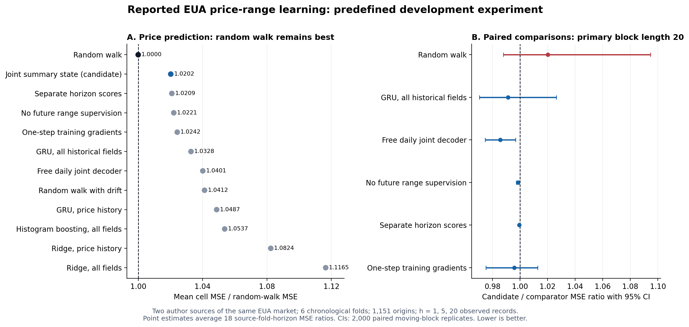
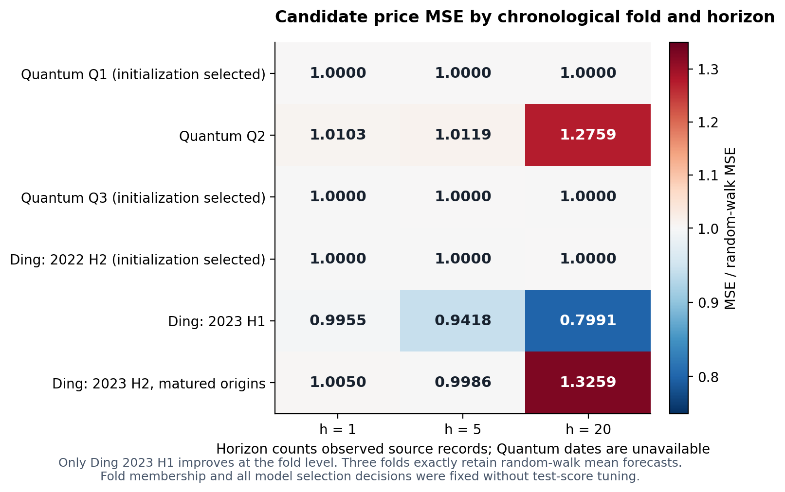

# 碳价格实验接续报告：报告价格—累计范围联合学习

日期：2026-10-19（北京时间；运行记录使用 UTC 2026-10-18）。

## 一、结论与交付状态

**本轮已完成方向核查、协议冻结、全部预定模型与消融、独立评分和权重重放。所检验的候选没有达到价格预测目标，应停止这一具体实现。** 这是一轮完成的开发实验，不是“已找到成功的模型创新”。

完整候选 `summary_state` 的主指标为 **1.020229**；RW 归一化为1，越低越好。因此其平均单元相对MSE比RW高 **2.02%**。主配对移动块95%区间为 **[0.987905,1.094544]**，没有提供优于RW的统计证据，也不能据此宣布它显著劣于RW。所有非RW对照的总体点估计也都高于1。

候选相对更自由的联合路径解码器有1.43%的平均单元误差改善；相对移除未来范围监督的同结构模型只有0.156%的改善。后者虽在本次条件bootstrap中区间低于1，但小于事先要求的1%幅度，且完整模型仍未胜RW。不能将这种局部比较提升为原目标成功。

最终机器判定为 `STOP_CANDIDATE_NO_RESCUE`。未据测试结果重选期限、种子、数据段或模型参数；没有打开旧EEX 2024–2025确认集。两份作者数据的许可、合约及字段语义限制同样仍然有效。

图1：左图是全部模型的18个来源×时间折×期限误差比均值；右图是完整候选相对各对照的配对比较。点预测图不把微小差距解释为统计胜出。

## 二、如何接续上一个实验

已读取用户交接文本，核对仓库实际分支和结果。接续基点为 `4cc0919a749e5263bba717f4bfdbafb26a3df77c`，对应[上一轮拍卖价格研究 PR #20](https://github.com/124-creator/carbon-forecast-model-research/pull/20)。[既往审计](audits/PRIOR_AUDIT_ZH.md)记录了已尝试的多期限、残差、时钟、跨市场、概率形状、价格过滤和拍卖约束方向，避免换名称重做。

旧FDMC在其自己的拍卖任务上，MSE/RW为1.004985，原先推进门槛全部失败；其较小误差不能与本轮1.020229直接比较高低，因为来源、时期、起点和评价任务不同。旧研究中“竞价中位数”也未被认证为同一合约的二级市场成交锚点，不能用它补造新的市场约束。[旧完整报告](../auction_clearing_innovation_20261018/REPORT_ZH.md)

本轮独立目录只新增研究材料，不修改旧研究的结果表或底层文件。新的研究问题从一般模型容量转向：**可额外取得的报告高低价，是否通过特定联合学习方式增加未来报告价格均值的预测价值？** 这个问题被实际实现并检验，但尚未得到满足既定门槛的肯定答案。

## 三、近期文献对方向选择的约束

[完整碳价文献核查](LITERATURE_ZH.md)列出2022–2026十篇高相关工作，分别标明实际读到正文、仅核出版社/机构摘要、以及实际检查作者文件的证据等级；不将有仓库链接等同于端到端复现。

| 研究脉络 | 已核文献及内容 | 对本项目的含义 |
|---|---|---|
| 实时分解与因果网络 | Li等，Applied Energy 2023，实时分解+CTCN+分组选择；Zhang等，Energies 2024，滑动分解+GRU，明确讨论泄漏。[1–2] | “避免全样本分解泄漏”已有直接研究；正确评估是必要条件，不能单独当模型创新。 |
| OHLC与区间结构 | Huang等，Energy Economics 2024，模型驱动多模态OHLC；Financial Innovation 2024给出显式约束变换与逆变换。[3–4] | 保证高低排序、位置变换及逆变换处理本身并非空白。硬OHLC路线先要通过字段认证。 |
| 多任务与形状损失 | Liu等，Mathematics 2025，TFT高低价多任务和文本/搜索数据；Niu等，HSSC 2025，SVMD/LSTM与既有DILATE。[5–6] | 不能将多任务或已有形状损失直接改名。实测高低价范围也不等于概率预测区间。 |
| 宏观、金融和文本信息 | Bastianin等2026版本的碳价BVAR/因子实验，短期RW难胜，部分中长期改善但DM不拒绝；Ewald与Li的JoF 2026研究采用260个周观测、54个12周预测，并明确区分带未来外生变量的条件ARIMAX。[7–8] | 须检查真实信息可用性、重叠预测和RW，而非只看百分比提升。大模型与多变量不自动带来稳定增益。 |

进一步核到五项直接方法近邻，详见[直接近邻审查](DIRECT_NEIGHBORS_ZH.md)：MQF2已做多期限联合分布/ES学习；JMLR 2024已有条件生成网络的评分规则估计；CLOVER已有一致样本与端到端评分；PNAS 2026已有共享随机转移、展开轨迹和多步ES；ASCMO 2025明确给出变换评分并包含min/max。[9–13]

因此，本轮只检验一项有限实证主张：在当前报告价格/范围语义下，低维动态与累计范围联合监督是否提高价格均值精度。**没有依据声称新的通用概率学习原理、完整路径分布识别或真实市场状态识别。**

## 四、数据审计改变了模型约束

| 来源 | 原始入模记录 | 处理与限制 |
|---|---:|---|
| Quantum-LSTM作者数据 | 1,805 | 从1,801个重叠窗口恢复一个有序序列，43,200项窗口重叠检查和1,800项标签对齐检查通过；CSV没有日历日期。 |
| Ding/Liu作者数据 | 772 | 2021-01-04—2023-12-29；日期唯一且有序；2024行在数值转换前排除。未使用新闻、搜索、情绪或宏观字段。 |
| 全国CEA官方档案 | 414份日报，仅审计 | 后两年档案不完整；第三方数据库有漏解析导致的伪零值；2023年综合价格口径变更。不进入主实验。 |

两份主输入均属于作者所述EUA序列，不能算两个独立市场。Quantum的Price有 **1,025/1,805** 条落在报告[Low,High]外；Ding有 **2/772** 条。它们全部保留原值；没有强行移动Price、改动高低价或删除不合结构的行。该发现足以否决把这些字段一概作为同一session真实成交OHLC的假设，但并不能单凭越界比例断定每条记录都是错误。

本轮将P明确称为“报告价格”。只用精确坐标

\[
d=\log(\sqrt{HL}/P),\qquad q=\tfrac12\log(H/L)\ge0
\]

还原报告高低价。H=P exp(d+q)、L=P exp(d−q)，不要求P在范围内。未来目标为 P的终点以及未来窗口报告高低价的累计max/min，不能替换成一条已认证的日内成交路径。

Quantum不伪造日期，其h=1/5/20仅指未来记录条数。不同来源不拼接，不自行认证连续合约、换月、币种和成交量单位。CEA实际可得源页、访问失败、六条源文对照及数据接触历史均在[数据审计](provenance/DATA_AUDIT_ZH.md)中公开说明。作者文件和派生逐行序列不重新发布到公共GitHub。

## 五、固定实验设计和真实执行量

三个Quantum索引段、三个Ding半年段组成六折扩展窗口评估，共1,151个不同起点、3,453个相关的价格预测目标。三个h不能当作独立样本。每折有此前100个验证起点；选择训练、验证、最终训练之间按照h=20留足成熟间隔。所有训练标签严格早于对应首次预测起点；每折参数固定，之后仅更新可用历史输入。

完整候选使用GRU16编码，13个参数形成低维AR状态及价格/范围条件响应，共 **1,773个参数**。Point GRU为1,603个参数，FreePath为4,612个参数。FreePath保留完整联合未来样本和同样的累计max/min损失，较独立端点头更直接地竞争候选；但它的common-factor协方差不是候选AR协方差的严格超集，不能把相对胜出解释成唯一机制识别。

所有神经模型各两种学习率、同样的30轮上限和5轮早停耐心；仅验证段选择。最终seed17/29/43从头训练，主分数先平均三个解析均值再算MSE，不挑最佳测试seed。价格均值有解析表达式，因此主MSE不含有限模拟均值产生的额外方差项。辅助ES采用32训练/128评估Sobol节点，明确为有限经验分布的V统计。

| 执行项目 | 实际完成量 |
|---|---:|
| 数据折×模型任务 | 72 / 72 |
| 神经模型选择拟合 | 84 |
| 最终神经模型构建 | 126 |
| 最终构建中实际发生梯度更新 | 63 |
| 最终构建中按验证选择第0轮 | 63 |
| 总计有梯度更新的神经拟合 | **147** |
| 正式神经优化步 | **16,986** |
| 经典回归器拟合 | **114** |
| 独立保存的预测文件 | 156 |
| 单独记录的合成预检 | 16次拟合、2,400步，不混入正式数量 |

第0轮并不是训练崩溃或遗漏：协议允许验证选择初始RW均值；这些最终模型不计入有梯度的拟合数。完整候选六折选中轮数为0、15、0、0、3、2。选择阶段仍实际训练并比较了后续轮数。

[冻结协议](PROTOCOL_ZH.md)、[方法精确定义](METHOD_ZH.md)、[完整训练收据](results/TRAINING_RECEIPTS.json)和[执行账目](results/EXECUTION_RECEIPT.json)可逐项核验。模型/特征/runner的联合SHA-256为 `ddc3c8ef45abf6e6afe3fe3a0d4a6b35018ca2ac82d33d378d001da8753bfdd8`。本地冻结提交为 `469d6a162ee4cbe778c98a7acfad540733bb73ae`；实验完成后再上传协议快照和结果，不冒称外部独立预注册。

## 六、全部主价格结果

R的定义是：每个来源×折×h先算模型MSE/RW MSE，再等权平均18单元。两来源各占一半。以下不是把不同货币/时期的平方误差简单池化，也不是RMSE比。

| 模型 | 总体R | 含义 |
|---|---:|---|
| RW | **1.000000** | 原价持久性基准 |
| 完整summary_state | **1.020229** | 本轮候选；未胜RW |
| state_marginal | 1.020900 | 各h分别评分 |
| state_price | 1.022105 | 无未来范围监督 |
| state_step1 | 1.024246 | 仅一步训练梯度 |
| GRU_full | 1.032802 | 全部历史信息直接均值 |
| FreePath | 1.040130 | 自由日级联合解码器 |
| Drift | 1.041223 | 带历史漂移的RW |
| GRU_price | 1.048746 | 仅价格历史 |
| HistGB_full | 1.053726 | 同信息树模型 |
| Ridge_price | 1.082353 | 仅价格历史线性模型 |
| Ridge_full | 1.116495 | 全部历史信息线性模型 |

候选虽然是本轮非RW模型中总体点估计最低者，但“胜过其它未胜RW的模型”不满足任务目标。GRU新增历史字段时总体R有所降低，而Ridge反而上升；这也不支持一个跨模型稳定的额外信息收益结论。

### 各时间段与期限

| 来源／折 | h=1 | h=5 | h=20 | 折平均R |
|---|---:|---:|---:|---:|
| Quantum Q1 | 1.000000 | 1.000000 | 1.000000 | 1.000000 |
| Quantum Q2 | 1.010346 | 1.011948 | 1.275887 | 1.099394 |
| Quantum Q3 | 1.000000 | 1.000000 | 1.000000 | 1.000000 |
| Ding 2022下半年 | 1.000000 | 1.000000 | 1.000000 | 1.000000 |
| Ding 2023上半年 | 0.995469 | 0.941797 | 0.799144 | **0.912137** |
| Ding 2023下半年已成熟起点 | 1.005008 | 0.998592 | 1.325922 | 1.109841 |

只有Ding 2023上半年一折胜RW；三折验证选择第0轮并与RW精确持平，另外两折更差。Ding上半年的h=20有约20.09%局部改善，但后半年的h=20误差高约32.59%，不能只展示上半年。Quantum和Ding各自总体R分别为 **1.033131** 与 **1.007326**，均高于1。

三个候选单seed总体R分别为 **1.015728、1.034936、1.023731**，都没有胜RW；最终1.020229来自预定三seed平均流程。没有报告“最佳测试seed”来取代主结果。

## 七、消融、置信区间和推进门槛

比较表的比率按每个单元先算候选MSE/该对照MSE再平均；不是直接用上一表两个总体R相除。置信区间用2,000次配对移动块，主长度20；同起点的所有模型与所有h绑定，保留重叠窗口相关性。

| 比较（完整候选／对照） | 误差比 | 95%CI，块20 | 解释 |
|---|---:|---|---|
| RW | **1.020229** | [0.987905,1.094544] | 未证明价格预测增益；2%推进门槛失败 |
| 验证预选同信息点控制 | 0.991254 | [0.970587,1.026427] | 六折均由验证选中GRU_full；改善0.875%，未到1% |
| 无未来范围监督state_price | 0.998445 | [0.997332,0.999456] | 局部改善0.156%，幅度不达标 |
| 边际评分state_marginal | 0.999445 | [0.999006,0.999947] | 跨期限联合评分差距约0.056%，不能夸大 |
| 一步训练state_step1 | 0.995828 | [0.975249,1.012861] | 区间跨1 |
| FreePath | **0.985684** | [0.974693,0.996856] | 这一对照门槛通过；不能替代RW与范围效益门槛 |

10项可执行推进检查只有3项通过：范围消融比较的CI上界、FreePath的幅度和CI。总体RW幅度/CI、同信息点控制幅度、范围监督幅度、两来源一致性和至少四折改善均未通过。完整的事先条件要求全部成立，因此结论为停止。

### 块长敏感性

| 块长 | 候选／RW的95%CI | 候选／GRU_full的95%CI |
|---:|---|---|
| 10 | [0.990888,1.073831] | [0.971797,1.017008] |
| 20，主设定 | [0.987905,1.094544] | [0.970587,1.026427] |
| 40 | [0.990864,1.094804] | [0.971059,1.028831] |

三个长度均未改变核心解释。短序列、非平稳和跨折训练依赖仍限制这些区间；这里是条件误差序列上的稳健性近似，不是对全部可能市场时期的置信保证。未用事后多重比较中的最有利一项替代主假设。

辅助九维ES（越低越好）分别为：完整0.893452、state_price0.894545、state_marginal0.893699、state_step1 **0.892618**、FreePath0.900964。完整模型不是这一辅助指标的最优者；范围有序和嵌套为构造性质，不能当成100%的预测命中率。ES按各seed的128条经验样本先评分再平均，不是三seed混合分布的ES。

## 八、独立核验与评分修复透明记录

独立模型审计从逐步递推重算条件方差与价格样本；解析均值与高精度积分、累计窗口、V统计系数、梯度、输入信息隔离和时间切分均通过。合成预检分别检查有信号的持续状态和原价鞅；第一次零log漂移负控制随后加固定Jensen校正并重跑，两次实际调用均记账，没有用合成收益替代市场结果。

正式评分器不导入模型或runner，从原始序列独立构造真值、训练分母、共同起点与成熟边界，核对全部156预测文件、源数据和权重哈希。另一名审查者检查评分公式与bootstrap实现。所有126个checkpoint再分别重放首/中/末三个起点：共378次，1,134个解析均值的最大差为1.42×10⁻¹⁴，311,040个摘要值的最大差为4.26×10⁻¹⁴，重建scaler/分母逐项差0，数值裁剪计数0。[重放回执](audits/REPLAY_AUDIT.json)

冻结后仅修复评分侧三处问题，详见[评分审计](audits/SCORER_AUDIT_ZH.md)及[数值修复前后回执](audits/SCORER_BEFORE_AFTER.json)：验证完全同分时补强字典序断言；将输入路径保护的误报改为Git真实工作树查询；用代数等价的稳定seed均值消除相同RW预测被浮点舍入计成微小胜出的现象。最后一项将错误的3/6“胜折”纠正为真实 **1/6**，总体R和停止结论不变。未改任何模型、训练、预测文件、评分定义、bootstrap或阈值。

## 九、现在可以主张什么，不能主张什么

可以主张：完成了一次有明确数据语义、固定预算和对照的碳价预测开发实验；在这两套作者EUA序列上，当前联合范围学习方案的平均点预测没有胜RW；它相对自由解码器有局部优势，但范围监督对原目标的改善量不足。数据审计、负结果和复现代码是本轮实际积累。

不能主张：已得到价格预测成功的新模型、得到可交易策略、识别真实订单簿/有效价格、证明全部范围方法无效、认证两市场泛化，或者完成所列所有外部作者模型的端到端复现。Quantum字段和日历尤其限制真实交易解释；独立数值核验无法消除原始数据来源的经济语义问题。

**本轮方向已被检验，当前实现不应继续增加层数、换损失权重或挑某个半年段来救分。** 若后续继续研究，最优先的问题应是可认证信息增量：在同一EUA合约与真实发布时间下，拍卖结果、二级市场锚点及成交量是否提供超越价格历史的可重复均值信号。必须先获得同一资产/时点的明确数据定义，再检验低维同信息基线，最后决定是否有值得提出的新估计机制。当前没有这些必要数据，不将这一未来条件性问题写成已实现的新实验。

## 十、投稿判断与公开复现

不建议把本轮直接包装成方法创新稿投稿。之前希望订阅发表且无强制作者费用的偏好已保留：当前JoF官方指南可确认无投稿费、OA可选；IJF当前学会政策要求原则上共享数据代码并做复现检查，但个刊费用存在未核条目；Energy Economics当前费用指南未能核实，不将它列为已确认零强制费路线。全部证据和访问限制见[投稿路径报告](PUBLICATION_ROUTE_ZH.md)。

本轮公开代码、协议、来源URL/哈希、全部聚合分数、优化历史、审计和科学图。完整的获取—训练—评分—重放命令见[README](README.md)。原始行情、派生逐行输入、逐起点预测及权重不放到公共GitHub；复现依赖固定作者文件可取得且使用合规。代码可以重新生成这些本地实验材料，不承诺源站永远可用。

本地协议提交先于市场拟合；协议和最终结果依用户要求于完成后一起上传。新PR保持Draft供研究审阅，不自动合并旧PR或覆盖既有主线。

## 参考来源

1. Li等，Applied Energy 2023，doi:10.1016/j.apenergy.2022.120452。[作者机构](https://scholars.cityu.edu.hk/en/publications/forecasting-carbon-prices-based-on-real-time-decomposition-and-ca/)
2. Zhang等，Energies 2024，doi:10.3390/en17174358。[出版社](https://www.mdpi.com/1996-1073/17/17/4358)
3. Huang等，Energy Economics 2024，doi:10.1016/j.eneco.2024.107459。[DOI](https://doi.org/10.1016/j.eneco.2024.107459)
4. Huang等，Financial Innovation 2024，doi:10.1186/s40854-024-00622-6。[全文](https://link.springer.com/article/10.1186/s40854-024-00622-6)
5. Liu等，Mathematics 2025，doi:10.3390/math13030455。[作者仓库](https://github.com/dinggaoliu/Interval-valued-carbon-prices-forecasting)
6. Niu等，HSSC 2025，doi:10.1057/s41599-025-05110-5。[出版社](https://www.nature.com/articles/s41599-025-05110-5)
7. Bastianin等，2026版本，doi:10.1016/j.jedc.2026.105435。[作者全文v3](https://arxiv.org/html/2402.04828v3)
8. Ewald与Li，JoF 2026，doi:10.1002/for.70202。[出版社全文](https://onlinelibrary.wiley.com/doi/full/10.1002/for.70202)
9. Kan等，MQF2，AISTATS 2022。[PMLR](https://proceedings.mlr.press/v151/kan22a.html)
10. Pacchiardi等，JMLR 2024。[全文](https://jmlr.org/papers/v25/23-0038.html)
11. Olivares等，CLOVER，TMLR 2024。[OpenReview](https://openreview.net/forum?id=q7YXEbFOAt)
12. Brolly，PNAS 2026，doi:10.1073/pnas.2609143123。[全文](https://pmc.ncbi.nlm.nih.gov/articles/PMC13534829/)
13. Pic等，ASCMO 2025，doi:10.5194/ascmo-11-23-2025。[全文](https://ascmo.copernicus.org/articles/11/23/2025/index.html)
