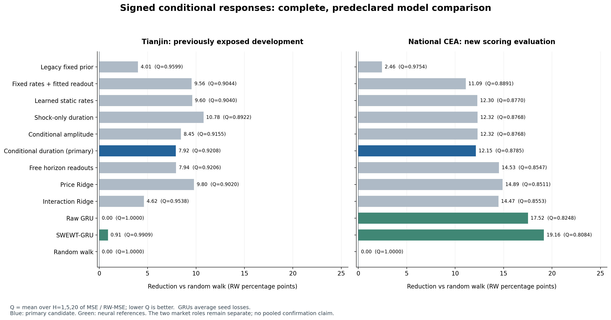
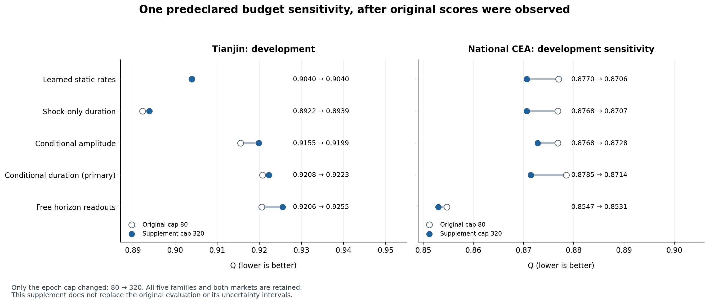

# 阶段 e 实验报告：有符号条件响应能否形成碳价模型创新？

报告日期：2026-10-19。对应本地原始冻结 `eff4540abfeb63e599859459d0d188d65fd637a3` 与补充冻结 `c12443a7adeb36f48683290287f85ac7760ee833`。本报告在结果完成后编写；冻结记录不是外部预注册。

## 1. 已完成的工作与当前判断

**本轮已完成模型实现、一个此前未发现模型评分记录的 CEA 市场评价、12 个模型的完整比较、独立数值与统计复算，以及一次限定的训练预算敏感性实验。模型确实学习了参数，超过随机游走的改善也有区间支持；新增的“上下文改变响应持续时长”机制尚未获得关键对照的支持。**

原始实验包括 244 个拟合任务、24 个市场×模型预测结果和 11,885 个有记录的正梯度更新。随后只将五个非线性模型的最大训练轮次从 80 延长到 320，新增 170 个拟合任务、10 个预测结果和 32,683 个正梯度更新。两批合计 **414 个拟合任务、44,568 个正梯度更新**。任务数包括验证选择与最终重拟合，不是 414 个独立市场样本；线性头内部求解也不反复算作新的模型实验。

CEA 原始主模型的综合误差比为 **0.878516**，随机游走为 1；但价格 Ridge 为 **0.851062**，静态持续度为 **0.876992**，同参数量的条件振幅模型为 **0.876827**。增加预算后，CEA 主模型降到 **0.871423**，静态模型仍为更低的 **0.870625**。天津原始主模型为 **0.920781**，增加预算后为 **0.922250**。这不是仅因某个 p 值不够小而暂停创新主张：关键消融的点估计本身就没有一致支持新增模块。

因此，本轮保留可复查的预测结果与模型代码，**不把当前条件时长门写成已经成立的创新发现，也不据此编写正结果投稿论文**。这不等于断言该模型永远无用或任何形式的论文都不能发表。用户的目标仍是先建立有实测贡献的模型，再组织论文；本轮证据尚不足以完成其中的创新成立环节。

完整原始结果与区间见 [独立统计审计](audits/INDEPENDENT_STATISTICAL_AUDIT_ZH.md)，补充结果见 [预算审计](audits/BUDGET_SENSITIVITY_AUDIT.md)。

## 2. 按已发表研究的实际做法，哪些信息使用可以采用？

本项目采纳用户的研究方向：查明具体论文怎样训练和评价，采用相应可复现设置。以下是针对性原始文献核查，不能由这些案例推断整个领域的“多数比例”。

| 文献或设置 | 实际做法与我们采用的方式 | 可以支持的表述 |
|---|---|---|
| Energies 2024，SWEWT–GRU，DOI 10.3390/en17174358 | 比较全序列、分区与逐窗口分解；使用顺序训练/验证/测试和验证调参。我们实现了每个发行原点单独对过去 64 个价格做 EWT 的多期限 GRU 参考。 | 可采用作者的滑窗预处理思想。我们的市场、训练预算、输入和预测头不同，属于方法适配，不能直接声称复现了作者表中的数值。 |
| ICDE 2025，TimeKD | 训练期教师可利用未来真实目标，部署时由只看过去的学生预测。 | 未来标签用于训练监督本身是可采用的设置；必须明确教师和学生各阶段实际输入。训练期特权信息不是本项目可单独主张的原创点。 |
| JEDC 2026，碳价 BVAR/因子研究 | 扩窗估计、多期限预测、RW 比较，并披露 DM 未拒绝平均等精度。对年度排放插值的潜在前视问题，给出删除该变量后的稳健性分析。 | 不应把“所有市场都胜、每项消融都显著、至少固定百分比收益”当作期刊共同规则。插值的具体敏感性结论也不能推广成任何前视处理都无影响。 |
| 2026 年 MuSTANet 碳收益率研究 | 出版社摘要和摘录已有多尺度趋势、动态变量选择与通道重标定。完整方法页未获读取。 | “多尺度＋状态依赖＋可解释”已经不足以构成清楚的原创表述；未核全文的环节不能写成已逐式排重或已完整复现。 |

在既定研究任务中，训练未来标签、历史输入窗口内的双向运算、按论文声明使用公开清洗数据、以及等待标签成熟后进行在线更新，均可形成合理实验设置。是否有前视要看**预测发行时真正使用了什么**，而不是看代码中是否出现未来目标或双向模块。全序列分解也可以作为明确标识的回顾性比较，但不能把它的成绩直接解释成逐时点实际可获得的预测成绩。

本轮核心模型使用发行时已知的历史价格与当日成交信息，测试期间滚动更新输入，模型权重固定；**没有**在本轮启用未来教师、扩窗权重更新或全序列分解主评价。前阶段已经完成的全序列/滑窗信息设置诊断保留原结果，不重新用于给本轮主模型加分。数据原值的阅读与质量检查也没有被自动计作模型成绩暴露。

文献来源：[SWEWT–GRU 出版社页面](https://www.mdpi.com/1996-1073/17/17/4358)、[作者全文的完整出版文本镜像](https://www.researchgate.net/publication/383685619_Carbon_Price_Forecasting_Using_Optimized_Sliding_Window_Empirical_Wavelet_Transform_and_Gated_Recurrent_Unit_Network_to_Mitigate_Data_Leakage)、[TimeKD 作者全文](https://arxiv.org/html/2505.02138v1)、[JEDC 作者 v3 全文，2026-10-03](https://arxiv.org/html/2402.04828v3)、[MuSTANet 出版社记录](https://www.sciencedirect.com/science/article/pii/S0306261926004629)。本轮 11 项直接数学和领域近邻的精确阅读范围见 [近邻核查](literature/DIRECT_MECHANISM_NEIGHBORS_ZH.md)。

## 3. 实际获取与使用的数据

| 项目 | 天津官方 TJEA | 全国 CEA，天津交易所官方转载历史表 |
|---|---|---|
| 本轮角色 | 已暴露开发市场 | 原始固定设计的新增评分评价；后续补充属于开发 |
| 总记录数 | 1,077 | 1,251 |
| 数据覆盖 | 2013-12-26 至 2026-09-30 | 2021-07-16 至 2026-09-30 |
| 原始训练/验证/最终训练有效原点 | 562 / 195 / 777 | 666 / 230 / 916 |
| 共同评价原点数 | 196 | 231 |
| 评价发行日范围 | 2023-04-19 至 2026-07-02 | 2025-09-12 至 2026-09-01 |
| 最后一个 H20 目标日 | 2026-09-30 | 2026-09-30 |
| 最大相邻记录日历间隔 | 319 天 | 13 天 |

来源为 [天津排放权交易所行情页](https://www.chinatcx.com.cn/tshq) 直接链接的静态 Body.js。该原始文件在前阶段已经成功下载，本轮复用相同的 7,288,971 字节，再抽取其中全国 CEA 主表；这不是另一次新的原始网页下载。CEA 的 1,251 行已实际生成可运行的标准数据，离线重建与预先登记哈希一致。

两市场的目标均是**官方公布、保留两位小数的当日总成交均价，单位为元/吨**。不是收盘价，也不是挂牌子表均价。保留全部对应行，只进行日期升序排列和数字千位分隔符去除；没有按模型表现删点、补交易日、重算均价或拼接其他来源。金额÷成交量只用于检查发布值的四舍五入一致性，不替换目标值。

原始数据内容哈希：

- Body.js：`c3e4c075832f6e5087cf416adecbae9d3c1b61859a6ad09fdf84294197393238`
- 天津标准数据：`85ca07648855db00fbf67c4e1c083db715f62ab829f74c143c3b3f67da21252a`
- CEA 标准数据：`f9f0e09b7500b2bdb4ec8b16c61d5d5fa2b64de63a24c0cf7bd1d269aa2be75d`

数据来源选择顺序在模型评分前登记。广州、湖北、深圳、全国原交易所入口的有限普通请求未成功后，采用事先列出的第一个可用后备来源；没有按哪个来源模型得分更好来选择数据。已有项目文件显示 CEA 原值此前用于来源核查和数据附录，未发现既有 CEA 模型预测评分记录。这个结论限定于项目证据，不声称全球无人看过这些公开价格。

当前数据是历史快照，逐日首发版本没有被独立核证；交易日历的全覆盖也未认证。因此 H1/H5/H20 准确定义为**之后第 1、5、20 个观测记录**，尤其不能把天津 H20 直接称为 20 个连续日历日或固定一个月。发行时间定义为当日报告已经发布之后。详见 [数据说明](provenance/SELECTED_OFFICIAL_MARKET_DATA_ZH.md) 与 [CEA 暴露证据](provenance/CEA_EXPOSURE_AUDIT_ZH.md)。

## 4. 这轮候选究竟创新在哪里，又不能主张什么？

### 4.1 可以被对照否证的具体假设

前阶段的正权暂态结构，对一个孤立正变化主要表达保留或回撤。本轮允许两个响应系数有正有负，并把问题收窄为：**在相同价格历史与当前交易上下文下，改变响应持续时长，能否提供超过静态时长、仅改变振幅以及自由期限预测头的额外信息？**

设训练尺度归一化价格变化为 \(r_t=(P_t-P_{t-1})/s_P\)，两个历史状态为

\[
v_{k,t}=(1-\rho_k)\sum_{\ell=0}^{63}\rho_k^\ell r_{t-\ell},\qquad k=1,2.
\]

输入上下文 \(z_t\) 包含当前变化幅度 \(\log(1+|r_t|)\) 和成交量惊异度。成交量惊异度由当前对数成交量相对严格过去 60 个记录的中位数与标准差计算，并设有效值掩码。条件门 \(q_t=2\tanh(Wz_t)\) 改变有序持续率 \(\lambda_{k,t}\)，且 \(0<\lambda_{1,t}<\lambda_{2,t}<0.98\)。单次预测内持续率固定。

主模型预测式是

\[
\widehat{P}_{t+h\mid t}-P_t
=s_P\left[\mu h+\sum_{k=1}^2 b_k v_{k,t}\sum_{j=1}^{h}\lambda_{k,t}^{j}\right],
\qquad h\in\{1,5,20\}.
\]

共 9 个拟合标量：2 个全局持续率参数、4 个条件门参数和 3 个线性读出系数。\(b_k\) 不限制符号，模型在形式上允许延续、回撤与不同期限方向变化。但实际两市场主模型的两个模式系数均为负，不能把模型的表达能力写成数据已经识别出一正一负的市场冲击机制。

### 4.2 估计方式与真实学习

固定非线性持续率与门参数后，对三个期限按原始训练目标的均方尺度加权，按训练设计列 RMS 标准化，再精确求解正则化线性头。外层通过该精确解及列尺度求导，用全批量 Adam 学习非线性参数。列尺度留在计算图中；原系数坐标的惩罚是 \(\alpha\|s(\theta)\beta\|^2\)，不是忽略尺度的普通 \(\alpha\|\beta\|^2\)。

这使“只拟合读出”和“再学习动力学”的差别可复查。epoch0 已经求解了监督线性头，并不是完全没有学习的原始先验。原始 10 个非线性市场×模型最终拟合均完成 80 次正更新；补充拟合也有逐步日志。精确线性解不保证外层达到全局最优。

### 4.3 已有方法的边界

几何阻尼趋势可直接追溯至 Gardner–McKenzie 1985；指数时间基底配合变量投影已有 optimized DMD 等工作；输入依赖衰减已有 Mamba 等先例。静态版本还能展开为跨期限—滞后系数矩阵秩至多为 2 的受限分布滞后回归。上述工具、参数少和响应曲线可画，均不能单独主张原创。

本模型没有建立未来上下文与价格的联合生成律，不能声称获得生成状态空间模型的时间一致性；总成交量和日价格变化也不识别外生冲击的因果效应。两个率有序只去掉标签交换，不能消除分量接近或系数很小时的弱识别。带漂移项 \(\mu h\) 的总预测也不能仅凭持续率小于 1 就声称价格过程有界。完整推导见 [模型设计](methods/SIGNED_RESPONSE_DESIGN_ZH.md)。

## 5. 实验怎样执行、比较是否足够具体？

顺序划分原始记录 60%/20%/20%。每个切分只纳入 H20 目标已在边界前成熟的训练原点；验证用于选择超参数和轮次；最终从相同初始化在全部可用的成熟训练标签上重新拟合。原始训练价格尺度和期限目标尺度固定，测试只滚动更新历史输入。训练、验证和评分的边界不是靠随机打散样本实现。

| 模型 | 关键差异 | 拟合标量数或规模 |
|---|---|---:|
| RW | 预测价格不变 | 0 |
| 旧固定响应 | 前阶段未拟合的固定结构参照 | 0 个本轮拟合参数 |
| 固定持续率＋监督头 | 固定 .5/.9，只拟合读出 | 3 |
| 静态持续率 | 学全局持续率，无条件门 | 5 |
| 无成交量的持续度门 | 只用当前价格活动条件化 | 7 |
| 条件振幅 | 相同上下文与基底，门改变振幅 | 9 |
| **条件持续度主模型** | 门改变未来持续时长 | **9** |
| 自由期限读出 | 同状态/门，各期限独立线性头 | 15 |
| 价格 Ridge | 最近 20 个归一化价格变化 | 63 个系数，含各期限截距 |
| 交互 Ridge | 20 个变化、2 上下文、40 交互项 | 189 个系数，含各期限截距 |
| Raw GRU | 64 个历史价格/量能/掩码 token | 3,651 |
| SWEWT–GRU | 每次用过去 64 价格做 EWT，最近 17 个特征 token | 3,939 |

非线性核心模型用 8 个正则化系数 \(10^{-5}\) 至 \(10^2\) 和两个学习率 .003/.01；确定性全批量训练，原预算最大 80 轮、最少 15 轮、patience12，梯度截断 5。每个模型独立按同一验证目标选参；固定率模型仅选择正则化。经典价格 Ridge 的平方和目标与 VP 的均值目标不同，不能以同名 alpha 的数值直接判断惩罚相等。

GRU 采用两个学习率、一个选择种子 17，以及最终种子 17/29/43；三个 H1/H5/H20 输出头均受监督。主表统计**种子误差的均值**，不是把三个预测先集成为更好的新模型。SWEWT 的窗口 64、模态 3、GRU32 与原文 TPE 搜索和最大 1000 轮等设置不同，因此它是固定预算参考，不是穷尽全领域 SOTA 的结论。

全部模型共享评价原点、目标和发行信息边界，但窗口并非逐变量完全相同：响应状态看 64 次变化，Ridge 看 20 次变化，GRU 历史成交量上下文又有更长的原始回看跨度。条件振幅与条件持续度同为 9 参数，代表匹配容量的对照，但不声称优化几何也完全相同。主要数据里没有额外能源与宏观变量。

## 6. 原始固定设计的完整结果

定义

\[
Q_m=\frac{1}{3}\sum_{h\in\{1,5,20\}}
\frac{\operatorname{MSE}_{m,h}}{\operatorname{MSE}_{RW,h}}.
\]

Q 越低越好，RW=1。\(100(1-Q)\) 为平均按 RW 归一化的 MSE 改善百分点；不能直接写成 RMSE 降幅，也不是相对另一个比较模型的百分比。

| 模型 | 天津：开发 Q | CEA：原始新增评价 Q |
|---|---:|---:|
| 随机游走 | 1.000000 | 1.000000 |
| 旧固定响应 | 0.959915 | 0.975443 |
| 固定持续率＋监督读出 | 0.904431 | 0.889095 |
| 学习静态持续率 | 0.903971 | 0.876992 |
| 无成交量的持续度门 | 0.892226 | 0.876821 |
| 条件振幅 | 0.915517 | 0.876827 |
| **条件持续度主模型** | **0.920781** | **0.878516** |
| 自由期限读出 | 0.920558 | 0.854695 |
| 价格 Ridge | 0.902011 | 0.851062 |
| 交互 Ridge | 0.953784 | 0.855321 |
| Raw GRU | 1.000000 | 0.824836 |
| SWEWT–GRU | 0.990924 | 0.808418 |

图表按事前定义保留全部模型，没有删去劣于主模型的市场或对照，也没有把 CEA 成绩最好的 SWEWT 事后改名为本项目原创模型。天津 Raw GRU 选择 epoch0，其最终输出等同 RW；主模型则确实进行了参数更新。

原生价格单位下，主模型 H1/H5/H20 的 RMSE 为天津 **3.525399 / 3.777042 / 5.141130** 元/吨，CEA **4.411995 / 5.483432 / 8.526741** 元/吨。完整各模型 RMSE、MAE 和期限细分见 [原生误差表](audits/NATIVE_METRICS.csv)。某模型的 MSE 排名不自动等于其 MAE 排名。

### 6.1 成块配对区间告诉了我们什么？

在评分前冻结统计规则：每市场分别进行 50,000 次循环成块配对自助法，块长 20 为主、40 为敏感性；每次重算 RW 分母；保持全部模型与期限的配对索引。主模型对 8 项核心比较同时给边际 95% 区间与按 Bonferroni 调整的家族 95% 区间。两个 GRU 参考只给边际 95%，不加入原八项家族，也不声称跨两个市场所有结论共同达到 95% 覆盖。

下表效应是 \(100(Q_{比较}-Q_{主模型})\)，正值表示主模型更好；区间使用原始块长 20 的家族口径。

| 比较 | 天津效应与家族区间，RW 百分点 | CEA 效应与家族区间，RW 百分点 |
|---|---:|---:|
| RW | +7.9219 [1.6738, 14.7840] | +12.1484 [3.5204, 21.9064] |
| 价格 Ridge | −1.8770 [−4.8400, 7.8024] | −2.7454 [−6.7349, 3.1870] |
| 静态持续度 | −1.6811 [−2.6921, −0.4004] | −0.1524 [−0.4807, 0.2034] |
| 无成交量门 | −2.8555 [−6.3251, −0.2483] | −0.1695 [−0.4887, 0.1797] |
| 条件振幅 | −0.5265 [−1.2148, 0.5472] | −0.1689 [−1.4498, 1.1088] |
| 自由期限读出 | −0.0224 [−0.6419, 0.8796] | −2.3821 [−4.7385, 1.4538] |

块长 40 时，CEA 相对 RW 的家族区间为 **[3.0992, 23.3860]**，天津相对静态、无成交量门的家族区间仍为负。两个块长的全部八项区间均已保留，未选择有利块长。各市场每种块长均没有无效 RW 分母重采样。

CEA 主模型对 Raw GRU/SWEWT–GRU 的点差分别为 −5.3680/−7.0098 个 RW 百分点；块长 20 的边际区间分别为 [−13.4091, 3.8917] 与 [−15.7707, 2.5462]。因此可以报告神经参考的点估计更好，不能把该排名直接写成它们显著胜出。区间也没有消除样本较短、H20 标签重叠和制度变化的限制。

### 6.2 收益来自哪里？

| 主模型学习归因 | 天津 Q | CEA Q |
|---|---:|---:|
| 相同已选 alpha、初始持续率＋最终训练读出 | 0.904431 | 0.889095 |
| 原始正式主模型 | 0.920781 | 0.878516 |
| 保留主模型已学全局持续率，去门并同 alpha 重解训练头 | 0.902975 | 0.876997 |

CEA 的非线性学习比相同 alpha 的初始动力学基准改善约 1.0579 个 RW 百分点；但去掉条件门后反而更好。天津加入非线性学习及条件门均没有带来这项诊断所期待的增量。最后一行是结果后的描述性线性求解，没有重新选择超参数或梯度训练，也不能冒充事前独立选优的静态对照。具体参数和只读复放见 [学习诊断](methods/SIGNED_RESPONSE_LEARNING_DIAGNOSIS_ZH.md)。

## 7. 唯一追加的预算敏感性：80 → 320

所有原始非线性模型都选中了 80 轮上限，构成了具体的预算疑问。因此在原始成绩已可见后，另行冻结一个补充计划：只提高最大轮次，保留全部五个非线性模型、两个市场、初始化、正则化网格、学习率、耐心值和验证选择规则。CEA 在这个追加分析中同样属于已暴露开发证据，不替代原始确认评价。

| 模型 | 天津：80 → 320 上限 Q | 天津新选轮次 | CEA：80 → 320 上限 Q | CEA 新选轮次 |
|---|---:|---:|---:|---:|
| 静态持续度 | 0.903971 → 0.903957 | 145 | 0.876992 → 0.870625 | 320 |
| 无成交量门 | 0.892226 → 0.893885 | 141 | 0.876821 → 0.870659 | 320 |
| 条件振幅 | 0.915517 → 0.919892 | 320 | 0.876827 → 0.872828 | 320 |
| **条件持续度主模型** | **0.920781 → 0.922250** | **320** | **0.878516 → 0.871423** | **320** |
| 自由期限读出 | 0.920558 → 0.925517 | 262 | 0.854695 → 0.853051 | 320 |

CEA 主模型改善 0.7093 个 RW 百分点，天津主模型下降 0.1469 个 RW 百分点。CEA 上主模型仍略差于静态与无成交量版本，自由期限模型仍更低；天津仍没有形成新增门的优势。原始经典基线与神经参考没有在这次补充中重拟合，表中五臂则都获得相同扩大预算。

**7/10 个新选择仍在 320 上限，故不能声称所有模型已完全收敛，或所有可能的优化不足已被排除。** 这一次固定敏感性没有改变机制结论；按补充计划停止继续扩大本候选的预算。没有追加新 p 值或把补充结果并入原八项统计家族。

## 8. 实现与验证证据

原始审计从 24 份逐原点预测和 208 个检查点重建评价。价格/量能特征、有限历史指数状态、列尺度、加权 Ridge 方程和验证选择使用独立 NumPy 计算；线性系数与增广最小二乘解最大差约 **2.53×10⁻¹⁴**，缩放 KKT 残差约 **2.32×10⁻¹⁵**，验证 loss 最大差约 **6.66×10⁻¹⁶**。GRU 使用 PyTorch 只读加载回放、EWT 使用冻结库，这两项不冒充独立算法重实现。

预算审计逐一比较 160 个相同配置的 **9,736 个共同 epoch 记录**，训练 loss、加权目标、验证 loss、持续率、梯度范数与 KKT 的共同前缀最大差均为 **0**。170 个补充检查点的独立价格预测最大差约 **4.44×10⁻¹⁵**，独立线性系数差约 **6.57×10⁻¹⁴**，缩放 KKT 残差约 **3.58×10⁻¹⁵**。这证明记录中的追加运行确实延长了同一训练过程，不证明非线性全局最优。

运行前已有有限差分导数检查、独立线性解检查、孤立正变化形状检查，以及未来价格/量能扰动不影响历史特征的检查。没有用这些合成构造成绩代替真实市场表现。原始阶段 d 文件保持原内容；本轮源代码与计划的运行前后哈希一致。

## 9. 怎样推进到能支撑论文的模型？

对本项目，“实验达标”应落实为三项可回答的问题，而不是承诺某个通用录用阈值：

1. **相对最近的方法增加什么？** 给出精确机制或限制，说明已有数学构件与新领域假设的区别；不能靠命名、多堆一个网络层或参数发生变化认定创新。
2. **增加的部分实际贡献了什么？** 在同一信息设置下保留强基线和能够推翻该机制的对照，报告效应大小、区间与失败条件。某项区间跨零不自动禁止投稿，但不能把收益归给点估计都未支持的模块。
3. **结论在哪里成立？** 明确市场、频率、价格定义、评价时期和数据可得条件；需要匹配结论范围的额外市场或后续未用于选优的证据。已评分 CEA 可以继续用于开发，但不能反复当成新的未见确认。

本轮已经实质完成了模型表达和可验证学习的改进，却没有完成条件时长机制的实证证明。下一候选应从新的可观测经济信息或目标构成出发，而不是继续给相同的持续度门增加轮次、改名或筛选有利区段。

一个具体待核的问题是：**日总成交均价的变化，有多少来自交易渠道的价格与成交份额变化，普通价格/总量门是否把这种目标构成误当成价格持续性？** 如果官方分项公告提供挂牌协议、大宗协议与单向竞价的价量，可研究未来渠道构成的训练监督能否改善发行时只看过去的总均价预测，并与使用完全相同过去分项信息的普通多任务模型、Ridge 和直接 GRU 比较。挂牌价不能自动被叫作潜在有效价格，未来份额与渠道价差的条件协方差也不能随意忽略。

这只是下一项具体假设，**尚未证明原创，也没有报告该候选的模型得分**。现有 CEA 主表只有总量、总额和均价，另一张较旧 CEA 表同样是总量表，二者不能冒充不同交易渠道；必须先取得并对齐真正的官方分项记录。已实际读到 [2026-07-30 官方日报](https://overview.cneeex.com/c/2026-07-30/498086.shtml) 的挂牌/大宗分项及当日无单向竞价说明，并读到 [2025-08 官方月报](https://overview.cneeex.com/c/2025-08-29/496735.shtml) 中单向竞价有成交的记录，因此不能一律忽略第三渠道。这只能证明分项公告存在，不等于已经取得完整面板。

训练期使用未来构成监督的思想已有特权信息学习先例，例如 [AISTATS 2022 的时序特权信息学习](https://proceedings.mlr.press/v151/k-a-karlsson22a.html)。创新只能进一步限定到具体构成机制、匹配对照和可复查的增量。下一候选的边界与最小对照见 [单项续研说明](literature/NEXT_SINGLE_CANDIDATE_ZH.md)。现阶段不重开已完成的普通 endpoint 教师失败实验，不将本研究转写为泄露审计论文。

实际尝试下载官方连续查询入口时，网络授权后的普通 GET 返回 HTTP403，未取得正常查询页面、已验证的公开接口或连续渠道面板；该入口已停止访问。分项逐日行数为 0，未知值没有填零，未执行新的模型训练。工具网络授权已通过，失败来自源站拦截。详见 [获取收据与限制](provenance/NEXT_CHANNEL_DATA_FEASIBILITY_ZH.md)。

## 10. 交付与复现入口

- [代码、数据、训练与审计命令](REPRODUCE_ZH.md)
- [下一轮续接记录](HANDOFF_CONTINUATION_ZH.md)
- [机器可读决定](FINAL_DECISION.json)
- [原始完整统计、数值和模型选择证据](audits/INDEPENDENT_STATISTICAL_AUDIT_ZH.json)
- [补充预算数值证据](audits/BUDGET_SENSITIVITY_AUDIT.json)
- [原始执行总数](provenance/EXECUTION_TOTALS_ORIGINAL.json)
- [完整结果导出记录](provenance/RESULT_EXPORT_RECEIPT_WITH_BUDGET.json)
- [本地与远端冻结内容对应](provenance/LOCAL_REMOTE_FREEZE_MAPPING.json)

公开交付包括模型源、全部选择与最终拟合的数值记录、自行训练的参数、汇总指标、图形和重建脚本；第三方原始逐日表、逐原点预测数组和二进制检查点保持原有处理范围。没有识别出原网站逐日表的再分发许可，所以源码依据固定官方字节重建数据，来源变更时会明确报错，不静默替换数据。远端镜像发生在拟合之后，不能把上传时间误写为更早的外部预注册时间。
