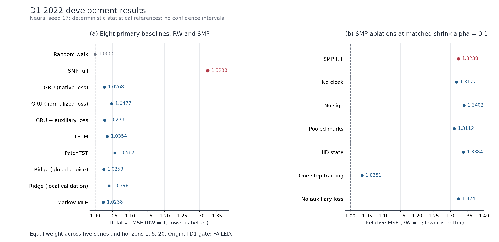
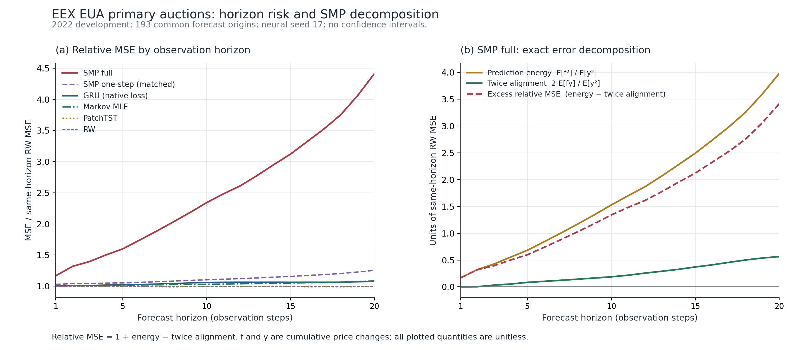

# 碳价预测结构创新实验报告：SMP 固定候选的开发检验

**实验日期：2026-10-17。状态：D1 完成、独立复核通过，固定候选停止。**

本轮完成了新模型的数学定义、代码实现、同条件基线、结构消融和真实市场开发实验。核心结果为 **SMP 的五序列、三主期限平均 MSE/RW_MSE = 1.323787**，随机游走为 1；SMP 没有胜过强基线，也没有胜过同一结构的单步训练消融。因此，**本候选尚未形成可发表论文的方法贡献**。继续在确认集上调试、挑选局部好结果或更换统计口径不能改变这个判断。

本报告是可复核的研究记录，不是宣称方法成功的论文结果章节。D1 事前规定的停止条件已经触发；本轮没有执行条件式 D2、多种子实测 bootstrap 或确认集预测。全部配置、实际训练日志、失败的科学假设和独立核验都保留。主要依据为 [完整配置](results/D1_ALL_CONFIGS.json)、[选择结果](results/D1_SELECTION.json)、[执行账本](results/EXPERIMENT_LEDGER.json) 和 [停止收据](results/STOP_DECISION.json)。

## 1. 本轮选择的创新问题

用户希望增加数据支撑，优先研究模型或学习机制的创新。本轮据此考察一个可被实验否定的问题：**碳价多步预测若共享一个随未来方向与零变化年龄演化的状态过程，能否比直接输出各期限均值的模型更稳定？**

新候选简称 SMP（Signed Markov Propagation，有符号 Markov 传播）。模型用历史编码器估计各未来状态的正、负、零变化概率及正负变化幅值，再在有限状态空间中联合计算 1–20 步预测。它对多期输出施加了一个明确的结构约束，贡献假设在于该约束能否产生可重复的泛化收益。

**Markov 奖励递推、GRU、hurdle 似然、指数幅值分布、尺度归一化和加权最小二乘均不是本研究的发明。** 神经模块组合或给模型命名不等于原创性。最近邻的一手阅读也表明，神经更新过程、异步多变量观测和连续时间循环状态已有方法；本轮仅在具体的未来符号／零龄有限闭合上提出条件性假设，没有证明其全球首创。[1–3] 完整归属与推导见 [方法定义](methods/METHOD_AND_ATTRIBUTION_ZH.md)。

| 最近邻 | 本轮实际完成 | 不能据此声称的内容 |
|---|---|---|
| Deep renewal processes，PLOS ONE 2021 | 阅读方法和作者指定的 GluonTS 核心，分析支持域及事件更新机制 | 没有执行作者 MXNet 模型，没有重现论文 benchmark |
| GRU-ODE-Bayes，NeurIPS 2019 | 阅读正式论文与固定版本作者核心，保留许可证和读取证据 | 没有执行该模型；共享隐藏状态与异步更新不是本轮创新 |
| Continuous Recurrent Units，ICML 2022 | 阅读方法边界，判断已存在的连续时间状态估计能力 | 没有完整复核或运行作者代码 |
| PatchTST，ICLR 2023 | 在本轮统一预测任务上实际重新训练作者核心，10 个配置流 | 新任务读出、RevIN 关闭及小模型配置使其不等于作者原始 benchmark |

前轮已经停止的 RRC 与既有 SOLID 参考没有重新打开。本轮也没有将文献审查的跨市场或概率分布分支临时改成另一套市场实验。它们没有先形成足够清晰的贡献边界，不能用名称替换来补救 SMP 的结果。

## 2. 数据规模：增加记录数以后仍要区分有效证据

本轮使用项目此前已核验、获准扩展的 **5 份开发文件，共 8,119 条报价记录**，没有在本轮重新声称采集了这些记录。所有映射文件的日期严格早于 2024 年；2022 年为 D1 开发筛选年。既有 2023 年只属于事前的条件式 D2 计划，本轮未进入该阶段。

| 序列 | 开发文件总行数 | D1 训练起点 | 年前验证起点 | 2022 评价起点 | 评价起点日期范围 |
|---|---:|---:|---:|---:|---|
| EEX EUA 拍卖（T3PA 序列） | 2,255 | 1,647 | 80 | 193 | 2022-01-10 至 2022-11-17 |
| 广州 | 1,434 | 770 | 80 | 222 | 2022-01-04 至 2022-12-02 |
| 湖北 | 1,408 | 756 | 80 | 217 | 2022-01-04 至 2022-12-02 |
| 上海 | 1,507 | 916 | 80 | 195 | 2022-01-04 至 2022-12-01 |
| 既有 EU 报价 | 1,515 | 819 | 80 | 238 | 2022-01-03 至 2022-12-01 |
| 合计 | **8,119** | **4,908** | **400** | **1,065** | 五序列分别保持时间顺序 |

以上数量来自每个真实任务的 [SUPPORT 收据](results/D1/jobs/)，不是将同一预测起点乘以模型数得到的新样本。8,119 包含完整开发时期，不能全部写成 D1 训练样本。滑动窗口和 20 个相互重叠的未来标签不是独立观测，两个 EU ETS 相关序列也不是独立市场复制。

数据充分性因此仍有限：本轮仅评价一个开发年度，多个中国序列的训练起点不足 1,000；报价不变的长段集中在少数序列。固定的 pre-2021 描述性诊断得到零净变化比例约为 EEX 2.18%、广州 5.27%、湖北 4.33%、上海 12.21%、EU 1.35%。这支持检验小状态模型，但不支持高容量长等待时间网络，更不意味着零报价变化就是没有成交。[诊断范围](provenance/DIAGNOSTIC_SCOPE.json) 与 [实际结果](results/PRE2021_DIAGNOSTIC.json) 均已保留。

EEX 与既有 EU 报价的工具身份并未全部统一认证；后者的具体交易场所、币种和换月定义仍有不足，不能强设两者是同一可套利工具。当前实验逐序列建模，没有用当日其他市场尚未发布的价格作供体，也没有用错误的时间对齐制造额外样本。

## 3. 模型、目标与可以归因的消融

### 3.1 观察与信息范围

预测目标为后续第 1、5、20 个**报价观测步**，不是固定自然日。所有模型输出完整 20 期向量，评价起点必须拥有同一自然年内完整 H20 标签；每个模型、每个期限采用共同起点支持。原报价不插值，同价记录不删除。

神经模型、结构消融和岭回归使用相同的 20 个历史 token：价格增量除以起点过去 60 个增量 RMS、已观察日期间隔、当前尺度与训练前缀尺度的比值、历史上一非零符号与截断零龄。EEX 另含已知历史的拍卖量、覆盖率与投标人数。尺度和上一非零符号带来超过 20 步的信息范围，不能将“20 个输入 token”写成“只使用 20 步信息”。训练固定统计仅来自清除区之前的训练价格前缀。

### 3.2 有限未来状态与多期均值

设状态由最近非零符号及连续零变化数构成：

\[
z=(\ell,a),\quad \ell\in\{-1,0,+1\},\quad a\in\{0,1,2+\}.
\]

历史 GRU32 产生上下文 \(c_t\)，对每个源状态输出 \(q_0,q_-,q_+\) 及正幅值均值 \(b_-,b_+\)。零分支保留符号并增加年龄；负／正分支分别重置为负／正符号、年龄零。固定本次上下文后：

\[
F_0(z)=0,
\]

\[
F_{h+1}(z)=q_0(z)F_h(T_0z)
+q_-(z)\{-b_-(z)+F_h(z_-)\}
+q_+(z)\{b_+(z)+F_h(z_+)\}.
\]

价格预测为 \(\widehat p_{t+h}=p_t+s_tF_h(z_t)\)。递推不需要 Monte Carlo 采样；这只是该有限模型的精确计算性质，不是新的概率恒等式。未来实际价格不会在同一次预测内重新驱动 GRU，因此这个闭合可能漏掉未来路径的高阶依赖，也不能保证不同预测起点之间满足全局条件期望一致性。

9 个名义状态中存在正常研究起点不可达的中性状态；本轮亦明确记录了训练状态频数。因此参数量是名义网络容量，不能把合成梯度覆盖当作真实市场对所有参数的识别。

### 3.3 统一原价风险与辅助目标

设 \(\Delta p_{t,h}=p_{t+h}-p_t\)，\(V_h^{\rm train}\) 为训练标签的随机游走均方误差。主要训练目标为：

\[
\mathcal L=\operatorname{mean}_{t,h}
\frac{(s_tm_{t,h}-\Delta p_{t,h})^2+\alpha(s_tm_{t,h})^2}{V_h^{\rm train}}
+\lambda\mathcal L_{\rm hurdle}.
\]

神经输出收缩候选仅为 \(\alpha\in\{0,0.1\}\)。SMP full 使用 \(\lambda=0.05\)，hurdle 项只监督一步零／正／负分支及条件幅值。`no_aux` 令其为零；`GRU aux` 使用自由 20 期均值头和相同辅助监督。普通 GRU 同时比较原价风险与旧式局部标准化风险，防止把常规样本权重修正归为 SMP 的创新。

| 消融 | 与 full 的精确差异 | 解释边界 |
|---|---|---|
| no_clock | 未来源状态在年龄维共享概率与幅值 | 仍保留当前输入中的零龄，不是删除所有年龄信息 |
| no_sign | 未来源状态在符号维共享概率与幅值 | 仍保留当前输入中的历史符号 |
| pooled_mark | 幅值在所有源状态共享，概率仍区分状态 | 检查状态与幅值耦合是否必要 |
| iid_state | 概率和幅值都在源状态之间共享 | 检查是否需要未来状态演化 |
| one_step | 网络相同，主训练误差只用 h1 | 早停仍使用统一 h1/5/20 验证风险 |
| no_aux | 网络相同，辅助 NLL 权重为零 | 检查辅助概率学习是否解释结果 |

## 4. 冻结实验规则与基线公平性

正式协议在 **2026-10-17 14:03:49 UTC** 写定，早于首个正式市场拟合；其 SHA256 为 `b10409de072efaba5fce1d570c15e6e0b4128f5234f037c25afeecfd90efc503`。其中固定了 12 个训练源文件的哈希、数据字节身份、网格、任务数、早停和晋级规则。[协议](provenance/PROTOCOL.json) 保持原字节。这是有时间收据的内部事前冻结，不是外部平台注册的预注册。

每序列在评价年开始前训练，保留最后 80 个成熟起点作验证；所有训练 H20 标签必须严格早于第一个验证起点，所有验证标签必须早于评价年。模型参数在该评价年不更新，特征在每个真实起点按已观察历史更新。这个训练刷新协议与前轮 RRC/SOLID 不同，因此旧表中的结果不能直接插入本轮排名。

全部神经模型从精确的随机游走点均值开始，每个配置以**自己的最终预测输出**选择检查点，允许 epoch 0 胜出。最多 50 轮、patience 10、batch 128、梯度裁剪 1、AdamW weight decay 0.001；循环模型学习率 0.003，PatchTST 为 0.001。共享骨干的 SMP/GRU 初始化与各配置 minibatch 顺序固定，所有控制使用相同有效起点。

主评分为先逐序列、逐期限计算 MSE/RW_MSE，再对 5×3 个单元等权平均：

\[
R=\frac1{15}\sum_{m=1}^5\sum_{h\in\{1,5,20\}}
\frac{\sum_{t\in I_m}(\widehat p_{t+h}-p_{t+h})^2}
{\sum_{t\in I_m}(p_t-p_{t+h})^2}.
\]

\(R<1\) 表示该预定指标优于随机游走。分母来自各模型相同评价起点；不把不同币种的原价误差直接混合。D1 各家族按该开发指标选择两个收缩候选之一，精确平局取较大收缩；所有家族本次均选中 0.1。这个开发选择不构成未见测试。

强基线包括相同信息下的原价 GRU、标准化损失 GRU、GRU 加辅助监督、LSTM、作者 PatchTST 核心适配、原价加权岭回归及平滑 Markov 统计模型。岭回归的五个系数为 0.01/0.1/1/10/100；同时公开全序列 D1 选中系数和各序列仅用年前验证选出的 `ridge_val`，后者没有额外拟合。

PatchTST 使用作者提交 `204c21efe0b39603ad6e2ca640ef5896646ab1a9` 的四个未改核心文件及 Apache 许可证，固定 1 层、d_model 16、2 个头、patch/stride 5、RevIN=False，并公开新的多输入到单输出线性读出。[4] 这是真实训练的强基线实现，不是声称作者 benchmark 已重现。

项目既有 Kalman／滤波器组参考使用沿已知价格前缀递推的滤波状态，并以最多 240 个过去误差作滚动选择，所以只作补充，**不纳入同信息结构归因或 D1 最强基线门槛**。240 是误差选择窗口，不是滤波状态的全部历史长度。

## 5. 真正执行了多少训练

| 执行项目 | 实际完成 | 说明 |
|---|---:|---|
| 神经拟合 | **120** | 12 家族 × 2 个收缩系数 × 5 序列，seed 17 |
| 岭回归拟合 | **25** | 5 个系数 × 5 序列 |
| 平滑 Markov 拟合 | **5** | 每序列 1 次 |
| 既有统计参考预测流 | **5** | 无新的神经／回归拟合 |
| 随机游走预测流 | **5** | 无拟合 |
| 正式合计 | **150 次拟合、160 个预测任务** | 160 完成，0 执行失败，0 自动重试 |
| 神经实际训练轮数 | **1,854** | 全部真实 FIT trace 的总和 |
| 神经优化器更新 | **15,818** | 不含另行计时用的合成数据 |
| 最终选择 epoch 0 | **26/120** | 真实训练后验证选择回到 RW 初始化，并非漏跑 |
| D1 总墙钟时间 | **119.358 秒** | 两进程 CPU；每进程单线程、float64 |
| D2／真实 bootstrap／确认预测 | **0／0／0** | 依事前门槛停止 |

正式运行前另有 3 个固定人工数据计时拟合，共 117 个优化器步，用于验证预算可行；它们不进入市场结果或 150 次市场拟合计数。运行环境为 Python 3.12.14、NumPy 2.5.4、PyTorch 2.3.1+cpu，记录见 [RUNTIME](provenance/RUNTIME.json)。该环境已实际执行本轮训练，不宣称又在全新环境完成了一次独立训练重放。

共保存 160 个逐任务公开日志单元，每个均有开始、支持和指标收据，150 个拟合另有 FIT 收据。逐起点预测共 34,080 行、681,600 个预测坐标；这是 1,065 个唯一序列起点在 32 个配置流和 20 个期限上的重复，不能写成 68 万个独立样本。所有 33 行全局配置汇总保留，其中 1 行 `ridge_val` 来自既有拟合的选择派生。

## 6. 主结果与结构消融

下面只作 **2022 开发集的描述性比较**，不写显著性星号，不将其称为未见测试。数值越小越好；MSE/RW_MSE 为 1 时等于随机游走。

| 对照模型 | 已选主评分 | 相对 RW 的变化 |
|---|---:|---:|
| 随机游走 | **1.000000** | 0.00% |
| 平滑 Markov | 1.023790 | +2.38% |
| 加权岭回归，D1 全局系数 100 | 1.025313 | +2.53% |
| GRU 原价风险 | 1.026783 | +2.68% |
| GRU 原价风险＋同样辅助监督 | 1.027910 | +2.79% |
| LSTM 原价风险 | 1.035423 | +3.54% |
| 岭回归，各序列年前验证选择 | 1.039844 | +3.98% |
| GRU 局部标准化风险 | 1.047658 | +4.77% |
| 作者 PatchTST 核心任务适配 | 1.056690 | +5.67% |
| **SMP full** | **1.323787** | **+32.38%** |

补充的项目既有参考为 1.129781。它的信息和刷新方式不同，单列而不充当同条件基线。所有选中模型均未在本轮全局主指标上胜过随机游走，不能把“胜过某个较弱深度模型”替代对基准本身的改善。

| SMP 同收缩系数 0.1 的消融 | 主评分 | 对 full 的含义 |
|---|---:|---|
| full | 1.323787 | 待检验候选 |
| no_clock | 1.317674 | 简化未来年龄作用后更好，年龄机制收益未建立 |
| no_sign | 1.340228 | full 略好，但两者均远差于 RW |
| pooled_mark | 1.311217 | 共享幅值更好，状态幅值耦合收益未建立 |
| iid_state | 1.338401 | full 略好，但不足以支持整体贡献 |
| **one_step** | **1.035092** | 仅一步主损失明显更好，多期联合训练未获支持 |
| no_aux | 1.324138 | 与 full 几乎同样差，不能把失效完全归因于辅助 NLL |

原价 GRU 在该开发年优于旧式标准化风险 GRU，但两者仍未胜过 RW；这一点只说明普通风险加权是必须控制的替代解释，不构成新学习理论。消融中的局部优胜也不能脱离强基线和全局误差，单独用来宣称结构创新有效。

图 1：左侧为八个预定主基线、RW 与 SMP；右侧为同系数的 SMP 消融。竖线为 RW=1，点为 2022 开发集的描述性评分，未绘制未经执行的置信区间。完整数值及各图的输入身份见 [图表说明](figures/FIGURES_ZH.md)。

## 7. 失效位置与可以支持的解释

| 序列 | SMP full | SMP one_step | GRU 原价风险 | 平滑 Markov |
|---|---:|---:|---:|---:|
| EEX EUA 拍卖 | **2.392421** | 1.111731 | 1.033864 | 1.035416 |
| 广州 | 0.989375 | 0.996279 | 1.023505 | 1.038377 |
| 湖北 | 1.000000 | 1.000000 | 1.000000 | 1.025948 |
| 上海 | 1.043790 | 1.072134 | 0.994558 | 0.975086 |
| 既有 EU 报价 | 1.193347 | 0.995317 | 1.081989 | 1.044124 |

完整 SMP 在广州略优于 RW，湖北则选中 epoch 0；这不能抵消 EEX 与 EU 报价的主要损失。EEX 上 full 的 h1/h5/h20 分别为 **1.166061／1.599303／4.411899**，长预测期是主要失效位置。EEX 的年前验证曾选中第 13 轮，验证评分 0.826420；随后 2022 年评价为 2.392421，说明这次验证优势没有迁移到该开发年度。

为解释误差，本轮先写定一个**结果后的描述性诊断范围**，再只读取新 D1 已选配置的预测，未读取新市场 CSV、确认集或增加拟合。[范围](provenance/POST_D1_DIAGNOSTIC_SCOPE.json) 与 [完整分解](results/D1_FAILURE_DECOMPOSITION.json) 公开。令 \(x=\widehat p_{t+h}-p_t\)、\(y=p_{t+h}-p_t\)，则精确恒等式为：

\[
\frac{\operatorname{MSE}}{\operatorname{RW\_MSE}}
=1+\frac{\mathbb E[x^2]}{\mathbb E[y^2]}
-\frac{2\mathbb E[xy]}{\mathbb E[y^2]}.
\]

EEX h20 的预测能量项为 **3.975488**，与真实变化的二倍对齐项仅 **0.563589**，故 \(1+3.975488-0.563589=4.411899\)。预测变动均值约为 RW 均方根变动的 **+1.7563 倍**，真实变动均值约为 **−0.0390 倍**；差值约 **+1.7953 倍**。这直接支持“长预测期出现过强正向预测偏差、幅度不足以由真实对齐弥补”的描述。

不能仅据这个分解断言某项宏观事件、某种经济制度或某个训练年行情造成失效；也不能据事后图表再调缩放系数。它是本次冻结模型误差的代数定位，不是已经验证的新修复机制。85 个已选模型—序列组合、全部 20 期的分解恒等式最大误差为 `7.55e-15`。

图 2：EEX 相同 193 个评价起点上的期限风险与 SMP full 分解。右侧虚线是超额相对 MSE，需加 1 才是左图的相对 MSE；图中所有量均无单位，只使用聚合结果，不含逐点报价或预测。

## 8. 事前门槛与独立复核

D1 四个门槛必须同时满足：

| 门槛 | 实际判断 | 结果 |
|---|---|---|
| full 优于 RW | 1.323787 < 1 | 失败 |
| full 优于同 alpha 的 iid_state | 1.323787 < 1.338401 | 通过 |
| full 优于同 alpha 的 one_step | 1.323787 < 1.035092 | 失败 |
| full 不高于最强预定基线的 1.02 倍 | 1.323787 ≤ 1.02 × 1.023790 | 失败 |

因此不进入 D2。1%、2% 等资源阈值来自本研究的事前计算分配规则，不是期刊的通用发表标准。

本轮核验分三个层级。第一，独立数学实现比较枚举与矩阵递推、有限差分梯度；数据管道用毒化未来价格／日期／协变量的人工样例核验因果边界，对应当时可见特征、尺度和状态的差为零。该项检查没有另行运行每个已训练模型的毒化前后预测。第二，训练器静态审查及人工运行检查确认任务计数、检查点选择与门槛；部分人工审查收据在正式训练开始后写入，因此不把所有审查日期都描述成早于训练。第三，独立评分脚本在**首次读取实际 D1 数值之前**冻结，但其冻结发生在 D1 已完成之后；这不是新的事前训练注册。

独立评分器不导入生产模型、数据、评分或选择实现，实际读取本轮 160 份逐起点预测，从中重算 3,200 个期限指标单元与共同支持。**858,585 个标量核对通过，指标最大差 0。** 其结果再与生产选择器比较了 **1,074 个离散项、3,185 个数值项**，最大数值差 `4.44e-16`；17 个已选家族、12 个同 alpha 家族、市场与全 20 期结果、局部岭选择、最强基线和所有门槛均一致。[指标审核](audits/D1_independent/METRIC_AUDIT.json)、[选择器一致性](audits/D1_independent/SELECTOR_AGREEMENT.json)。

这些审核证明记录内部的评分和选择可复核，不等于独立研究者从原始数据重新训练了 150 次。评分审查没有重新读取市场 CSV 或验证所有训练权重；原始数据边界主要由已冻结数据管道及合成因果检查保障。公开代码审核、数值审核和市场泛化证据不能混为一谈。

条件式 D2 原计划使用 2023 年、3 个种子；只有点门槛通过才执行共享自然日索引的循环分块 bootstrap，主块长 28 天，14/56 天敏感性，每种 2,000 个有效重复，联合处理跨序列相关性。本轮这些都**没有执行**，不能填补为零宽置信区间或虚构显著性。EEX 2024/2025 也没有进入本轮模型训练、调参或评分。

## 9. 与“可以发表论文”的距离

| 要求 | 本轮证据状态 | 判断 |
|---|---|---|
| 模型数学定义与明确可证伪假设 | 已有公式、代码、限制和独立数学核对 | 已完成这一工作层面 |
| 强基线与同条件消融 | 已执行，包含普通损失、辅助学习、线性与状态统计控制 | 已完成 D1 有限比较 |
| 比 RW 与合理强基线的稳定提升 | full 1.323787，多项简单控制更好 | **不满足** |
| 关键结构各自带来的贡献 | no_clock、pooled_mark、one_step 均可更好 | **未建立** |
| 多年度、多种子与相关误差不确定性 | 因 D1 失败未进入后续阶段 | **未完成，也无晋级依据** |
| 真正未见数据确认 | 确认集没有用于本轮模型 | **尚无确认结果** |
| 有限文献查证下可辩护的新颖性 | 已标明最近邻与标准组件，无法证明唯一首创 | **仅条件性模型假设** |
| 可复核交付 | 协议、源码、全部配置、日志、审核、复现说明和许可证 | 本轮完整保留 |

据此，本轮不适合撰写“新模型显著优于已有方法”的结论，也不能把“审查通过”当作“达到发表标准”。用户的论文目标仍未实现；真实完成的是对这个具体结构候选的一轮有限且可核验的检验。

任何下一轮研究都应先形成新的、与已失败候选有实质区别的可检验机制，并解决数据工具身份、信息发布时间和独立评价时期的问题，再冻结模型及新实验范围。不能仅增加 seed、改变 h20 权重、选广州子样本或将本次正向偏差事后缩小来续命。本文不把未执行的修复建议写成已确认的新模型，也不据此启动备用市场实验。

## 10. 复现、公开范围与阅读入口

复现操作见 [REPRODUCE_ZH.md](REPRODUCE_ZH.md)。准备入口核对原协议、12 个训练源及五份开发文件的精确 SHA256，再创建全新的工作目录，通过数据映射重定位，不回写原协议。准备工具的真实源码检查与 63 个人工文件边界检查均通过；没有为交付重复训练一次真实市场实验。

| 路径 | 内容 |
|---|---|
| `provenance/PROTOCOL.json` | 原字节协议、完整训练源哈希、固定数据身份和后续条件 |
| `source/` | 模型、训练器、选择器、统计对照、独立评分器、复现入口与审核脚本 |
| `source/vendor/` | 本轮实际使用的 PatchTST 作者核心与许可证 |
| `results/D1/jobs/` | 所有 160 个真实任务的开始／支持／拟合／指标收据 |
| `results/D1_ALL_CONFIGS.json` | 全部 33 个全局配置行，包含未被选中的系数 |
| `results/D1_SELECTION.json` | 17 个家族选择、12 个同 alpha 对照、全部门槛 |
| `results/tables/` 与 `figures/` | 可复算的汇总表和只含聚合误差的科学图 |
| `audits/` | 数学、数据、训练、统计、独立评分及最终交付审核 |
| `literature/` | 一手材料阅读层级、代码版本、归属与未执行边界 |

EEX 的原始报价、逐行派生数据、逐起点预测、尺度及模型权重不随公开交付再分发；公开的是代码、固定数据指纹、指标、聚合诊断和核验收据。既有 EEX 复原程序可以从官方归档机械生成开发及确认文件；那一准备动作曾涉及完整归档，不能宣称历史上“从未解析确认字节”。**本轮没有重跑该准备程序，也没有在模型中使用确认集。**

本轮 GitHub 交付是基于父提交 `b953fb52c9e2b1f02fdf4f4c7d9eb9b574455aeb` 的独立新增研究目录，保留父研究的结果与来源，不覆盖旧实验、不合并主分支。发布后的远端身份由交付收据另行确认。

## 参考文献与来源

1. Türkmen A. C. 等. *Forecasting intermittent and sparse time series: A unified probabilistic framework via deep renewal processes*. PLOS ONE, 2021. [DOI 与原文](https://journals.plos.org/plosone/article?id=10.1371/journal.pone.0259764)。
2. De Brouwer E. 等. *GRU-ODE-Bayes: Continuous Modeling of Sporadically-Observed Time Series*. NeurIPS, 2019. [正式论文](https://papers.nips.cc/paper_files/paper/2019/file/455cb2657aaa59e32fad80cb0b65b9dc-Paper.pdf)。
3. Schirmer M. 等. *Modeling Irregular Time Series with Continuous Recurrent Units*. ICML, 2022. [PMLR 正式页面](https://proceedings.mlr.press/v162/schirmer22a.html)。
4. Nie Y. 等. *A Time Series is Worth 64 Words: Long-term Forecasting with Transformers*. ICLR, 2023. [作者预印本](https://arxiv.org/abs/2211.14730)，[本轮固定作者提交](https://github.com/yuqinie98/PatchTST/tree/204c21efe0b39603ad6e2ca640ef5896646ab1a9)。

本报告所有实验数值来自同目录真实执行记录；外部论文用于归属与研究边界，不作为本轮性能数值的来源。
